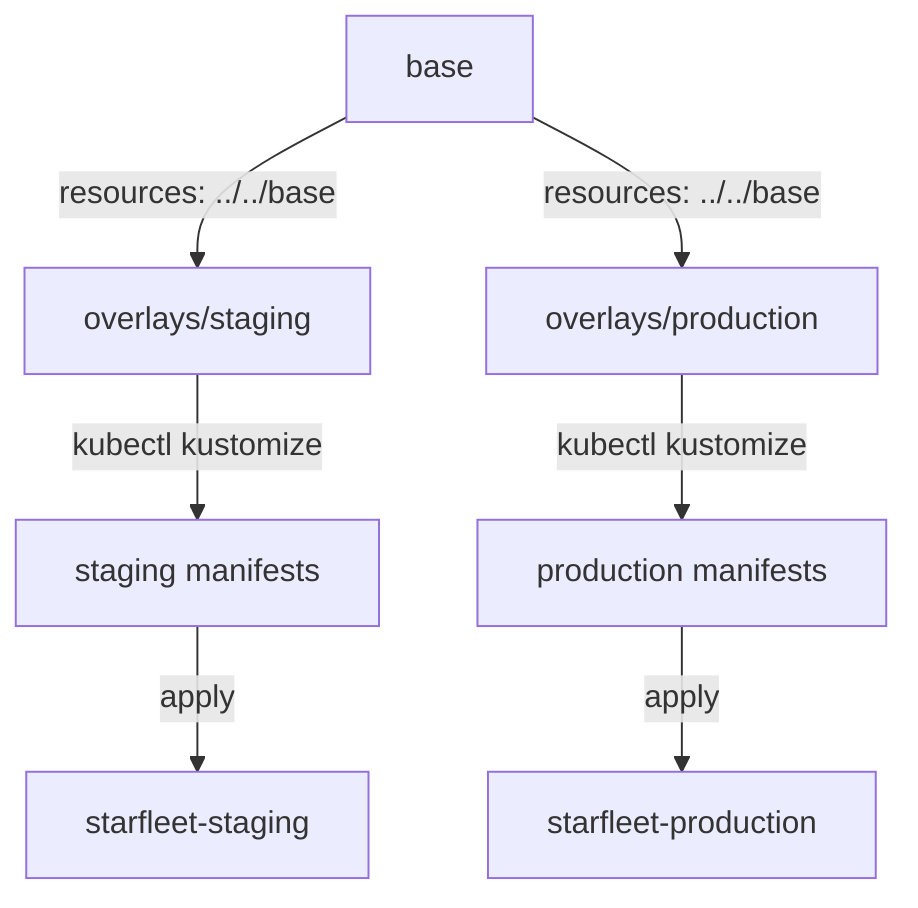

# Overlays And Patches

The base describes `scout` once. Staging and production need it slightly differently: their own namespace, a newer image in staging, more replicas and more memory in production. This part builds one overlay for each environment. It uses the shortcut fields Kustomize has for the most common changes, and the two kinds of patch for everything else.

## What an overlay is

An overlay is a kustomization whose `resources` list points at another kustomization, usually the base. Kustomize renders the base first, then applies the overlay's changes to the result. The base folder has no idea that overlays exist, so the same base can serve any number of environments.



The diagram shows one base feeding two overlays, and each overlay rendering its own manifests for its own namespace.

Your folder will end up with this layout:

```text
scout/
├── base/
│   ├── deployment.yaml
│   ├── kustomization.yaml
│   └── service.yaml
└── overlays/
    ├── production/
    │   └── kustomization.yaml
    └── staging/
        ├── deployment-env.yaml
        └── kustomization.yaml
```

## The staging overlay

Staging runs in the namespace `starfleet-staging` and tries the newer image `6.15.0` before production gets it. It also passes a message to the application through environment variables taken from a ConfigMap. The ConfigMap itself comes from a generator; for now, only notice the `configMapGenerator` block and the patch that uses it.

<!-- astrona:playground:renew -->

Save this as `overlays/staging/kustomization.yaml`:

```yaml
apiVersion: kustomize.config.k8s.io/v1beta1
kind: Kustomization
namespace: starfleet-staging
resources:
  - ../../base
labels:
  - pairs:
      environment: staging
images:
  - name: ghcr.io/stefanprodan/podinfo
    newTag: 6.15.0
configMapGenerator:
  - name: scout-settings
    literals:
      - PODINFO_UI_MESSAGE=staging
patches:
  - path: deployment-env.yaml
```

`namespace` sets `metadata.namespace` on every object the overlay renders, and it overwrites any namespace already there. `images` works the same way as in the base. Because the overlay's change runs after the base's, `6.15.0` replaces `6.14.0`. `labels` adds a second label on top of the base's label.

The `patches` entry names a file. A patch is a partial manifest that Kustomize merges into a matching object. This kind is called a **strategic merge patch**: it looks like the object it changes, holds only the fields to change, and Kustomize finds its target by `kind` and `metadata.name`.

Save this as `overlays/staging/deployment-env.yaml`:

```yaml
apiVersion: apps/v1
kind: Deployment
metadata:
  name: scout
spec:
  template:
    spec:
      containers:
        - name: scout
          envFrom:
            - configMapRef:
                name: scout-settings
```

The patch adds an `envFrom` block to the container named `scout`. Strategic merge knows that a list of containers is merged by the container's `name`, so it changes the existing `scout` container instead of adding a second container. That is the "strategic" part: Kubernetes publishes, for each list field, how its entries are matched.

Render the overlay and read the Deployment:

```sh
kubectl kustomize overlays/staging
```

The output starts with the ConfigMap and the Service. The Deployment part looks like this:

```text
kind: Deployment
metadata:
  labels:
    app.kubernetes.io/part-of: starfleet
    environment: staging
  name: scout
  namespace: starfleet-staging
spec:
  replicas: 1
  selector:
    matchLabels:
      app: scout
  template:
    metadata:
      labels:
        app: scout
    spec:
      containers:
      - envFrom:
        - configMapRef:
            name: scout-settings-6khtk7h7k6
        image: ghcr.io/stefanprodan/podinfo:6.15.0
        name: scout
        ports:
        - containerPort: 9898
          name: http
        readinessProbe:
          httpGet:
            path: /readyz
            port: http
        resources:
          requests:
            cpu: 10m
            memory: 32Mi
```

Every change is visible: the namespace, both labels, the image `6.15.0`, and the `envFrom` block from the patch. The ConfigMap name ends in `-6khtk7h7k6`, although the patch says `scout-settings`. Kustomize added that suffix and updated the reference for you; the next part explains why.

## The production overlay

Production stays on the image tag the base sets, runs three replicas and gets more memory. The replica count has a shortcut field. The memory change is a good case for the second kind of patch.

Save this as `overlays/production/kustomization.yaml`:

```yaml
apiVersion: kustomize.config.k8s.io/v1beta1
kind: Kustomization
namespace: starfleet-production
resources:
  - ../../base
labels:
  - pairs:
      environment: production
replicas:
  - name: scout
    count: 3
patches:
  - target:
      kind: Deployment
      name: scout
    patch: |-
      - op: replace
        path: /spec/template/spec/containers/0/resources/requests/memory
        value: 64Mi
      - op: add
        path: /spec/template/spec/containers/0/resources/limits
        value:
          memory: 128Mi
```

`replicas` sets `spec.replicas` on the workload with that name, without a patch. The patch here is a **JSON 6902 patch**, named after the standard that defines it (RFC 6902, JSON Patch). It is a list of operations, and each one has an `op` (`add`, `replace`, `remove`, `move`, `copy` or `test`) and a `path` into the object. Because the operations do not name an object, the `target` block selects it, here by `kind` and `name`. A target can also select by `group`, `version`, `namespace`, `labelSelector` or `annotationSelector`.

The path uses `/` between fields and a number for a list position. `containers/0` means the first container. That is the weakness of JSON 6902: it addresses a container by position, not by name. Use it when you need an operation that a merge cannot express, such as removing one field or replacing one value deep in a list. Use a strategic merge patch when you just want to add or change fields.

The patch can also live in its own file. Write `path: memory-patch.yaml` instead of `patch: |-`, and keep the `target` block in the `kustomization.yaml` file.

Render the overlay:

```sh
kubectl kustomize overlays/production
```

The Deployment part looks like this:

```text
kind: Deployment
metadata:
  labels:
    app.kubernetes.io/part-of: starfleet
    environment: production
  name: scout
  namespace: starfleet-production
spec:
  replicas: 3
  selector:
    matchLabels:
      app: scout
  template:
    metadata:
      labels:
        app: scout
    spec:
      containers:
      - image: ghcr.io/stefanprodan/podinfo:6.14.0
        name: scout
        ports:
        - containerPort: 9898
          name: http
        readinessProbe:
          httpGet:
            path: /readyz
            port: http
        resources:
          limits:
            memory: 128Mi
          requests:
            cpu: 10m
            memory: 64Mi
```

Production has three replicas, the image `6.14.0` from the base, a memory request of `64Mi` and a memory limit of `128Mi`. It has no ConfigMap and no `envFrom` block, because those changes live only in the staging overlay.

## Which change runs when

Kustomize applies the fields of one kustomization in a fixed order, not in the order you write them. It first loads `resources` and runs the generators, then applies `patches`, and then runs the shortcut fields such as `namespace`, `labels`, `images` and `replicas`. The safest habit is to write each change once, in the field made for it, and render the result.

You can now take one base and produce two different environments from it with no copied manifests. Each overlay holds only its own differences: a namespace, a tag, a replica count, a patch. The rendered output shows exactly what each environment gets. The open question is how to take that output to the cluster safely, and what happens to the generated ConfigMap when its content changes.

## Common pitfalls

> [!WARNING]
> - **Forgetting `../../` in an overlay's `resources`.** The path is relative to the overlay folder, so `base` alone points at `overlays/staging/base`, which does not exist.
> - **Giving a strategic merge patch a different name than the object.** The patch is matched by `kind` and `metadata.name`, so a typo in either one stops the build.
> - **Using a JSON 6902 path that points at a field that is not there.** `replace` needs the field to exist; `add` creates it. Render the base to see which fields exist.
> - **Counting on the order of fields in `kustomization.yaml`.** Kustomize runs its own fixed order. Render the overlay to see the result.
