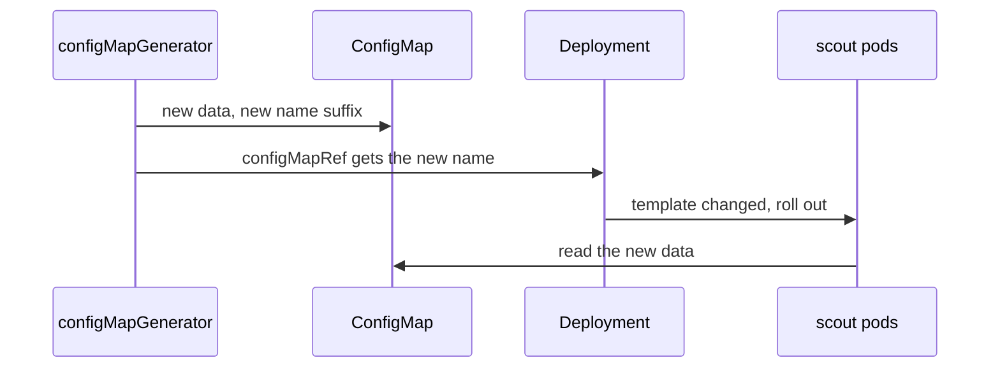

# Generators, Diff And Apply

Rendering on your machine proves the files build. It does not show what will change in the cluster, and it does not change anything there. This part takes the staging and production overlays to the playground cluster. First it explains the ConfigMap that the staging overlay generates, because its name decides when the `scout` pods restart.

## Generated ConfigMaps and the hash suffix

A **generator** is a `kustomization.yaml` field that creates an object instead of reading one from a file. `configMapGenerator` creates a ConfigMap, and `secretGenerator` creates a Secret in the same way. Each entry takes its data from `literals` (`KEY=value` pairs), from `files`, or from `envs` (a `.env` file).

The staging overlay generates a ConfigMap named `scout-settings` with one key, `PODINFO_UI_MESSAGE`. `podinfo` reads that environment variable and returns its value as `message` in every response. In the rendered output, though, the ConfigMap is named `scout-settings-6khtk7h7k6`. The suffix is a hash of the ConfigMap's content. Kustomize also rewrote every reference to it, such as the `configMapRef` in the Deployment, to the new name.

The reason is how Deployments react to changes. A Deployment only starts new pods when its pod template changes. If you edit the data of a ConfigMap that pods read as environment variables, the template is unchanged, so the running pods keep the old values until something restarts them. With a hash suffix, a change to the data produces a new ConfigMap name. The new name lands in the pod template, and the Deployment rolls out new pods that read the new data.



The diagram shows a change to the generator's data flowing through the new ConfigMap name into the Deployment, which then rolls out pods that read the new data.

If an object must keep a fixed name, for example because something outside Kustomize reads it, set `options: {disableNameSuffixHash: true}` on that generator entry. You then lose the automatic rollout.

## Compare before you apply

`kubectl diff -k` renders the folder, asks the API server what the result would be if it were applied, and prints the difference from the live objects. The API server runs its admission checks on the request, so a manifest it would reject fails here too. Nothing is stored.

<!-- astrona:playground:renew -->

Run it against the staging overlay. The namespace is still empty, so every object shows as new:

```sh
kubectl diff -k overlays/staging
```

You should see something like this (shortened; the full output has one block per object, and the temporary folder names differ on your machine):

```text
diff -u -N /var/folders/.../LIVE-2417683204/apps.v1.Deployment.starfleet-staging.scout /var/folders/.../MERGED-2266974549/apps.v1.Deployment.starfleet-staging.scout
--- /var/folders/.../LIVE-2417683204/apps.v1.Deployment.starfleet-staging.scout
+++ /var/folders/.../MERGED-2266974549/apps.v1.Deployment.starfleet-staging.scout
@@ -0,0 +1,60 @@
+apiVersion: apps/v1
+kind: Deployment
+metadata:
+  creationTimestamp: "2026-10-10T14:43:41Z"
+  generation: 1
+  labels:
+    app.kubernetes.io/part-of: starfleet
+    environment: staging
...
```

Each block names one object as `group.version.Kind.namespace.name`. `LIVE` is the object in the cluster (empty here) and `MERGED` is what it would become. Lines that start with `+` would be added. The exit code tells you the result without reading the text: `0` means no difference, `1` means there are differences, and anything higher means `kubectl diff` itself failed.

## Apply the staging overlay

`kubectl apply -k` renders the folder and applies the result, the same as piping `kubectl kustomize` into `kubectl apply -f -`.

```sh
kubectl apply -k overlays/staging
kubectl -n starfleet-staging rollout status deploy/scout
```

You should see:

```text
configmap/scout-settings-6khtk7h7k6 created
service/scout created
deployment.apps/scout created
Waiting for deployment "scout" rollout to finish: 0 of 1 updated replicas are available...
deployment "scout" successfully rolled out
```

Now send a request from the `shuttle` pod to the new Service. A Service in another namespace is reached as `<service>.<namespace>`:

```sh
kubectl -n starfleet exec deploy/shuttle -- curl -s http://scout.starfleet-staging
```

You should see something like:

```text
{
  "hostname": "scout-6fdc45c86f-wfxqr",
  "version": "6.15.0",
  "revision": "dd507173b7b75b2312a36cabe0de5f09c1ce69c8",
  "color": "#34577c",
  "logo": "https://raw.githubusercontent.com/stefanprodan/podinfo/gh-pages/cuddle_clap.gif",
  "message": "staging",
  "goos": "linux",
  "goarch": "arm64",
  "runtime": "go1.27.0",
  "num_goroutine": "6",
  "num_cpu": "6"
}
```

The response proves both overlay changes reached the pod: `version` is `6.15.0` from the overlay's `images` field, and `message` is `staging` from the generated ConfigMap. If `curl` instead stops with `command terminated with exit code 7`, the connection was refused because the cluster had not finished setting up the network rules for the new Service; wait a few seconds and run it again. Run `kubectl diff -k overlays/staging` once more: it prints nothing and exits with `0`, because the cluster now matches the overlay.

## Change the generated data

Change the message to see the hash suffix at work. In `overlays/staging/kustomization.yaml`, change the literal to `PODINFO_UI_MESSAGE=staging-v2`, then compare with the cluster:

```sh
kubectl diff -k overlays/staging
```

The output is long, so here it is shortened to the lines that change (temporary folder names removed):

```text
--- LIVE/apps.v1.Deployment.starfleet-staging.scout
+++ MERGED/apps.v1.Deployment.starfleet-staging.scout
-  generation: 1
+  generation: 2
...
         - configMapRef:
-            name: scout-settings-6khtk7h7k6
+            name: scout-settings-fk69fb9565
...
--- LIVE/v1.ConfigMap.starfleet-staging.scout-settings-fk69fb9565
+++ MERGED/v1.ConfigMap.starfleet-staging.scout-settings-fk69fb9565
+  PODINFO_UI_MESSAGE: staging-v2
...
+  name: scout-settings-fk69fb9565
```

The diff shows a new ConfigMap and one changed line in the Deployment: the reference to the new name. That one line is a change to the pod template, so it triggers a rollout. Apply it and check the result:

```sh
kubectl apply -k overlays/staging
kubectl -n starfleet-staging rollout status deploy/scout
kubectl -n starfleet-staging get configmaps
```

You should see something like:

```text
configmap/scout-settings-fk69fb9565 created
service/scout unchanged
deployment.apps/scout configured
Waiting for deployment "scout" rollout to finish: 1 old replicas are pending termination...
deployment "scout" successfully rolled out
NAME                        DATA   AGE
kube-root-ca.crt            1      30s
scout-settings-6khtk7h7k6   1      19s
scout-settings-fk69fb9565   1      6s
```

Send the request again; after a few seconds the response carries `"message": "staging-v2"`. Look at the ConfigMap list, too: the old `scout-settings-6khtk7h7k6` is still there. `kubectl apply` creates and updates objects, but it never deletes an object that is no longer in your files. A GitOps controller with pruning switched on removes such leftovers for you. With plain `kubectl`, you delete them yourself.

## Apply the production overlay

Production uses the same commands with the other folder:

```sh
kubectl apply -k overlays/production
kubectl -n starfleet-production rollout status deploy/scout
kubectl -n starfleet-production get pods
```

You should see something like:

```text
service/scout created
deployment.apps/scout created
Waiting for deployment "scout" rollout to finish: 0 of 3 updated replicas are available...
Waiting for deployment "scout" rollout to finish: 1 of 3 updated replicas are available...
Waiting for deployment "scout" rollout to finish: 2 of 3 updated replicas are available...
deployment "scout" successfully rolled out
NAME                    READY   STATUS    RESTARTS   AGE
scout-7b4694464-42f9g   1/1     Running   0          6s
scout-7b4694464-mxz6j   1/1     Running   0          6s
scout-7b4694464-z624j   1/1     Running   0          6s
```

Three pods, as the overlay asked. A request to `http://scout.starfleet-production` from the `shuttle` pod returns `"version": "6.14.0"` and `"message": "greetings from podinfo v6.14.0"`, which is `podinfo`'s default message, because production has no ConfigMap.

You have now taken both environments from files to a running cluster, compared each change before you applied it, and seen a ConfigMap change roll out new pods because of its hash suffix. Everything so far built cleanly. The open question is what happens when it does not: what Kustomize prints when a path or a patch is wrong, and which mistake it does not report at all.

## Common pitfalls

> [!WARNING]
> - **Editing a generated ConfigMap with `kubectl edit`.** The next apply creates a ConfigMap from your files with its own name, and your edit is lost. Change the generator in the `kustomization.yaml` file.
> - **Turning off the hash suffix without a plan for restarts.** With `disableNameSuffixHash: true`, a data change no longer rolls out new pods.
> - **Expecting `kubectl apply -k` to remove old objects.** It never deletes; old generated ConfigMaps stay until you delete them.
> - **Reading only the text of `kubectl diff`.** Its exit code is `1` when there are differences, so a script that treats any non-zero code as a failure misreads a normal result.
