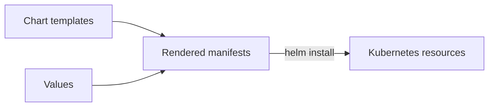

# Chart Layout, Rendering And Installation

The `scout` application needs a Deployment and a Service in `starfleet-production`. Helm can generate both from a chart, a directory that holds templates and default values. Rendering means replacing template expressions with concrete values to produce Kubernetes manifests.

Use Helm 4.3.0 in the playground terminal. A namespace groups Kubernetes resources; the playground already creates the namespace used here. Start in an empty working directory.

<!-- astrona:playground:renew -->

Create the chart directory:

```sh
export PATH="$HOME/.astrona/bin:$PATH"
helm version --short
mkdir -p scout/templates
```

Check that Helm reports `v4.3.0`. Save this as `scout/Chart.yaml`:

```yaml
apiVersion: v2
name: scout
description: A small podinfo workload for release practice
type: application
version: 0.1.0
appVersion: "6.14.0"
```

`apiVersion: v2` selects the chart format, not a Kubernetes resource API. `name` identifies the chart. `version` identifies the chart package using semantic versioning: major, minor and patch numbers. `appVersion` describes the application version and is a string. It does not set a container image by itself.

Save this as `scout/values.yaml`:

```yaml
replicaCount: 1
image:
  repository: ghcr.io/stefanprodan/podinfo
  tag: "6.14.0"
message: baseline
```

`values.yaml` supplies default inputs. The author chooses the key names; Helm does not give `replicaCount` or `image.tag` special meaning. A template must read a value before it can affect a workload.

Save this as `scout/templates/deployment.yaml`:

```yaml
apiVersion: apps/v1
kind: Deployment
metadata:
  name: {{ .Release.Name }}
  labels:
    app.kubernetes.io/instance: {{ .Release.Name }}
spec:
  replicas: {{ .Values.replicaCount }}
  selector:
    matchLabels:
      app.kubernetes.io/instance: {{ .Release.Name }}
  template:
    metadata:
      labels:
        app.kubernetes.io/instance: {{ .Release.Name }}
    spec:
      containers:
        - name: scout
          image: "{{ .Values.image.repository }}:{{ .Values.image.tag }}"
          ports:
            - name: http
              containerPort: 9898
          readinessProbe:
            httpGet:
              path: /readyz
              port: http
          resources:
            requests:
              cpu: 10m
              memory: 32Mi
            limits:
              memory: 128Mi
```

A Deployment maintains the requested number of application pods. `.Release.Name` reads the name chosen at installation. `.Values` reads the merged values. The selector matches the labels on the pod template, so the Deployment can find its pods. The readiness probe asks `/readyz` whether a pod can serve requests. Resource requests reserve capacity; the memory limit bounds the container's memory use.

Save this as `scout/templates/service.yaml`:

```yaml
apiVersion: v1
kind: Service
metadata:
  name: {{ .Release.Name }}
spec:
  selector:
    app.kubernetes.io/instance: {{ .Release.Name }}
  ports:
    - name: http
      port: 80
      targetPort: http
```

A Service gives ready pods a stable address. Its selector matches the pod labels, and `targetPort: http` selects the named container port. Before installation, check the chart and render it:

```sh
helm lint ./scout
helm template scout ./scout --namespace starfleet-production
```

`helm lint` checks chart structure and common mistakes. `helm template` prints manifests locally without installing a release. Look for a Deployment named `scout`, one replica, image `6.14.0`, and a Service whose selector matches the pod labels. Neither command proves that the application will run on the cluster.

Apply it:

```sh
helm install scout ./scout --namespace starfleet-production --wait=watcher --timeout 180s
```

`scout` is the release name; `./scout` is the chart path. Helm renders the files, sends the resources to Kubernetes and records the release in that namespace. In Helm 4.3.0, `--wait=watcher` waits for readiness. Omitting the flag uses `hookOnly`, which does not wait for ordinary workloads to become ready.

Then check the result:

```sh
helm list --namespace starfleet-production
kubectl -n starfleet-production get deployment,service
kubectl -n starfleet exec deploy/shuttle -- curl -fsS http://scout.starfleet-production/
```

Look for a deployed `scout` release and a response with version `6.14.0`. This response comes from the running podinfo container, not the chart metadata.



Helm renders templates and values, then installs the resulting Kubernetes resources.

The chart now has a package description, default inputs and templates that Kubernetes can run. Changing a value only works when a template uses it; the next decision is where a configuration change belongs.

## Common pitfalls

> [!WARNING]
> - **Applying a template with kubectl.** Kubernetes does not understand Helm expressions; render or install the chart with Helm.
> - **Treating appVersion as an image setting.** This chart reads `image.tag` for the container image.
> - **Listing the wrong namespace.** Releases are scoped to the namespace passed to Helm.
