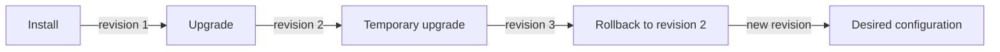

# History And Rollback

A temporary change to the `scout` message must be undone without deleting the release. Helm records revisions, numbered snapshots of a release's chart and values. A rollback restores an earlier revision's configuration and records a new revision for that operation.

Use the `scout` release in `starfleet-production`. For the sequence below, revision 1 installed chart `0.1.0`, and revision 2 upgraded chart `0.2.0` with image `6.15.0`, two replicas and message `release-ready`. The working chart is `./scout`, and `production-values.yaml` holds the desired values. If you have run extra upgrades, read history and select the revision that contains those desired settings.

<!-- astrona:playground:renew -->

Save this as `trial-values.yaml`:

```yaml
message: temporary
```

Apply it:

```sh
helm upgrade --install scout ./scout --namespace starfleet-production -f production-values.yaml -f trial-values.yaml --wait=watcher --timeout 180s
```

The rightmost values file changes only the message. This is a healthy upgrade with an unwanted configuration, so a readiness check alone cannot find the problem.

Then check the result:

```sh
helm list --namespace starfleet-production
helm history scout --namespace starfleet-production
kubectl -n starfleet exec deploy/shuttle -- curl -fsS http://scout.starfleet-production/
```

`helm list` shows releases in one namespace. `helm history` shows revisions for one release, including chart version, application version, status and description. Look for the latest deployed revision and a response with message `temporary`. Earlier successful revisions become `superseded` after a successful upgrade.

Read the history before choosing a rollback target. In the clean sequence described above, revision 2 has the desired configuration. Restore it:

```sh
helm rollback scout 2 --namespace starfleet-production --wait=watcher --timeout 180s
```

The argument `2` is a release revision, not chart version `0.2.0` and not an application version. Helm uses the stored chart and values for that revision; it does not reread your current values file.

Check the recovery:

```sh
helm history scout --namespace starfleet-production
kubectl -n starfleet-production rollout status deploy/scout --timeout=180s
kubectl -n starfleet exec deploy/shuttle -- curl -fsS http://scout.starfleet-production/
```

Look for a new deployed revision whose description identifies the rollback target. The response should again contain version `6.15.0` and message `release-ready`. Rollback changes the cluster release; it does not rewrite `trial-values.yaml`. Keep the intended values in your source files before the next upgrade.



A rollback adds a release revision while restoring the configuration of the selected earlier revision.

You can now inspect release history and recover a known configuration. Pair Helm's release status with a real request: a deployed release can still serve a value that does not meet the workload requirement.

## Common pitfalls

> [!WARNING]
> - **Using a chart version as a rollback argument.** Choose a revision number from `helm history`.
> - **Expecting history to shrink.** A rollback creates a new revision.
> - **Reapplying temporary values.** Rollback leaves local files unchanged; use the desired file on the next upgrade.
