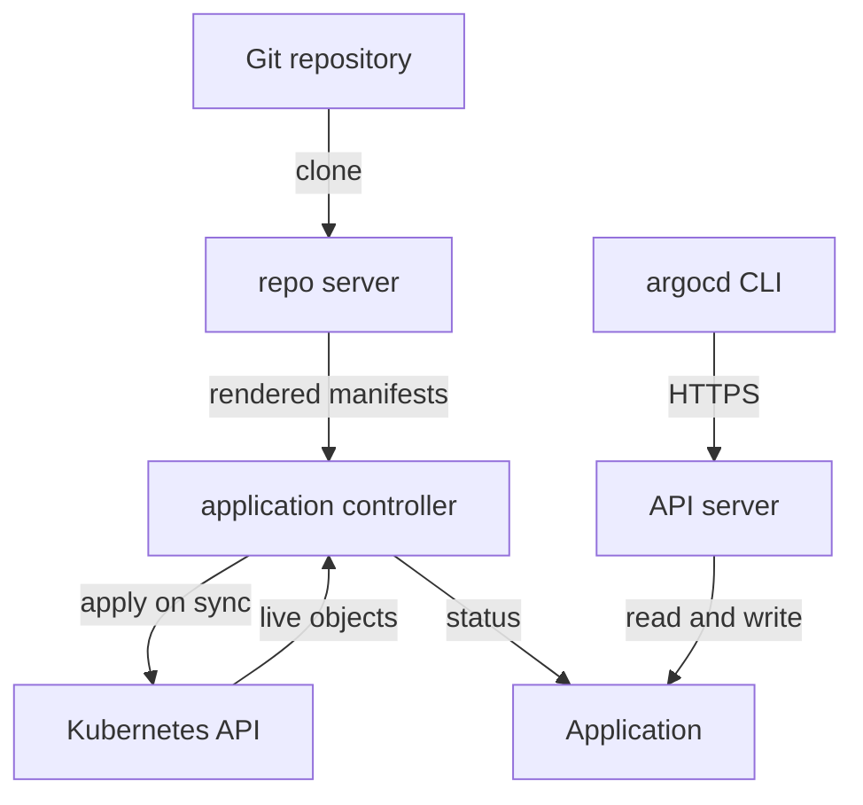

# GitOps And The Argo CD Components

Before you write an `Application`, it helps to know who does the work once you have written it. Argo CD is not one program but a handful of components, and each status message you will read comes from one of them. This part names the GitOps principles Argo CD carries out, maps them to the components running in your playground, and logs you in with the `argocd` command-line tool.

## The four GitOps principles

GitOps is a way to run a cluster where a Git repository holds the desired state and a controller in the cluster keeps the live state equal to it. The **desired state** is what the files in Git say the cluster should run. The **live state** is what the cluster runs right now. The OpenGitOps project describes four principles:

- **Declarative.** The desired state is written as data (Kubernetes manifests), not as a script of steps.
- **Versioned and immutable.** The desired state lives in Git, so every change is a commit with an author, a time and a way back.
- **Pulled automatically.** A controller inside the cluster fetches the desired state. Nobody outside pushes changes in with `kubectl apply`.
- **Continuously reconciled.** The controller compares desired and live state again and again and removes any difference. That loop is called **reconciliation**, and a difference it finds is called **drift**.

The third principle is the one that changes daily work most. With GitOps, a pipeline or a person changes Git, never the cluster. The controller is the only writer.

## The components and what each does

Argo CD splits that loop over several components. List them in your playground:

<!-- astrona:playground:renew -->

```sh
kubectl -n argocd get pods
```

You should see something like:

```text
NAME                                                READY   STATUS    RESTARTS   AGE
argocd-application-controller-0                     1/1     Running   0          29s
argocd-applicationset-controller-5c66f59556-k2rj7   1/1     Running   0          29s
argocd-redis-7f877d46b7-r2w5v                       1/1     Running   0          29s
argocd-repo-server-7bc46c4ddf-tv6vr                 1/1     Running   0          29s
argocd-server-57bf79bfcc-4gmxk                      1/1     Running   0          29s
```

Four of them carry the GitOps loop:

| Component | What it does |
| --- | --- |
| `argocd-repo-server` | Clones the Git repository, runs Kustomize or Helm on the path, and returns the rendered manifests. It never talks to the cluster you deploy to |
| `argocd-application-controller` | Compares the rendered manifests with the live objects, decides the sync status and the health status, and applies changes during a sync. It is a StatefulSet |
| `argocd-server` | The API server behind the web page and the `argocd` command-line tool. It checks who you are and what you may do |
| `argocd-redis` | A cache for rendered manifests and live state, so the other components do not repeat expensive work |

The fifth pod, `argocd-applicationset-controller`, generates many `Application` objects from one template; it is not part of the basic loop. A full install also runs `argocd-dex-server` for single sign-on and `argocd-notifications-controller` for messages to chat tools. Both exist in your playground, scaled to zero.



The diagram shows the path from Git to the cluster: the repo server renders, the application controller compares and applies, and the API server only serves people and tools.

This split explains the error messages. A message that mentions Git, `refs` or `generate manifest` comes from the repo server. A message about applying an object comes from the application controller. A login or permission error comes from the API server.

## Log in with the argocd tool

The `argocd` command-line tool talks to the API server over HTTPS. In your playground the API server is reachable on `https://127.0.0.1:8080`. A new install creates the user `admin` with a random password, stored in the Secret `argocd-initial-admin-secret` in the `argocd` namespace. Log in with it:

```sh
argocd login 127.0.0.1:8080 --username admin --insecure \
  --password "$(kubectl -n argocd get secret argocd-initial-admin-secret -o jsonpath='{.data.password}' | base64 -d)"
```

You should see:

```text
'admin:login' logged in successfully
Context '127.0.0.1:8080' updated
```

`--insecure` accepts the self-signed certificate the API server uses in a fresh install. The login is saved in your local `argocd` configuration, so later commands need no flags. Check that the client and server versions match, and that Argo CD knows the cluster it runs in:

```sh
argocd version --short
argocd cluster list
```

You should see:

```text
argocd: v3.5.4+d6d5b24
argocd-server: v3.5.4
SERVER                          NAME        VERSION  STATUS   MESSAGE                                                  PROJECT
https://kubernetes.default.svc  in-cluster  1.35.8   Unknown  Cluster has no applications and is not being monitored.
```

The cluster `https://kubernetes.default.svc` is the cluster Argo CD itself runs in. It is always registered under the name `in-cluster`. Its status is `Unknown` only because nothing is deployed to it yet.

Many tasks need only `kubectl`, because every Argo CD object is a Kubernetes resource. The `argocd` tool adds what `kubectl` cannot show: rendered manifests, diffs and per-object status. You will use both.

You now know what GitOps asks for and which component does each part of it: the repo server renders, the application controller compares and applies, and the API server serves people. The open question is how to tell Argo CD what to deploy, which is the job of the `Application` resource.

## Common pitfalls

> [!WARNING]
> - **Changing the cluster to fix a GitOps-managed object.** The controller is the only writer. Change Git, or your change is reverted or lost.
> - **Looking for Git errors in the application controller's logs.** Cloning and rendering happen in the repo server.
> - **Forgetting that the `argocd` tool needs the API server.** If the port to the API server is closed, `argocd` commands fail while `kubectl get applications` still works.
> - **Keeping the initial admin password Secret forever.** In a real installation, change the password and delete `argocd-initial-admin-secret`.
