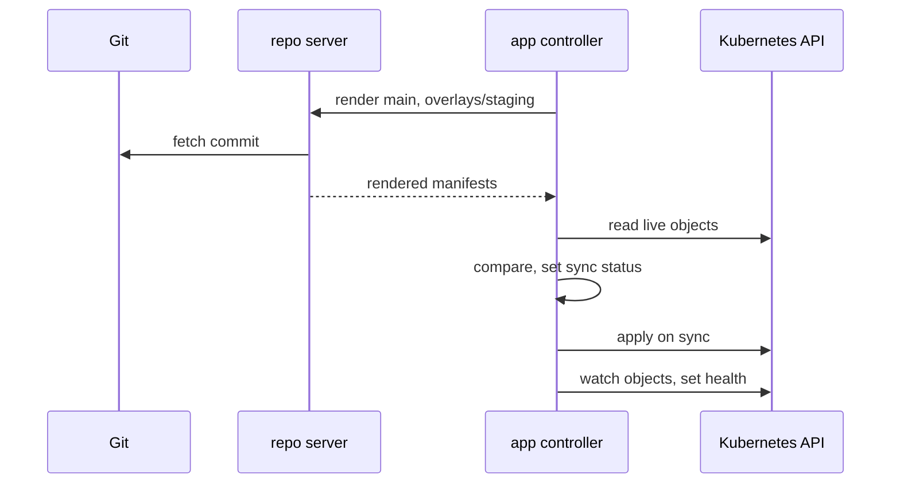

# The Application Resource

Argo CD deploys nothing until an `Application` tells it what to deploy and where. This part writes the first `Application` for `scout` in staging. It does not work on the first try: the repository is private, and the target namespace does not exist. Fixing both shows you where Argo CD reports each kind of problem.

## Source and destination

An `Application` is an Argo CD custom resource. It always lives in the `argocd` namespace, whatever namespace it deploys to. Its `spec` answers two questions: where the desired state comes from (`source`) and where it goes (`destination`).

<!-- astrona:playground:renew -->

Save this as `application-scout-staging.yaml`:

```yaml
apiVersion: argoproj.io/v1alpha1
kind: Application
metadata:
  name: scout-staging
  namespace: argocd
spec:
  project: default
  source:
    repoURL: http://gitea-http.gitea.svc:3000/starfleet/scout-deploy.git
    targetRevision: main
    path: overlays/staging
  destination:
    server: https://kubernetes.default.svc
    namespace: starfleet-staging
```

The fields map one to one to the GitOps loop:

- `source.repoURL` is the Git repository. The repo server clones it from inside the cluster, so the address is the in-cluster one.
- `source.targetRevision` is a branch, a tag or a commit ID. A branch follows new commits; a tag or a commit pins one version.
- `source.path` is the folder to render. Because it holds a `kustomization.yaml` file, the repo server renders it with Kustomize.
- `destination.server` is the cluster, here the one Argo CD runs in. `destination.name: in-cluster` means the same.
- `destination.namespace` is the namespace for objects that have none in their manifest.
- `project` is the `AppProject` the `Application` belongs to. Every install has a project called `default` that allows everything.

Apply it:

```sh
kubectl apply -f application-scout-staging.yaml
```

Then check the result with `kubectl`, and then with the `argocd` tool:

```sh
kubectl -n argocd get applications
argocd app get scout-staging
```

You should see something like:

```text
NAME            SYNC STATUS   HEALTH STATUS
scout-staging   Unknown       Healthy
Name:               argocd/scout-staging
Project:            default
Server:             https://kubernetes.default.svc
Namespace:          starfleet-staging
URL:                https://127.0.0.1:8080/applications/scout-staging
Source:
- Repo:             http://gitea-http.gitea.svc:3000/starfleet/scout-deploy.git
  Target:           main
  Path:             overlays/staging
SyncWindow:         Sync Allowed
Sync Policy:        Manual
Sync Status:        Unknown
Health Status:      Healthy

CONDITION        MESSAGE  LAST TRANSITION
ComparisonError  Failed to load target state: failed to generate manifest for source 1 of 1: rpc error: code = Unknown desc = failed to list refs: authentication required: Unauthorized
                 2026-10-10 17:28:36 +0200 CEST
```

The sync status is `Unknown`, because Argo CD could not render the desired state, so it has nothing to compare. The reason is in the `CONDITION` table: a `ComparisonError` whose message says `failed to list refs: authentication required`. That wording comes from the repo server, which tried to clone the repository without credentials. The health status says `Healthy` only because there are no objects yet; ignore it while the sync status is `Unknown`.

## Give Argo CD the repository credentials

Argo CD reads repository credentials from Secrets in its own namespace that carry the label `argocd.argoproj.io/secret-type: repository`. The `url` in the Secret must match the `repoURL` of the `Application`.

Save this as `secret-repo-scout-deploy.yaml`:

```yaml
apiVersion: v1
kind: Secret
metadata:
  name: repo-scout-deploy
  namespace: argocd
  labels:
    argocd.argoproj.io/secret-type: repository
stringData:
  type: git
  url: http://gitea-http.gitea.svc:3000/starfleet/scout-deploy.git
  username: platform
  password: starfleet-gitops
```

Apply it:

```sh
kubectl apply -f secret-repo-scout-deploy.yaml
```

Then check that Argo CD can reach the repository, and ask for a fresh comparison with `--refresh` instead of waiting for the next timed one:

```sh
argocd repo list
argocd app get scout-staging --refresh
```

The end of the output looks like this:

```text
TYPE  NAME  REPO                                                         INSECURE  OCI    LFS    CREDS  STATUS      MESSAGE  PROJECT
git         http://gitea-http.gitea.svc:3000/starfleet/scout-deploy.git  false     false  false  false  Successful           
...
Sync Status:        OutOfSync from main (0cfdbef)
Health Status:      Missing

GROUP  KIND        NAMESPACE          NAME   STATUS     HEALTH   HOOK  MESSAGE
       Service     starfleet-staging  scout  OutOfSync  Missing        
apps   Deployment  starfleet-staging  scout  OutOfSync  Missing
```

The repository connection is `Successful`, and the condition is gone. Argo CD rendered the overlay at commit `0cfdbef` (your commit ID differs) and found two objects. Each is `OutOfSync` with health `Missing`, because it exists in Git but not in the cluster. Argo CD reports this and does nothing else: the `Sync Policy` is `Manual`, so nothing is applied until someone starts a sync. In version 3, the old way of listing repositories in the `argocd-cm` ConfigMap is gone; repository Secrets are the only declarative way.

## The first sync

A **sync** is the operation where the application controller applies the rendered manifests to the cluster. Start one by hand:

```sh
argocd app sync scout-staging
```

The end of the output is:

```text
Operation:          Sync
Sync Revision:      0cfdbef647534ab56a6d8061f0eef0a4dbeba19c
Phase:              Failed
Start:              2026-10-10 17:29:03 +0200 CEST
Finished:           2026-10-10 17:29:03 +0200 CEST
Duration:           0s
Message:            one or more objects failed to apply, reason: namespaces "starfleet-staging" not found

GROUP  KIND        NAMESPACE          NAME   STATUS     HEALTH   HOOK  MESSAGE
       Service     starfleet-staging  scout  OutOfSync  Missing        namespaces "starfleet-staging" not found
apps   Deployment  starfleet-staging  scout  OutOfSync  Missing        namespaces "starfleet-staging" not found
{"level":"fatal","msg":"Operation has completed with phase: Failed","time":"2026-10-10T17:29:03+02:00"}
```

This time rendering worked and applying failed. The message comes from the Kubernetes API server, passed on by the application controller: the namespace does not exist. Argo CD does not create a destination namespace unless you ask. The sync option `CreateNamespace=true` asks for it. Add a `syncPolicy` block at the end of `application-scout-staging.yaml`, under `spec`:

```yaml
  syncPolicy:
    syncOptions:
      - CreateNamespace=true
```

Apply it and sync again:

```sh
kubectl apply -f application-scout-staging.yaml
argocd app sync scout-staging
```

The end of the output is:

```text
Sync Status:        Synced to main (0cfdbef)
Health Status:      Progressing

Operation:          Sync
Sync Revision:      0cfdbef647534ab56a6d8061f0eef0a4dbeba19c
Phase:              Succeeded
Start:              2026-10-10 17:29:10 +0200 CEST
Finished:           2026-10-10 17:29:10 +0200 CEST
Duration:           0s
Message:            successfully synced (all tasks run)

GROUP  KIND        NAMESPACE          NAME               STATUS   HEALTH       HOOK  MESSAGE
       Namespace                      starfleet-staging  Running  Synced             namespace/starfleet-staging created
       Service     starfleet-staging  scout              Synced   Healthy            service/scout created
apps   Deployment  starfleet-staging  scout              Synced   Progressing        deployment.apps/scout created
```

The namespace was created first, then the Service and the Deployment. The Deployment is `Progressing` because its pod is still starting.

## What happens during a sync

The whole path from a commit to running objects crosses three components. This is the order in which they work:



The diagram shows the repo server fetching and rendering, and the application controller comparing, applying, and then watching the objects to work out their health.

Wait for the application to become healthy, then send a request from `shuttle`:

```sh
argocd app wait scout-staging --health
kubectl -n argocd get applications
kubectl -n starfleet exec deploy/shuttle -- curl -s http://scout.starfleet-staging
```

The `kubectl` line and the important part of the response are:

```text
NAME            SYNC STATUS   HEALTH STATUS
scout-staging   Synced        Healthy
...
  "version": "6.15.0",
  "message": "staging",
```

`Synced` means the live objects match the commit, and `Healthy` means they work. The version and message come from the staging overlay in Git; nobody applied a manifest by hand.

You can now write an `Application`, give Argo CD access to a private repository, and read the three places a first deployment can fail: the `ComparisonError` condition from the repo server, the failed sync operation from the application controller, and the per-object messages. The application still only changes when someone runs `argocd app sync`. The open question is how to make Argo CD keep the cluster equal to Git on its own.

## Common pitfalls

> [!WARNING]
> - **Creating the `Application` in the target namespace.** It must live in the `argocd` namespace; its `destination.namespace` says where the objects go.
> - **Repository Secret without the label.** Argo CD ignores a Secret without `argocd.argoproj.io/secret-type: repository`.
> - **A `repoURL` that differs from the Secret's `url`.** A missing `.git` or a different host name means the credentials do not apply.
> - **Trusting `Healthy` while the sync status is `Unknown`.** With nothing rendered, there is nothing to be unhealthy. Read the conditions first.
> - **Expecting Argo CD to create namespaces.** Add `CreateNamespace=true`, or put the Namespace in Git.
