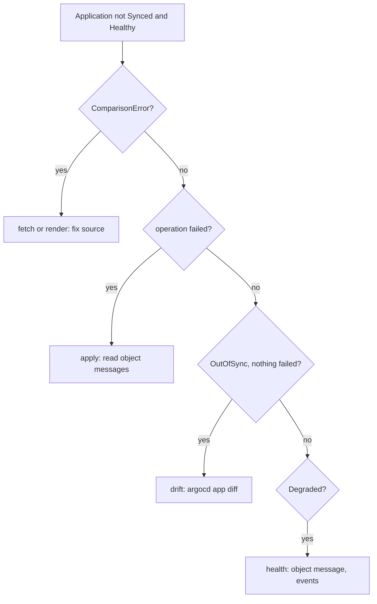

# Where Argo CD Reports A Problem

Argo CD writes problems into three different places, and each place belongs to one stage of its loop. Read the wrong one and a broken application looks fine. This part lists the four applications, maps their status to the stage that failed, and then fixes the earliest stage: an application whose source cannot be fetched or rendered.

## Four applications, four stages

Start with the overview. Log the `argocd` tool in if you have not (`argocd login 127.0.0.1:8080 --username admin --insecure`, with the password from the Secret), then list the applications:

<!-- astrona:playground:renew -->

```sh
kubectl -n argocd get applications
```

You should see:

```text
NAME           SYNC STATUS   HEALTH STATUS
scout-hpa      OutOfSync     Healthy
scout-image    Synced        Degraded
scout-path     Unknown       Healthy
scout-reject   OutOfSync     Healthy
```

Four different combinations, and none of them `Synced` and `Healthy`. The two columns are a first hint, not an answer. `Unknown` sync status means Argo CD could not even build the desired state. `OutOfSync` means it built the desired state but the cluster differs. `Degraded` means the objects exist but do not work.

The details live in three places:

| Where | What it holds | Read it with |
| --- | --- | --- |
| `status.conditions` | Problems with the `Application` itself: fetch, render, project rules (`ComparisonError`, `InvalidSpecError`) | The `CONDITION` table of `argocd app get` |
| `status.operationState` | The last sync operation: its phase, revision, retry count and message | The `Operation` and `Message` lines of `argocd app get` |
| Per-object status | Sync status, health and message of each object | The object table of `argocd app get` |

The order of the stages gives the order to read them in:



The diagram shows the decision tree: conditions first, then the sync operation, then drift, then health.

## A path that does not exist

`scout-path` has the sync status `Unknown`, which points at the first box. Read its conditions:

```sh
argocd app get scout-path
```

The end of the output is:

```text
Sync Status:        Unknown
Health Status:      Healthy

CONDITION        MESSAGE                                                                                                                                      LAST TRANSITION
ComparisonError  Failed to load target state: failed to generate manifest for source 1 of 1: rpc error: code = Unknown desc = paths: app path does not exist  2026-10-10 18:05:15 +0200 CEST
```

A `ComparisonError` comes from the repo server, the component that fetches and renders. The last words name the cause: `paths: app path does not exist`. The repository has a folder `path`, not `paths`. The health `Healthy` means nothing here; there are no objects to judge.

The same condition can be read with `kubectl` alone, which is useful when the `argocd` tool is not available:

```sh
kubectl -n argocd get application scout-path \
  -o jsonpath='{range .status.conditions[*]}{.type}: {.message}{"\n"}{end}'
```

You should see:

```text
ComparisonError: Failed to load target state: failed to generate manifest for source 1 of 1: rpc error: code = Unknown desc = paths: app path does not exist
```

## Three ways to break a source

A source has three fields that can be wrong: the repository, the revision and the path. Each gives a `ComparisonError` with its own last words, and it pays to have seen all three. Break the revision first, and fix the path at the same time:

```sh
kubectl -n argocd patch application scout-path --type merge \
  -p '{"spec":{"source":{"targetRevision":"mian","path":"path"}}}'
argocd app get scout-path --refresh
```

The condition now reads:

```text
ComparisonError  Failed to load target state: failed to generate manifest for source 1 of 1: rpc error: code = Unknown desc = unable to resolve 'mian' to a commit SHA  2026-10-10 18:06:34 +0200 CEST
```

Now put the revision back and break the repository URL instead:

```sh
kubectl -n argocd patch application scout-path --type merge \
  -p '{"spec":{"source":{"targetRevision":"main","repoURL":"http://gitea-http.gitea.svc:3000/starfleet/scout-fault.git"}}}'
argocd app get scout-path --refresh
```

The condition now reads:

```text
ComparisonError  Failed to load target state: failed to generate manifest for source 1 of 1: rpc error: code = Unknown desc = failed to list refs: repository not found: Repository not found
```

The three messages map to the three fields:

| Last words of the message | Field to check |
| --- | --- |
| `app path does not exist` | `source.path` |
| `unable to resolve '<revision>' to a commit SHA` | `source.targetRevision` |
| `failed to list refs: repository not found` | `source.repoURL` |
| `failed to list refs: authentication required` | The repository credentials Secret |

Fix all three fields:

```sh
kubectl -n argocd patch application scout-path --type merge \
  -p '{"spec":{"source":{"repoURL":"http://gitea-http.gitea.svc:3000/starfleet/scout-faults.git","targetRevision":"main","path":"path"}}}'
argocd app get scout-path --refresh
argocd app wait scout-path --health
```

The end of the output is:

```text
Sync Status:        Synced to main (3ea1193)
Health Status:      Healthy

GROUP  KIND        NAMESPACE       NAME   STATUS  HEALTH   HOOK  MESSAGE
       Service     starfleet-path  scout  Synced  Healthy        service/scout unchanged
apps   Deployment  starfleet-path  scout  Synced  Healthy        deployment.apps/scout unchanged
```

Here the fix belonged in the `Application`, because the source fields were wrong, not the files in Git. On a platform where the `Application` itself comes from Git, that is still a commit, just to a different repository.

You can now find the stage that failed from the status, and read a `ComparisonError` down to the source field that caused it. One application is repaired. The open question is what happens when rendering works but the cluster refuses what Argo CD tries to apply.

## Common pitfalls

> [!WARNING]
> - **Reading health first.** With a `ComparisonError` there are no objects, so `Healthy` means nothing. Read the conditions first.
> - **Looking for a `ComparisonError` in Git.** It is about how the `Application` points at Git; check `repoURL`, `targetRevision` and `path` before the files.
> - **Waiting for the timer after a fix.** Use `argocd app get --refresh` to compare again at once.
