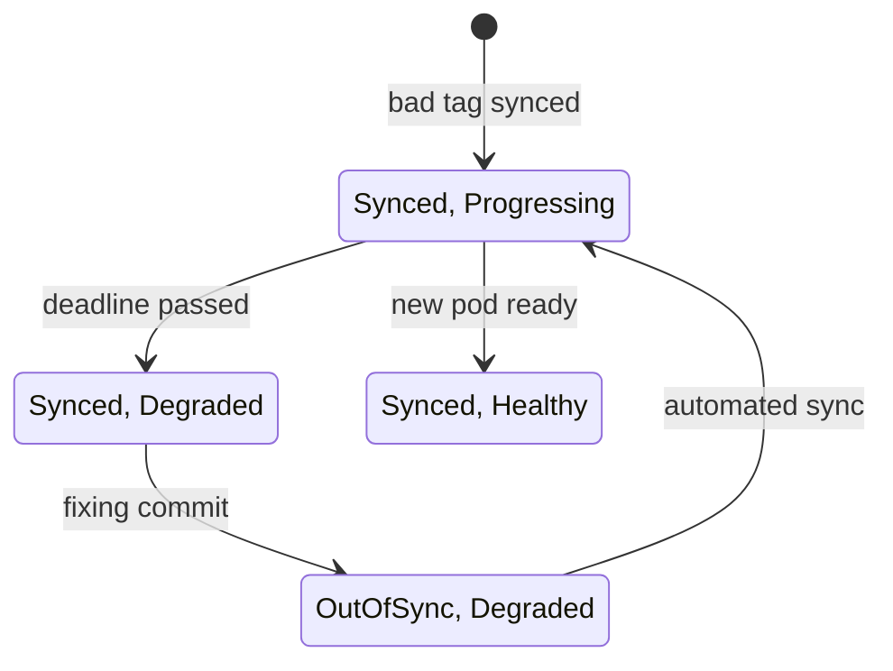

# Health Failures

The last application is the hardest to spot from a distance: `scout-image` is `Synced`. Argo CD applied exactly what Git says, and every sync check passes. The problem is that what Git says does not work. This part reads the health message down to the pod event that explains it, and repairs it the only way that lasts in a GitOps setup, with a commit.

## Read the health message

Start with the overall status, then ask for the health of each object:

<!-- astrona:playground:renew -->

```sh
kubectl -n argocd get application scout-image
argocd app get scout-image -o json | jq -c '.status.resources[] | select(.kind=="Deployment") | .health'
```

You should see:

```text
NAME          SYNC STATUS   HEALTH STATUS
scout-image   Synced        Degraded
{"status":"Degraded","message":"Deployment \"scout\" exceeded its progress deadline"}
```

The application controller judges a Deployment `Degraded` when Kubernetes marks its rollout as failed, which happens after `progressDeadlineSeconds` (60 seconds in these manifests, ten minutes by default). The message says that the rollout failed, not why. Argo CD's health message is a pointer; the cause is in Kubernetes.

## Follow it to the pod

The Deployment did not get new pods ready. Look at the pods and their events:

```sh
kubectl -n starfleet-image get pods
kubectl -n starfleet-image describe pod -l app=scout | grep -E "Failed|Back-off"
```

You should see something like:

```text
NAME                     READY   STATUS             RESTARTS   AGE
scout-5dbdb495b7-cfwk7   0/1     ImagePullBackOff   0          8m3s
  Warning  Failed     4m59s (x5 over 8m2s)   kubelet            spec.containers{scout}: Failed to pull image "ghcr.io/stefanprodan/podinfo:6.51.0": rpc error: code = NotFound desc = failed to pull and unpack image "ghcr.io/stefanprodan/podinfo:6.51.0": failed to resolve reference "ghcr.io/stefanprodan/podinfo:6.51.0": ghcr.io/stefanprodan/podinfo:6.51.0: not found
  Warning  Failed     4m59s (x5 over 8m2s)   kubelet            spec.containers{scout}: Error: ErrImagePull
  Normal   BackOff    2m55s (x21 over 8m2s)  kubelet            spec.containers{scout}: Back-off pulling image "ghcr.io/stefanprodan/podinfo:6.51.0"
```

The kubelet cannot pull `podinfo:6.51.0`, because that tag does not exist. The image in Git has its digits swapped; the published version is `6.15.0`.

## Fix it in Git

`kubectl set image` would fix the pod for a few seconds, until self-heal sets the Deployment back to what Git says. The fix is a commit. In your clone of `scout-faults`, change the tag in `image/scout.yaml`, then push and wait:

```sh
git pull
sed -i.bak 's/podinfo:6.51.0/podinfo:6.15.0/' image/scout.yaml && rm image/scout.yaml.bak
git commit -am "Use the published scout image 6.15.0"
git push
argocd app get scout-image --refresh
argocd app wait scout-image --health
```

The end of the output is:

```text
Sync Status:        Synced to main (00eaa07)
Health Status:      Healthy

GROUP  KIND        NAMESPACE        NAME   STATUS  HEALTH   HOOK  MESSAGE
       Service     starfleet-image  scout  Synced  Healthy        service/scout unchanged
apps   Deployment  starfleet-image  scout  Synced  Healthy        deployment.apps/scout configured
```

The application went through these combinations of sync and health status:



The diagram shows the bad commit moving from `Progressing` to `Degraded`, and the fixing commit going through `OutOfSync` and `Progressing` back to `Healthy`.

With all four repaired, the overview is clean:

```sh
kubectl -n argocd get applications
```

You should see:

```text
NAME           SYNC STATUS   HEALTH STATUS
scout-hpa      Synced        Healthy
scout-image    Synced        Healthy
scout-path     Synced        Healthy
scout-reject   Synced        Healthy
```

You can now follow a `Degraded` application from Argo CD's health message to the Kubernetes event that explains it, and repair it in Git. Together with the other parts, you can place any failing application at its stage (fetch and render, apply, drift, or health) and fix it where the cause lives.

## Common pitfalls

> [!WARNING]
> - **Treating `Synced` as success.** Sync only compares with Git; a broken manifest synced perfectly is still broken.
> - **Stopping at Argo CD's health message.** It says what failed; the pod events and logs say why.
> - **Fixing the Deployment with `kubectl`.** Self-heal reverts it within seconds. Commit the fix.
> - **Waiting ten minutes for `Degraded`.** Without a shorter `progressDeadlineSeconds`, a failed rollout stays `Progressing` for the default ten minutes.
