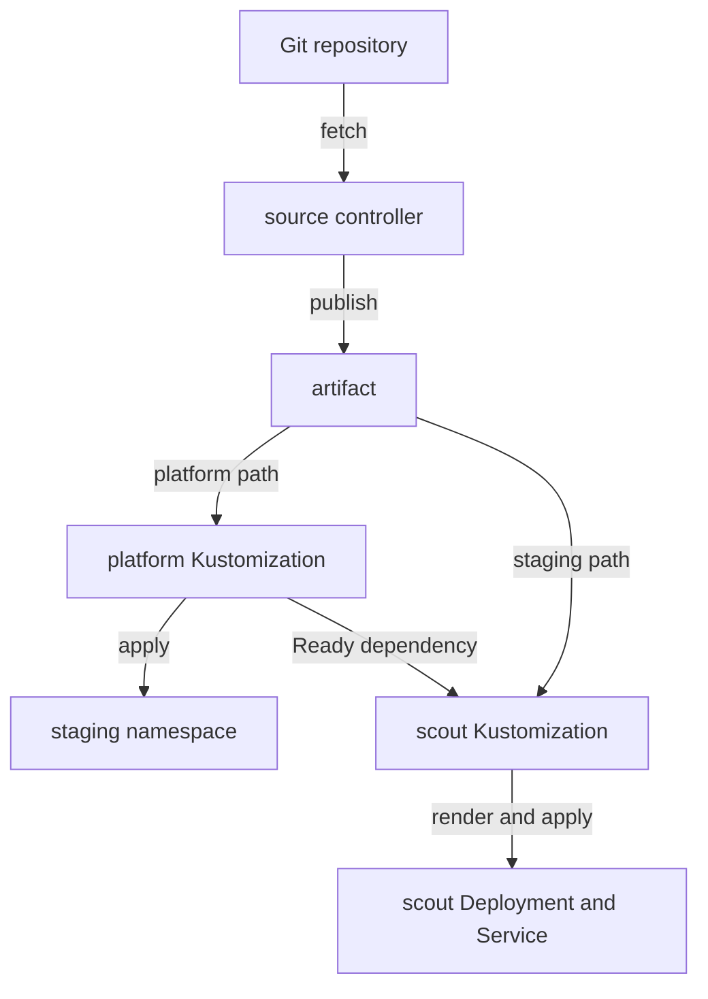

# Apply Paths And Order Dependencies

An overlay is a Kustomize directory that changes a shared set of manifests for one environment. The staging overlay needs the namespace `starfleet-staging`. Its Git files describe a Deployment, which keeps application pods running, and a Service, which gives ready pods a stable network address. They do not describe that namespace. A Flux Kustomization can wait for a separate Kustomization to create the namespace before it applies the application. You will first see the missing dependency, then provide it.

## The source and the applier

A Flux Kustomization is a custom resource that tells the kustomize controller which artifact path to render and apply. It is different from a local `kustomization.yaml`, the file that lists resources and transformations for Kustomize. The local file lives in Git; the Flux object lives in the cluster and names that file's directory.

The source controller has already fetched `scout`. The kustomize controller will render its staging directory, apply its objects and check their health. `dependsOn` names another Flux Kustomization whose Ready condition must be true before that work begins.



The diagram shows one artifact supplying both paths, with namespace readiness ordering application delivery.

## Apply the application before its dependency exists

The GitRepository `scout` must already be Ready. The staging directory uses the podinfo 6.15.0 image and sets the response message to `staging`.

<!-- astrona:playground:renew -->

Save this as `kustomization-scout.yaml`:

```yaml
apiVersion: kustomize.toolkit.fluxcd.io/v1
kind: Kustomization
metadata:
  name: scout
  namespace: flux-system
spec:
  interval: 1m
  path: ./overlays/staging
  prune: true
  targetNamespace: starfleet-staging
  wait: true
  timeout: 1m
  dependsOn:
    - name: platform
  sourceRef:
    kind: GitRepository
    name: scout
```

Apply it:

```sh
kubectl apply -f kustomization-scout.yaml
```

Then check the result after a few seconds:

```sh
kubectl -n flux-system get kustomization scout -o jsonpath='{range .status.conditions[*]}{.type}={.status} {.reason}: {.message}{"\n"}{end}'
```

```text
Ready=False DependencyNotReady: dependency 'flux-system/platform' not found: kustomizations.kustomize.toolkit.fluxcd.io "platform" not found
```

The controller has not tried to create the Deployment. It stopped at the dependency check. That differs from a bad repository credential: the source is Ready, but the applier cannot proceed.

`path` selects the artifact directory. `sourceRef` names the source object in the same namespace. `targetNamespace` sets the namespace of the rendered namespaced objects; it does not create a namespace. `prune: true` removes objects this applier previously managed when they leave the rendered manifests. Flux tracks those objects in its status inventory.

`wait: true` makes the controller check the health of the applied objects. `timeout: 1m` bounds that work. Without a health check, successful application does not necessarily mean the Deployment has ready pods. An Argo CD Application exposes sync and health separately; here the Kustomization's Ready condition includes the configured health check.

## Create the namespace dependency

The `platform` directory holds a Namespace manifest and a local Kustomize file that includes it. A Namespace is cluster-scoped, so this Kustomization needs no `targetNamespace`.

Save this as `kustomization-platform.yaml`:

```yaml
apiVersion: kustomize.toolkit.fluxcd.io/v1
kind: Kustomization
metadata:
  name: platform
  namespace: flux-system
spec:
  interval: 1m
  path: ./platform
  prune: true
  sourceRef:
    kind: GitRepository
    name: scout
```

Apply it:

```sh
kubectl apply -f kustomization-platform.yaml
```

Then check the result:

```sh
kubectl -n flux-system wait kustomization/platform --for=condition=Ready --timeout=90s
flux reconcile kustomization scout
flux get kustomizations
kubectl -n starfleet exec deploy/shuttle -- curl -s http://scout.starfleet-staging
```

The status and response were:

```text
NAME    	REVISION          	SUSPENDED	READY	MESSAGE                              
platform	main@sha1:fc4373ea	False    	True 	Applied revision: main@sha1:fc4373ea	
scout   	main@sha1:fc4373ea	False    	True 	Applied revision: main@sha1:fc4373ea
```

```text
{
  "hostname": "scout-859bff8ff5-qwllw",
  "version": "6.15.0",
  "revision": "dd507173b7b75b2312a36cabe0de5f09c1ce69c8",
  "color": "#34577c",
  "logo": "https://raw.githubusercontent.com/stefanprodan/podinfo/gh-pages/cuddle_clap.gif",
  "message": "staging",
  "goos": "linux",
  "goarch": "arm64",
  "runtime": "go1.27.0",
  "num_goroutine": "6",
  "num_cpu": "6"
}
```

Both appliers report the same Git revision. The request proves that the ready workload actually serves version 6.15.0 and the staging message. The hostname varies because Kubernetes gives each pod a generated name.

For more detail, inspect the applier:

```sh
kubectl -n flux-system describe kustomization scout
```

Read its conditions, last applied revision, inventory and events. The events name `kustomize-controller` as the component that created the Service and Deployment and passed the health check. When an object is rejected, the condition and events give the failing object and application programming interface (API) error.

You have now delivered two paths in the right order, checked the controller's result and proved the application answers. The same dependency mechanism can order configuration before workloads, but it does not copy data between the two appliers.

## Common pitfalls

> [!WARNING]
> - **Expecting `targetNamespace` to create a Namespace.** Include a Namespace manifest or create it through a dependency.
> - **Confusing the two Kustomization kinds.** The Flux object applies a path; the local file tells Kustomize how to render it.
> - **Creating a dependency cycle.** Neither applier becomes Ready if each waits for the other.
> - **Removing a namespace from a pruned path casually.** Pruning a Namespace also removes its namespaced workloads.
