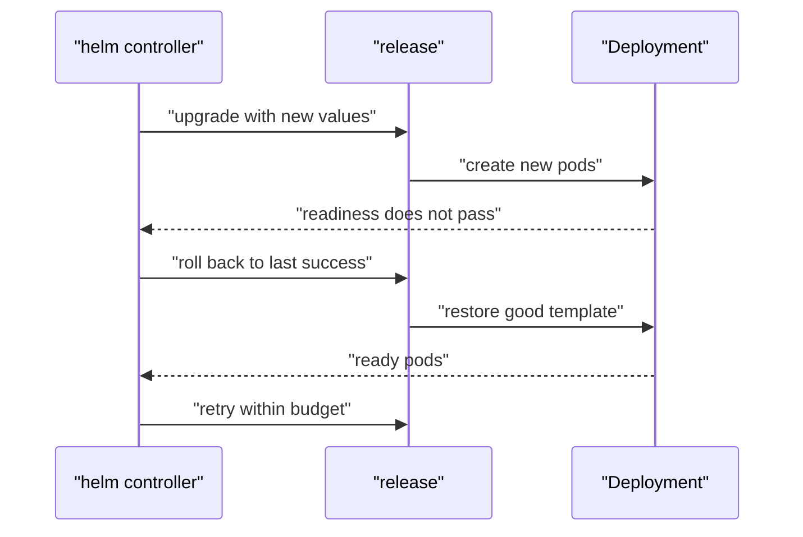

# Remediation And Rollback

The `scout` release now serves its last good configuration. A HelmRelease is the Flux object that defines an installed chart and its values. You can tell its helm controller to restore the last good release when an upgrade fails. That recovery is called remediation: an action the controller takes after a failed install or upgrade.

## Configure recovery before the failure

A chart is a package of Kubernetes templates and defaults. A release is an installed copy, and a revision numbers each install, upgrade or rollback. A rollback restores the values and manifests of a previous successful release through another release operation.

Install and upgrade recovery have different starting points. A failed install has no successful revision to restore, so install remediation uninstalls the failed release before retrying. An upgrade can roll back. The `retries` field counts extra attempts after the first attempt, and `remediateLastFailure` asks the controller to recover even when no retries remain.

The `scout-values` ConfigMap must already contain the last good message. A ConfigMap stores non-secret configuration; this release reads its values document through `valuesFrom`.

<!-- astrona:playground:renew -->

Save this as `helmrelease-scout-remediation.yaml`:

```yaml
apiVersion: helm.toolkit.fluxcd.io/v2
kind: HelmRelease
metadata:
  name: scout
  namespace: starfleet
spec:
  interval: 1m
  timeout: 30s
  chartRef:
    kind: OCIRepository
    name: podinfo
  values:
    replicaCount: 1
    resources:
      requests:
        cpu: 10m
        memory: 32Mi
      limits:
        memory: 128Mi
    faults:
      unready: true
  valuesFrom:
  - kind: ConfigMap
    name: scout-values
    valuesKey: values.yaml
  install:
    remediation:
      retries: 1
      remediateLastFailure: true
  upgrade:
    remediation:
      retries: 1
      remediateLastFailure: true
      strategy: rollback
```

Apply it:

```sh
kubectl apply -f helmrelease-scout-remediation.yaml
```

This both configures rollback and deliberately sets `unready: true` again. The helm controller tries the upgrade, waits for the Deployment to become ready, then rolls back when the 30-second timeout expires. A Deployment keeps application pods running. The new pods fail readiness because podinfo rejects the check.



The diagram shows the controller restoring good workload settings after a failed upgrade before spending its retry budget.

Then check the result once retries finish:

```sh
kubectl -n starfleet wait helmrelease/scout --for=condition=Stalled --timeout=90s
flux get helmreleases -n starfleet
kubectl -n starfleet get helmrelease scout -o jsonpath='{range .status.conditions[*]}{.type}={.status} {.reason}: {.message}{"\n"}{end}'
kubectl -n starfleet get helmrelease scout -o jsonpath='{range .status.history[*]}{.version}{" "}{.status}{" "}{.chartVersion}{"\n"}{end}'
```

The condition output is shortened to the recovery and retry result:

```text
Stalled=True RetriesExceeded: Failed to upgrade after 2 attempt(s)
Ready=False RollbackSucceeded: Helm rollback to previous release starfleet/scout.v6 with chart podinfo@6.15.0+ff3d3e14728f succeeded
Remediated=True RollbackSucceeded: Helm rollback to previous release starfleet/scout.v6 with chart podinfo@6.15.0+ff3d3e14728f succeeded
```

The history was:

```text
8 deployed 6.15.0+ff3d3e14728f
3 superseded 6.15.0+ff3d3e14728f
7 failed 6.15.0+ff3d3e14728f
6 superseded 6.15.0+ff3d3e14728f
```

One retry means two failed upgrade attempts. Rollback created revision 8, now `deployed`, with the good settings. Read each revision's status instead of assuming the list is sorted numerically.

`Ready=False` is correct even though rollback succeeded. The current desired values still ask for the fault. `Remediated=True` describes recovery; it does not mean those desired values were delivered successfully. Check the actual Service too. A Service provides a stable address for ready pods:

```sh
kubectl -n starfleet exec deploy/shuttle -- curl -s http://scout-podinfo:9898
```

The response is shortened to its version and message:

```text
  "version": "6.15.0",
  "message": "flux-configmap",
```

## Repair the desired state

In `helmrelease-scout-remediation.yaml`, change `unready: true` to `unready: false` and save the corrected document as `helmrelease-scout-repaired.yaml`. Keep the remediation settings for future failures. Apply it:

```sh
kubectl apply -f helmrelease-scout-repaired.yaml
```

Then check the result:

```sh
flux reconcile helmrelease scout -n starfleet --reset
flux get helmreleases -n starfleet
```

```text
NAME 	REVISION           	SUSPENDED	READY	MESSAGE                                                                                      
scout	6.15.0+ff3d3e14728f	False    	True 	Helm upgrade succeeded for release starfleet/scout.v8 with chart podinfo@6.15.0+ff3d3e14728f
```

`--reset` clears failure counters and requests reconciliation. It does not fix values for you. Here the recovered revision already had the desired good values, so readiness returned without needing a new revision. Resetting the same broken values would just spend the retry budget again.

## Match Flux objects to Argo CD

Argo CD is another GitOps controller: it applies desired state from a versioned source. Its Application object combines source, destination and sync settings. Flux separates the fetched artifact from the object that applies it.

| Job | Flux | Argo CD |
| --- | --- | --- |
| Fetch a Git revision | GitRepository | Application Git source |
| Select a chart | OCIRepository or HelmRepository | Application chart source |
| Render and apply a Kustomize path | Kustomization | Application Kustomize source and destination |
| Manage an installed chart release | HelmRelease | Application renders chart manifests and syncs them |

The last row has a practical difference. Flux manages release operations and their revision history through the helm controller. Argo CD renders a chart into manifests and applies those objects; its Application does not provide this HelmRelease rollback history or remediation policy.

You can now set a retry budget, distinguish recovery from successful delivery, and prove the last good application still serves after rollback. Repairing the desired values completes recovery; a successful rollback alone leaves a failed desired state to resolve.

## Common pitfalls

> [!WARNING]
> - **Reading `Remediated=True` as successful delivery.** Check Ready and the desired values too.
> - **Counting `retries: 1` as one total attempt.** It permits one retry after the first attempt.
> - **Expecting install remediation to roll back.** A failed first install has no good revision to restore.
> - **Resetting failure counters without fixing the fault.** Reset permits another attempt; it does not repair values.
