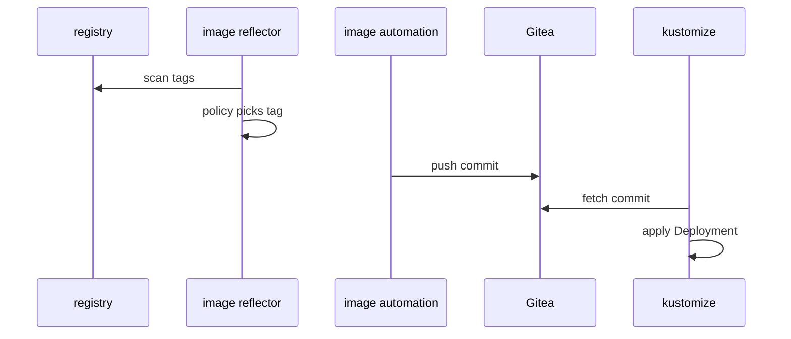

# Release A New Tag And Read The Status

The path from policy to pod works for a tag that existed at setup. In daily use, a new tag appears later, and nobody touches Git. This part publishes a new tag and follows it through each object. It ends with the status fields that tell you which step stopped when a release does not arrive.

## Publish a tag and follow it

The flow has five steps, and four different controllers act in it. The sequence below shows who does what after a tag appears.



The image reflector controller scans the registry and applies the policy. The image automation controller pushes a commit to Gitea. The source and kustomize controllers fetch and apply that commit, which the diagram shows as one step.

<!-- astrona:playground:renew -->

The playground "builds" an image by copying one. A Job in the `registry` namespace gives the existing `6.15.0` image the new tag `6.15.1`, using `crane`, a tool that copies and tags images in a registry. Save this as `job-publish-scout.yaml`:

```yaml
apiVersion: batch/v1
kind: Job
metadata:
  name: publish-scout-6-15-1
  namespace: registry
spec:
  template:
    spec:
      restartPolicy: Never
      containers:
        - name: crane
          image: gcr.io/go-containerregistry/crane/debug:v0.22.1
          command:
            - crane
            - tag
            - --insecure
            - registry.registry.svc:5000/starfleet/scout:6.15.0
            - 6.15.1
```

Apply it:

```sh
kubectl apply -f job-publish-scout.yaml
```

Then check the result. The registry now holds a fifth tag, so ask the image reflector controller to scan again instead of waiting for its one-minute interval:

```sh
kubectl -n registry wait --for=condition=complete job/publish-scout-6-15-1 --timeout=120s
flux reconcile image repository scout -n flux-system
kubectl -n flux-system wait imagepolicy/scout --for=jsonpath='{.status.latestRef.tag}'=6.15.1 --timeout=90s
flux get image policy -n flux-system
```

```text
✔ scan fetched 5 tags
```

```text
NAME 	IMAGE                                     	TAG   	READY	MESSAGE                                                                                                                                           
scout	registry.registry.svc:5000/starfleet/scout	6.15.1	True 	Latest image tag for registry.registry.svc:5000/starfleet/scout resolved to 6.15.1 (previously registry.registry.svc:5000/starfleet/scout:6.15.0)
```

The policy message now names the previous tag too. That gives you the history of tag changes without opening Git. Next, wait for the automation to push its commit and for the Kustomization to apply it:

```sh
kubectl -n flux-system wait imageupdateautomation/scout --for=jsonpath='{.status.observedPolicies.scout.tag}'=6.15.1 --timeout=90s
flux reconcile source git scout-deploy -n flux-system
git pull
git log --format='%h %an %s'
```

```text
233008c fluxcdbot Update 6.15.0 to 6.15.1
57e8e63 fluxcdbot Update 6.14.0 to 6.15.0
4240f2e platform Add image policy setter
87fae37 platform Initial content of scout-deploy
```

The history now reads as a list of releases. Each one is a commit by the automation, so a revert in Git is a rollback. Finally, confirm the Deployment runs the new tag:

```sh
kubectl -n starfleet get deploy scout -o jsonpath='{.spec.template.spec.containers[0].image}{"\n"}'
```

```text
registry.registry.svc:5000/starfleet/scout:6.15.1
```

The image is a copy of 6.15.0, so the response from `shuttle` still reports version 6.15.0. The image tag in the Deployment is the proof here.

## Read the status of each object

When a release does not arrive, find the first object that stopped. Each object answers one question, and you read them in the order of the flow.

1. `flux get image repository`: did the scan work, and when? A failure here means a registry address, credential or TLS problem.
2. `flux get image policy`: did a tag match? An empty `TAG` column means the range or filter selects nothing.
3. `flux get image update`: did the last run succeed? A failure here is usually a missing marker path or a Git push that the server refused.
4. `flux get sources git` and `flux get kustomizations`: did the commit arrive and apply?

The events of the automation list each push with its commit hash:

```sh
flux events -n flux-system --for ImageUpdateAutomation/scout
```

The last lines of the output were:

```text
pushed commit '233008c' to branch 'main'
Update 6.15.0 to 6.15.1
```

The automation can also be paused without deleting it. `flux suspend image update scout -n flux-system` stops its runs, and `flux resume image update scout -n flux-system` starts them again. Pause it when you need to change the file by hand without a race.

## Compare it with a pipeline commit

A Tekton pipeline can do the same job from the other side. It builds an image, then runs a Task that edits the tag in Git and pushes a commit. The pipeline decides when a release happens, and it needs its own Git credential. With image automation, the cluster watches the registry, and the rule for what counts as a release lives in the `ImagePolicy`.

Both ways end the same: a commit in Git that the GitOps controller delivers. Choose the pipeline commit when a release needs a human gate or a test result before the tag moves. Choose image automation when every tag that matches a rule should go out on its own, for example in a staging environment.

You can now publish a tag, follow it through four controllers and find the object where a release stopped. The key point is that Git stays the source of truth. The automation only writes commits, and the Flux controllers deliver them as before.

## Common pitfalls

> [!WARNING]
> - **Waiting on the wrong interval.** The scan, the automation run and the Git fetch each have their own interval. Use `flux reconcile` to force a step.
> - **Debugging the Kustomization first.** If the commit is missing, the fault is earlier. Start at the `ImageRepository`.
> - **Editing the marked line by hand and expecting it to stay.** The next run writes the policy tag again.
> - **Expecting a new tag to match a range that stops below it.** A policy with `>=6.14.0 <6.15.0` never selects `6.15.1`.
