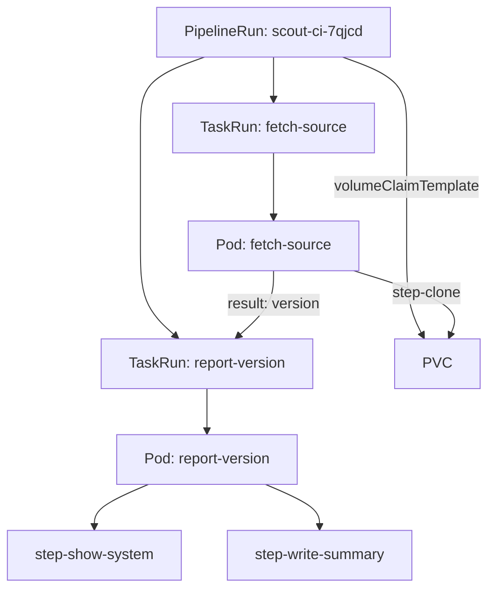

# Workspaces, Pipelines And Results

A real CI run has more than one job. It fetches the source, tests it, and reports what it built, and each job needs the files the job before it produced. This part gives a Task a volume to work in, chains two Tasks in a Pipeline, and passes a value from the first Task to the second.

## Workspaces

A **workspace** is a volume that Tekton mounts into the steps of a Task so they can share files. The Task only declares the workspace by name. The run decides what backs it: an `emptyDir`, a ConfigMap, a Secret, or a PersistentVolumeClaim. Tekton mounts it at `/workspace/<name>`, and the variable `$(workspaces.<name>.path)` holds that path.

The next Task clones the `scout-app` repository into a workspace called `source`. It also reports two results: the commit ID it cloned and the content of the `VERSION` file.

<!-- astrona:playground:renew -->

Save this as `task-fetch-source.yaml`:

```yaml
apiVersion: tekton.dev/v1
kind: Task
metadata:
  name: fetch-source
  namespace: starfleet
spec:
  params:
    - name: url
      type: string
      description: The Git repository to clone
  workspaces:
    - name: source
      description: The folder the repository is cloned into
  results:
    - name: commit
      description: The commit ID that was cloned
    - name: version
      description: The content of the VERSION file
  steps:
    - name: clone
      image: alpine/git:2.52.0
      workingDir: $(workspaces.source.path)
      script: |
        #!/bin/sh
        set -eu
        git clone --quiet "$(params.url)" .
        echo "Cloned commit $(git rev-parse --short HEAD)"
        printf '%s' "$(git rev-parse HEAD)" > "$(results.commit.path)"
        printf '%s' "$(cat VERSION)" > "$(results.version.path)"
```

`workingDir` makes the step start inside the workspace, so `git clone ... .` writes the repository straight into the shared volume. `set -eu` stops the script at the first failing command, so the step fails instead of carrying on with missing files.

Apply it:

```sh
kubectl apply -f task-fetch-source.yaml
```

## A Pipeline with runAfter and a result

A Pipeline lists Tasks under `tasks`. Each entry has its own name inside the Pipeline, a `taskRef`, and the params and workspaces it passes to that Task. Without any ordering, Tekton starts all the Tasks at the same time. Two things create an order: `runAfter`, which names the Tasks that must finish first, and a reference to another Task's result, which makes Tekton wait for that Task as well.

Save this as `pipeline-scout-ci.yaml`:

```yaml
apiVersion: tekton.dev/v1
kind: Pipeline
metadata:
  name: scout-ci
  namespace: starfleet
spec:
  params:
    - name: repo-url
      type: string
      default: http://gitea-http.gitea.svc:3000/starfleet/scout-app.git
  workspaces:
    - name: shared
  tasks:
    - name: fetch-source
      taskRef:
        name: fetch-source
      params:
        - name: url
          value: $(params.repo-url)
      workspaces:
        - name: source
          workspace: shared
    - name: report-version
      runAfter:
        - fetch-source
      taskRef:
        name: report-version
      params:
        - name: version
          value: $(tasks.fetch-source.results.version)
  results:
    - name: commit
      value: $(tasks.fetch-source.results.commit)
```

The Pipeline declares its own workspace `shared` and maps it to the Task's workspace `source`. The variable `$(tasks.fetch-source.results.version)` takes the `version` result of the Task called `fetch-source` and passes it as the `version` param of `report-version`, the Task you wrote earlier. The Pipeline's own `results` field publishes the commit ID on the PipelineRun.

Apply it:

```sh
kubectl apply -f pipeline-scout-ci.yaml
```

## A PipelineRun with a PersistentVolumeClaim

Each Task in a Pipeline runs in its own pod, so an `emptyDir` cannot carry files from one Task to the next. The workspace must be a PersistentVolumeClaim (PVC), a request for storage that outlives a single pod. A `volumeClaimTemplate` tells Tekton to create a new PVC for each PipelineRun and to delete it together with the run.

Save this as `pipelinerun-scout-ci.yaml`:

```yaml
apiVersion: tekton.dev/v1
kind: PipelineRun
metadata:
  generateName: scout-ci-
  namespace: starfleet
spec:
  pipelineRef:
    name: scout-ci
  workspaces:
    - name: shared
      volumeClaimTemplate:
        spec:
          accessModes:
            - ReadWriteOnce
          resources:
            requests:
              storage: 64Mi
```

Create it, because it uses `generateName`:

```sh
kubectl create -f pipelinerun-scout-ci.yaml
```

Wait about 20 seconds, then read the logs and the status of the run:

```sh
tkn -n starfleet pipelinerun logs --last
tkn -n starfleet pipelinerun describe --last
```

The output is:

```text
[fetch-source : clone] Cloned commit 9962c15

[report-version : show-system] Running on 3.23.6

[report-version : write-summary] Reporting version 6.15.0

Name:              scout-ci-7qjcd
Namespace:         starfleet
Pipeline Ref:      scout-ci
Service Account:   default
Labels:
 tekton.dev/pipeline=scout-ci

Status

STARTED          DURATION   STATUS
25 seconds ago   16s        Succeeded

Timeouts
 Pipeline:   1h0m0s

Results

 NAME     VALUE
 commit   9962c157b23c9b7d3d3f224da0dbf099d10ba0bd

Workspaces

 NAME     SUB PATH   WORKSPACE BINDING
 shared   ---        VolumeClaimTemplate

Taskruns

 NAME                            TASK NAME        STARTED          DURATION   STATUS
 scout-ci-7qjcd-report-version   report-version   14 seconds ago   5s         Succeeded
 scout-ci-7qjcd-fetch-source     fetch-source     25 seconds ago   11s        Succeeded
```

The log lines now carry two names, `[<task> : <step>]`. `report-version` printed `6.15.0`, the content of `VERSION` in Git, and not its own default: the value came through the result. The Pipeline result `commit` holds the full commit ID (yours differs). The `Taskruns` table shows that the PipelineRun created one TaskRun per Task, named `<pipelinerun>-<task>`.

This is the chain of objects one PipelineRun creates:



The diagram shows the PipelineRun creating one TaskRun and one pod per Task, the clone step writing into the shared PVC, and the `version` result flowing into the second TaskRun as a param.

List the objects in the namespace to see the PVC and the pods:

```sh
kubectl -n starfleet get pvc,pods
```

The output is:

```text
NAME                                   STATUS   VOLUME                                     CAPACITY   ACCESS MODES   STORAGECLASS   VOLUMEATTRIBUTESCLASS   AGE
persistentvolumeclaim/pvc-af629738b1   Bound    pvc-d9789c00-7ccf-4808-a44e-3072aafe4807   64Mi       RWO            standard       <unset>                 29s

NAME                                    READY   STATUS      RESTARTS   AGE
pod/report-version-9xdp6-pod            0/2     Completed   0          68s
pod/report-version-run-sqm8t-pod        0/2     Completed   0          45s
pod/scout-ci-7qjcd-fetch-source-pod     0/1     Completed   0          29s
pod/scout-ci-7qjcd-report-version-pod   0/2     Completed   0          18s
pod/shuttle-5c44b786bb-wm5dj            1/1     Running     0          83s
```

Tekton created the PVC with a generated name, and the default StorageClass `standard` provided the volume. The PVC stays until the PipelineRun is deleted. The pods also stay, in the `Completed` state, so that you can still read their logs.

You can now share files between Tasks with a PVC workspace, order Tasks with `runAfter` and results, and read a whole run with `tkn pipelinerun describe` and `tkn pipelinerun logs`. Every run so far has succeeded. The open question is how to find the cause when one Task in the chain fails.

## Common pitfalls

> [!WARNING]
> - **Using `emptyDir` for a workspace that two Tasks share.** Each Task is a separate pod, so the second Task sees an empty folder. Use a PVC or a `volumeClaimTemplate`.
> - **Forgetting `runAfter` when the order matters.** Tasks with no `runAfter` and no result reference start at the same time, and the second Task may read the workspace before the clone is done.
> - **Mixing up the two workspace names.** In the Pipeline, `name` is the Task's workspace and `workspace` is the Pipeline's workspace it binds to.
> - **Referencing a result with the Task's own name instead of the Pipeline task name.** `$(tasks.<name>.results.<result>)` uses the `name` of the entry under `tasks`.
> - **Cleaning up PVCs by hand.** A PVC from a `volumeClaimTemplate` belongs to its PipelineRun. Delete old PipelineRuns and their PVCs go with them.
