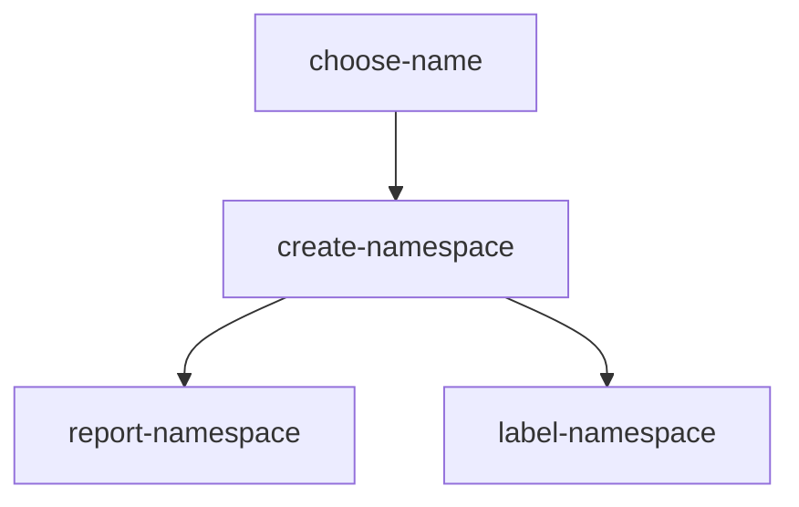

# Parallel Tasks, tkn Runs And Cluster Access

A Pipeline does not always stop at building and testing. Some Pipelines change the cluster itself, such as one that prepares a namespace for a new team. A Task like that needs rights in the Kubernetes API, and it runs with no rights unless you give them to it. The same Pipeline usually runs many times with different values, and a failed run stays behind until someone removes it. This part builds such a Pipeline and works through all of that with `tkn`.

<!-- astrona:playground:renew -->

## A Pipeline that creates a namespace

A step that calls the Kubernetes API needs the `kubectl` program, so these Tasks use the image `alpine/kubectl:1.35.4`, which the node already holds. The Task `choose-name` works out the namespace name and stores it in a result. The other two Tasks read that name from a param.

Save this as `tasks-team-namespace.yaml`:

```yaml
apiVersion: tekton.dev/v1
kind: Task
metadata:
  name: choose-name
  namespace: starfleet
spec:
  params:
    - name: team
      type: string
  results:
    - name: namespace
      description: The name of the namespace for this team
  steps:
    - name: choose
      image: alpine:3.23
      env:
        - name: TEAM
          value: $(params.team)
      script: |
        #!/bin/sh
        set -eu
        printf 'team-%s' "$TEAM" > "$(results.namespace.path)"
---
apiVersion: tekton.dev/v1
kind: Task
metadata:
  name: create-namespace
  namespace: starfleet
spec:
  params:
    - name: namespace
      type: string
  steps:
    - name: create
      image: alpine/kubectl:1.35.4
      env:
        - name: TARGET_NAMESPACE
          value: $(params.namespace)
      script: |
        #!/bin/sh
        set -eu
        kubectl get namespace "$TARGET_NAMESPACE" >/dev/null 2>&1 || kubectl create namespace "$TARGET_NAMESPACE"
---
apiVersion: tekton.dev/v1
kind: Task
metadata:
  name: report-namespace
  namespace: starfleet
spec:
  params:
    - name: namespace
      type: string
  steps:
    - name: report
      image: alpine/kubectl:1.35.4
      env:
        - name: TARGET_NAMESPACE
          value: $(params.namespace)
      script: |
        #!/bin/sh
        set -eu
        kubectl get namespace "$TARGET_NAMESPACE" -o name
        echo "Namespace $TARGET_NAMESPACE is ready"
```

The script of `create-namespace` reads the namespace first, so a second run for the same team succeeds and changes nothing.

Save this as `pipeline-team-namespace.yaml`:

```yaml
apiVersion: tekton.dev/v1
kind: Pipeline
metadata:
  name: team-namespace
  namespace: starfleet
spec:
  params:
    - name: team
      type: string
  tasks:
    - name: choose-name
      taskRef:
        name: choose-name
      params:
        - name: team
          value: $(params.team)
    - name: create-namespace
      runAfter:
        - choose-name
      taskRef:
        name: create-namespace
      params:
        - name: namespace
          value: $(tasks.choose-name.results.namespace)
    - name: report-namespace
      runAfter:
        - create-namespace
      taskRef:
        name: report-namespace
      params:
        - name: namespace
          value: $(tasks.choose-name.results.namespace)
```

Apply both files:

```sh
kubectl apply -f tasks-team-namespace.yaml
kubectl apply -f pipeline-team-namespace.yaml
```

## Start a run with tkn

`tkn pipeline start` creates a PipelineRun for you. It gives the run a generated name that begins with `team-namespace-run-`. The flag `-p` sets one Pipeline param, and `--showlog` prints the log lines until the run ends:

```sh
tkn -n starfleet pipeline start team-namespace -p team=alpha --showlog
```

Then read the run:

```sh
tkn -n starfleet pipelinerun describe --last
```

The run has failed. `--last` selects the newest run, so look at its `Service Account` line and its TaskRun table. The account is `default`, because you did not name one, and `create-namespace` failed. The log from the previous command holds a line from `[create-namespace : create]` with the word `forbidden`, and that line names the account `system:serviceaccount:starfleet:default`.

## Give the run an account

A ServiceAccount is the identity of a pod in the Kubernetes API. Every Task pod runs as the ServiceAccount of its run, so that account needs the rights. A namespace is a cluster-scoped object: it belongs to the cluster and not to another namespace. So its rights need a ClusterRole, which can apply to the whole cluster, and a ClusterRoleBinding, which gives that ClusterRole to the account.

Save this as `rbac-namespace-maker.yaml`:

```yaml
apiVersion: v1
kind: ServiceAccount
metadata:
  name: namespace-maker
  namespace: starfleet
---
apiVersion: rbac.authorization.k8s.io/v1
kind: ClusterRole
metadata:
  name: namespace-maker
rules:
  - apiGroups: [""]
    resources: ["namespaces"]
    verbs: ["get", "create"]
---
apiVersion: rbac.authorization.k8s.io/v1
kind: ClusterRoleBinding
metadata:
  name: namespace-maker
subjects:
  - kind: ServiceAccount
    name: namespace-maker
    namespace: starfleet
roleRef:
  apiGroup: rbac.authorization.k8s.io
  kind: ClusterRole
  name: namespace-maker
```

Apply it:

```sh
kubectl apply -f rbac-namespace-maker.yaml
```

Then check the result. `kubectl auth can-i` asks the API server whether a request is allowed, and `--as` asks on behalf of another identity. It prints `yes` or `no`:

```sh
kubectl auth can-i create namespaces --as=system:serviceaccount:starfleet:namespace-maker
kubectl auth can-i delete namespaces --as=system:serviceaccount:starfleet:namespace-maker
```

Look for `yes` on the first line and `no` on the second. The account has the rights the Tasks need and nothing more.

A finished run never changes, so start new runs. The flag `-s` sets the ServiceAccount of a run. The same Pipeline now runs twice with different values, and nothing in its definition changes:

```sh
tkn -n starfleet pipeline start team-namespace -p team=alpha -s namespace-maker --showlog
tkn -n starfleet pipeline start team-namespace -p team=beta -s namespace-maker --showlog
kubectl get namespaces team-alpha team-beta
```

Look for both namespaces with the status `Active`.

## Run a second Task at the same time

Each team should also record its owner as a label on the namespace. Reporting and labelling do not depend on each other, so they can run at the same time. Two Tasks run in parallel when neither has to wait for the other, so give the new Task the same `runAfter` as `report-namespace`. The new Task receives two values: the namespace from the result of `choose-name`, and the owner from a new Pipeline param.

Save this as `task-label-namespace.yaml`:

```yaml
apiVersion: tekton.dev/v1
kind: Task
metadata:
  name: label-namespace
  namespace: starfleet
spec:
  params:
    - name: namespace
      type: string
    - name: owner
      type: string
  steps:
    - name: label
      image: alpine/kubectl:1.35.4
      env:
        - name: TARGET_NAMESPACE
          value: $(params.namespace)
        - name: OWNER
          value: $(params.owner)
      script: |
        #!/bin/sh
        set -eu
        kubectl label namespace "$TARGET_NAMESPACE" "owner=$OWNER" --overwrite
```

Save this as `pipeline-team-namespace.yaml`, in place of the first version:

```yaml
apiVersion: tekton.dev/v1
kind: Pipeline
metadata:
  name: team-namespace
  namespace: starfleet
spec:
  params:
    - name: team
      type: string
    - name: owner
      type: string
  tasks:
    - name: choose-name
      taskRef:
        name: choose-name
      params:
        - name: team
          value: $(params.team)
    - name: create-namespace
      runAfter:
        - choose-name
      taskRef:
        name: create-namespace
      params:
        - name: namespace
          value: $(tasks.choose-name.results.namespace)
    - name: report-namespace
      runAfter:
        - create-namespace
      taskRef:
        name: report-namespace
      params:
        - name: namespace
          value: $(tasks.choose-name.results.namespace)
    - name: label-namespace
      runAfter:
        - create-namespace
      taskRef:
        name: label-namespace
      params:
        - name: namespace
          value: $(tasks.choose-name.results.namespace)
        - name: owner
          value: $(params.owner)
```

Apply both files:

```sh
kubectl apply -f task-label-namespace.yaml
kubectl apply -f pipeline-team-namespace.yaml
```

The Tasks now run in this order:



When `create-namespace` ends, Tekton starts `report-namespace` and `label-namespace` together, because each one waits only for `create-namespace`.

Then check the result:

```sh
tkn -n starfleet pipeline describe team-namespace
```

In the task table, look at the `RUNAFTER` column: it shows `create-namespace` for both Tasks. This table is your proof of the order. The order of the lines in a log is not proof, because a log line does not show when its Task started.

## Add the missing right

`kubectl label` sends a `patch` request to the API server, and the ClusterRole allows only `get` and `create`. In `rbac-namespace-maker.yaml`, change the `verbs` line of the ClusterRole to this:

```yaml
    verbs: ["get", "create", "patch"]
```

Apply it:

```sh
kubectl apply -f rbac-namespace-maker.yaml
```

Then check the result:

```sh
kubectl auth can-i patch namespaces --as=system:serviceaccount:starfleet:namespace-maker
```

Look for `yes`.

## Save the log of a run

This time keep the name of the run. With `-o name`, `tkn` prints only the name of the new run, and `kubectl wait` holds your shell until the run has succeeded. You cannot use `-o` together with `--showlog`.

```sh
RUN="$(tkn -n starfleet pipeline start team-namespace -p team=gamma -p owner=drifter -s namespace-maker -o name)"
kubectl -n starfleet wait "pipelinerun/$RUN" --for=condition=Succeeded --timeout=120s
kubectl get namespace team-gamma --show-labels
```

Look for the label `owner=drifter` on the namespace.

`tkn pipelinerun logs` prints the log of one run, and without `-f` it prints what is available when you call it. So save the log after the run has ended, or the file can stop early. A redirect sends the output to a file:

```sh
tkn -n starfleet pipelinerun logs "$RUN" > team-gamma-run.log
grep 'report-namespace : report' team-gamma-run.log
```

Each line in the file starts with `[<task> : <step>]`. Look for a line from `report-namespace` that names `team-gamma`.

## Delete a failed run

The first run for `alpha` is still there and still shows as failed. Find its name, then delete it. The flag `-f` skips the question that `tkn` otherwise asks before it deletes:

```sh
tkn -n starfleet pipelinerun list
tkn -n starfleet pipelinerun delete <name of the failed run> -f
tkn -n starfleet pipelinerun list
```

Look in the last list: the failed run is gone, and the other runs stay. The TaskRuns and the pods of the deleted run go with it, because Kubernetes removes objects whose owner is deleted.

You can now run two Tasks in parallel and pass them a result and a param, start one Pipeline many times with different values, give a run the account and the rights it needs, save a log to a file, and remove a failed run.

## Common pitfalls

> [!WARNING]
> - **Binding a Role when the object is a namespace.** A Role lives in one namespace, and a namespace is cluster-scoped. Use a ClusterRole and a ClusterRoleBinding.
> - **Fixing the rights of the wrong account.** A run without `-s` uses `default`. Read the account in the `forbidden` line before you change any rights, and do not bind `cluster-admin` to get past the error.
> - **Leaving out a param on `tkn pipeline start`.** `tkn` asks for every param you did not set with `-p`, even one with a default. Use `--use-param-defaults` to accept the defaults without a question.
> - **Trusting the exit code of `--showlog`.** Without `-E`, the command does not exit with the status of the run. Read the status with `tkn pipelinerun describe` or wait for the condition with `kubectl wait`.
> - **Using `--pipeline` to delete one run.** `tkn pipelinerun delete --pipeline team-namespace` deletes all runs of that Pipeline. Name the one run you want to remove.
> - **Expecting the namespace to go with the run.** The Task created it through the API, so no owner links it to the run. Deleting a run leaves `team-alpha` in place.

## Your mission: Run A Pipeline That Changes The Cluster With tkn

The Pipeline `outpost-onboard` prepares a namespace for each new site, and its first run has failed. Find out why with `tkn`, add a Task that runs in parallel with another, give the account the right it is missing, run the Pipeline for two sites, save the log of one run, and delete the failed run.

Pause the playground, then start the lab and read the task:

```sh
astrona stop ats-018-playground-040-01
astrona run --git ssh://git@github.com/astrona-io/ATS018.git -c sections/section-040/module-01/labs/lab-02
```

Check your progress with `--watch` while you work, because a plain `astrona submit` finishes the attempt and deletes the lab. Stop the watch with Ctrl-C and submit once at the end. Then remove the lab and start the playground again:

```sh
astrona submit --watch --git ssh://git@github.com/astrona-io/ATS018.git -c sections/section-040/module-01/labs/lab-02
astrona submit --git ssh://git@github.com/astrona-io/ATS018.git -c sections/section-040/module-01/labs/lab-02
astrona destroy ats-018-lab-040-01-02
astrona start ats-018-playground-040-01
```
