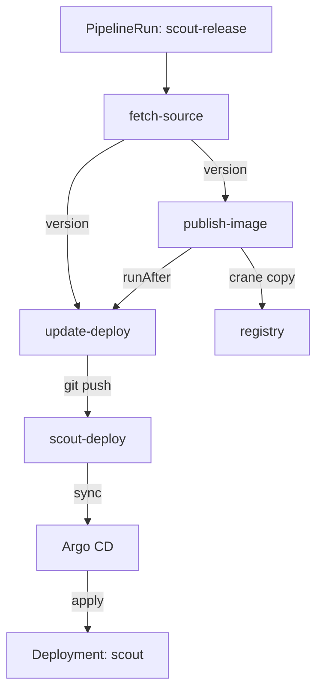

# One Pipeline From Source To Commit

Two Tasks started by hand, with a version typed twice, is not a release process. The version should come from the source repository, the publish should run before the commit, and a failure in either should stop the release. This part chains the three Tasks in one Pipeline and follows one run until Argo CD serves its result.

## The release Pipeline

The playground already has the Task `fetch-source` in `starfleet`. It clones a repository at a revision into a workspace called `source`, and reports two results: `commit` and `version`, the content of the `VERSION` file. The Pipeline passes `version` to the other two Tasks.

<!-- astrona:playground:renew -->

Save this as `pipeline-scout-release.yaml`:

```yaml
apiVersion: tekton.dev/v1
kind: Pipeline
metadata:
  name: scout-release
  namespace: starfleet
spec:
  params:
    - name: revision
      type: string
      default: main
  workspaces:
    - name: source
  tasks:
    - name: fetch-source
      taskRef:
        name: fetch-source
      params:
        - name: url
          value: http://gitea-http.gitea.svc:3000/starfleet/scout-app.git
        - name: revision
          value: $(params.revision)
      workspaces:
        - name: source
          workspace: source
    - name: publish-image
      taskRef:
        name: publish-image
      params:
        - name: version
          value: $(tasks.fetch-source.results.version)
    - name: update-deploy
      runAfter:
        - publish-image
      taskRef:
        name: update-deploy
      params:
        - name: version
          value: $(tasks.fetch-source.results.version)
  results:
    - name: deploy-commit
      value: $(tasks.update-deploy.results.commit)
```

`publish-image` has no `runAfter`, but it uses a result of `fetch-source`, so Tekton starts it only after the clone. `update-deploy` must wait for the publish, which it does not take a result from, so it needs `runAfter`. The `revision` param defaults to `main`; a later step sets it to an exact commit ID.

Apply it:

```sh
kubectl apply -f pipeline-scout-release.yaml
```

## Run it with the service account

Two Tasks clone private repositories, so every TaskRun of this Pipeline needs the service account `scout-ci`. In a PipelineRun, `taskRunTemplate.serviceAccountName` sets it for all the TaskRuns. Only `fetch-source` uses the workspace, so an `emptyDir` is enough here.

Save this as `pipelinerun-scout-release.yaml`:

```yaml
apiVersion: tekton.dev/v1
kind: PipelineRun
metadata:
  generateName: scout-release-
  namespace: starfleet
spec:
  pipelineRef:
    name: scout-release
  taskRunTemplate:
    serviceAccountName: scout-ci
  workspaces:
    - name: source
      emptyDir: {}
```

Create it:

```sh
kubectl create -f pipelinerun-scout-release.yaml
```

Wait about 30 seconds, then read the logs and the status:

```sh
tkn -n starfleet pipelinerun logs --last
tkn -n starfleet pipelinerun describe --last
```

The output is (the `describe` part is shortened):

```text
[fetch-source : clone] Cloned http://gitea-http.gitea.svc:3000/starfleet/scout-app.git at d9f0ba5, VERSION 6.14.0

[publish-image : copy] Published registry.registry.svc:5000/starfleet/scout:6.14.0 (sha256:0a8aa037137c010a75aed8d3fe56931d0edd3bcd0e55acfb96db11e1e96397b1)

[update-deploy : commit-tag] Pushed 254de29: Deploy scout 6.14.0

...
STARTED          DURATION   STATUS
35 seconds ago   17s        Succeeded
...
Results

 NAME            VALUE
 deploy-commit   254de29aa3cd8f1323225b211c2527db8b49a786
...
 NAME                                TASK NAME       STARTED          DURATION   STATUS
 scout-release-wz4lh-update-deploy   update-deploy   23 seconds ago   5s         Succeeded
 scout-release-wz4lh-publish-image   publish-image   28 seconds ago   5s         Succeeded
 scout-release-wz4lh-fetch-source    fetch-source    35 seconds ago   7s         Succeeded
```

The version came from Git this time. The `VERSION` file in `scout-app` still says `6.14.0`, so the pipeline published `6.14.0` and committed it to `scout-deploy`. That undoes the `6.14.1` you committed by hand: the source repository decides the version, not a person who starts a Task. The `deploy-commit` result names the commit that Argo CD will deliver.

## Follow the commit to the cluster

Now prove the result. Refresh the application, wait until Argo CD has synced and the application is healthy, and wait for the Deployment rollout to finish:

```sh
argocd app get scout --refresh
argocd app wait scout --sync --health
kubectl -n starfleet rollout status deploy/scout
```

The status lines of `argocd app wait` and the rollout are:

```text
Sync Status:        Synced to main (254de29)
Health Status:      Healthy
deployment "scout" successfully rolled out
```

The application is synced to `254de29`, the commit from the pipeline's result. Then send a request from `shuttle`:

```sh
kubectl -n starfleet exec deploy/shuttle -- curl -s http://scout.starfleet | grep version
```

The output is:

```text
  "version": "6.14.0",
```

If the answer still shows the old version, ask again after a few seconds: for a short moment after the rollout, the old pod can still be in the Service's endpoints while it shuts down.

This is the chain one release now follows:



The diagram shows the version flowing from `fetch-source` into both later Tasks, the pipeline writing only to the registry and to Git, and Argo CD as the only component that applies to the cluster.

You can now run the whole release with one PipelineRun and prove its result with the Argo CD status and a request from `shuttle`. The version comes from Git, but a person still has to create the PipelineRun after every change. The open question is how a push to `scout-app` starts the pipeline by itself.

## Common pitfalls

> [!WARNING]
> - **Setting the service account on the Pipeline instead of the run.** A Pipeline has no service account field. Set `taskRunTemplate.serviceAccountName` on the PipelineRun.
> - **Expecting result order to replace `runAfter`.** `update-deploy` takes no result from `publish-image`, so without `runAfter` both start together and the commit can land before the image exists.
> - **Checking `shuttle` before the rollout ends.** Wait for `argocd app wait` and `kubectl rollout status`, then ask, and ask again if the old version answers once.
> - **Changing `scout-deploy` by hand while the pipeline also writes it.** The next run overwrites the tag with the version from `scout-app`.
