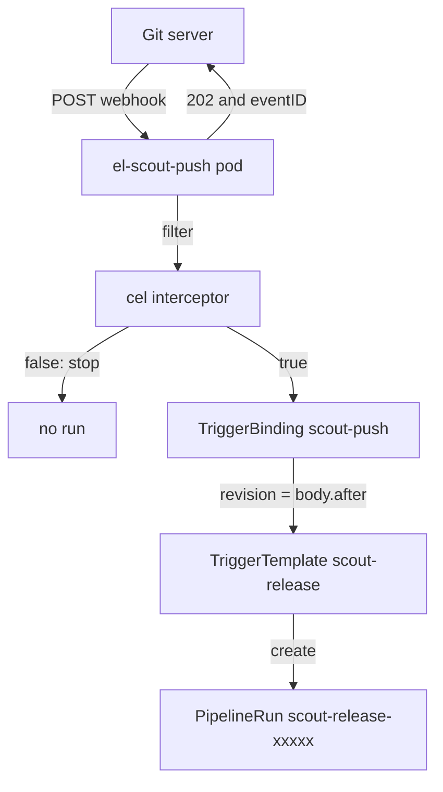

# Listen For A Push With Tekton Triggers

Continuous integration means every change runs the pipeline, without anyone starting it. The Git server can send an HTTP (Hypertext Transfer Protocol) request, a webhook, on every push. Tekton Triggers turns that request into a PipelineRun. This part builds the three Triggers objects that do the conversion, gives the listener the permissions it needs, and proves it is up and reachable before any Git server is connected to it.

## Three objects between a request and a run

Tekton Triggers is a separate Tekton project with its own controller. It adds three custom resources:

- An **`EventListener`** is the Tekton Triggers object that receives a webhook and creates a run from it. For each `EventListener`, the Triggers controller starts a Deployment and a Service called `el-<name>` that accept HTTP requests on port `8080`.
- A **`TriggerBinding`** reads values out of the request, such as the commit ID from the JSON body, and names them as params.
- A **`TriggerTemplate`** holds the resource to create, here a PipelineRun, with `$(tt.params.<name>)` placeholders for those params.

An `EventListener` can also run **interceptors** first. An interceptor checks or filters the request before any run is created. The `cel` interceptor evaluates an expression in the Common Expression Language (CEL) against the headers and body, and drops the request when the expression is false.

The `el-` pod, not the Triggers controller, handles each request. It works through the trigger in a fixed order. First the interceptors run; a `cel` `filter` that evaluates to false stops the trigger there. Then the bindings read the headers and the JSON body: `$(body.after)` takes the field `after` from the body, `$(header.X-Gitea-Event)` would take a header, and a field that is missing from the request falls back to the `default` of the template param with the same name, if one is set. Last, the template's placeholders are replaced and the pod creates the resources in its own namespace, with three labels on each: `triggers.tekton.dev/eventlistener`, `triggers.tekton.dev/trigger` and `triggers.tekton.dev/triggers-eventid`.



The diagram shows one request moving through the trigger, and the reply going back as soon as the listener has taken the request: the pod answers with HTTP status 202 and a JSON body that holds an `eventID` without waiting for the interceptors, whether or not one of them drops the event. That is why the reply never proves that a run exists.

## Permissions for the EventListener

The `el-` pod reads the Triggers objects and creates PipelineRuns, so it needs its own service account with rights to do that. Tekton Triggers ships two ClusterRoles for this: `tekton-triggers-eventlistener-roles` for the namespace, and `tekton-triggers-eventlistener-clusterroles` for the cluster-wide objects such as the interceptors.

<!-- astrona:playground:renew -->

Save this as `rbac-scout-triggers.yaml`:

```yaml
apiVersion: v1
kind: ServiceAccount
metadata:
  name: scout-triggers
  namespace: starfleet
---
apiVersion: rbac.authorization.k8s.io/v1
kind: RoleBinding
metadata:
  name: scout-triggers
  namespace: starfleet
subjects:
  - kind: ServiceAccount
    name: scout-triggers
    namespace: starfleet
roleRef:
  apiGroup: rbac.authorization.k8s.io
  kind: ClusterRole
  name: tekton-triggers-eventlistener-roles
---
apiVersion: rbac.authorization.k8s.io/v1
kind: ClusterRoleBinding
metadata:
  name: scout-triggers
subjects:
  - kind: ServiceAccount
    name: scout-triggers
    namespace: starfleet
roleRef:
  apiGroup: rbac.authorization.k8s.io
  kind: ClusterRole
  name: tekton-triggers-eventlistener-clusterroles
```

This service account only creates runs. The runs themselves still use `scout-ci`, which holds the Git credentials. The two accounts are set in two different places: `scout-triggers` in the `EventListener`, `scout-ci` inside the PipelineRun that the template creates.

## The binding, the template and the listener

The Git server sends a JSON body on each push. Its field `after` is the commit ID the branch points to after the push, and its field `ref` is the branch, for example `refs/heads/main`. The binding takes `after` as the param `revision`.

Save this as `triggerbinding-scout-push.yaml`:

```yaml
apiVersion: triggers.tekton.dev/v1beta1
kind: TriggerBinding
metadata:
  name: scout-push
  namespace: starfleet
spec:
  params:
    - name: revision
      value: $(body.after)
```

The template creates the same PipelineRun you created by hand, with the pushed commit as the `revision` param. Building from the exact commit, not from `main`, means a second push during the run cannot change what this run builds.

Save this as `triggertemplate-scout-release.yaml`:

```yaml
apiVersion: triggers.tekton.dev/v1beta1
kind: TriggerTemplate
metadata:
  name: scout-release
  namespace: starfleet
spec:
  params:
    - name: revision
      description: The commit ID that was pushed
  resourcetemplates:
    - apiVersion: tekton.dev/v1
      kind: PipelineRun
      metadata:
        generateName: scout-release-
      spec:
        pipelineRef:
          name: scout-release
        params:
          - name: revision
            value: $(tt.params.revision)
        taskRunTemplate:
          serviceAccountName: scout-ci
        workspaces:
          - name: source
            emptyDir: {}
```

The listener ties them together. Its `cel` filter accepts only push events (the Git server sets the header `X-Gitea-Event: push`) to the `main` branch. The `header.match` function compares the header name without regard to case; `body.ref` reads the decoded JSON body.

Save this as `eventlistener-scout-push.yaml`:

```yaml
apiVersion: triggers.tekton.dev/v1beta1
kind: EventListener
metadata:
  name: scout-push
  namespace: starfleet
spec:
  serviceAccountName: scout-triggers
  triggers:
    - name: push-to-main
      interceptors:
        - ref:
            name: cel
          params:
            - name: filter
              value: "header.match('X-Gitea-Event', 'push') && body.ref == 'refs/heads/main'"
      bindings:
        - ref: scout-push
      template:
        ref: scout-release
```

Apply all four files:

```sh
kubectl apply -f rbac-scout-triggers.yaml -f triggerbinding-scout-push.yaml \
  -f triggertemplate-scout-release.yaml -f eventlistener-scout-push.yaml
```

Then check the result after about 20 seconds:

```sh
kubectl -n starfleet get eventlistener
kubectl -n starfleet get deploy,svc -l eventlistener=scout-push
```

The output is:

```text
NAME         ADDRESS                                                 AVAILABLE   REASON                     READY   REASON
scout-push   http://el-scout-push.starfleet.svc.cluster.local:8080   True        MinimumReplicasAvailable   True    
NAME                            READY   UP-TO-DATE   AVAILABLE   AGE
deployment.apps/el-scout-push   1/1     1            1           21s

NAME                    TYPE        CLUSTER-IP      EXTERNAL-IP   PORT(S)             AGE
service/el-scout-push   ClusterIP   10.96.150.188   <none>        8080/TCP,9000/TCP   21s
```

The Triggers controller created the Deployment and the Service `el-scout-push`, and the `ADDRESS` column shows the URL the webhook must call. Port `8080` takes the webhooks; port `9000` serves the listener's own metrics. When `READY` stays `False`, its `REASON` column and the `el-scout-push` pod say why; a service account that does not exist is one common cause.

You can now name the three objects between a request and a run, say in which order the `el-` pod applies them, and give the listener the two role bindings it needs. The listener is up, but nothing has sent it a request yet; the next step is to send one by hand, then connect the Git server.

## Common pitfalls

> [!WARNING]
> - **An `EventListener` without a service account that has the Triggers roles.** The `el-` pod cannot read the bindings or create runs. Bind both `tekton-triggers-eventlistener-roles` and `tekton-triggers-eventlistener-clusterroles`.
> - **Mixing up the two service accounts.** `scout-triggers` lets the listener create the run; `scout-ci` inside the template lets the run clone and push. Each one goes in its own object.
> - **Building from `main` instead of the pushed commit.** A later push can change what the run builds. Bind `$(body.after)` and clone that commit.
> - **A binding that names a field the request does not have.** The param then takes the template's `default`, or the run is not created when there is none. Check a real request body before you write the binding.
