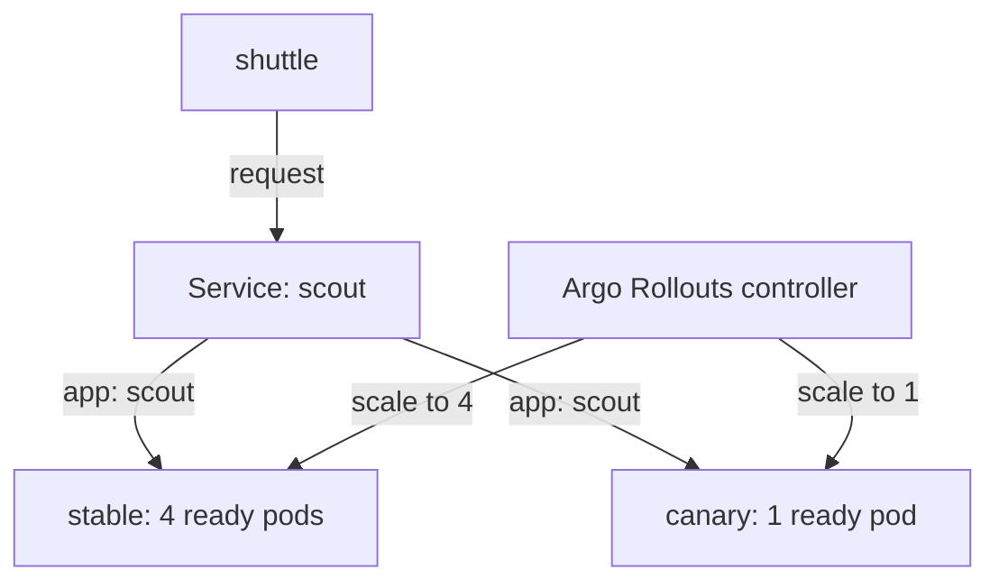

# Canary Steps And Replica Weights

The `scout` Rollout has five stable pods running podinfo 6.14.0. The `scout` Service provides one address and selects ready pods with matching labels. A Rollout is the Argo Rollouts resource that manages a release through ReplicaSets, each of which owns pods from one template. Change the image to 6.15.0 and inspect the first planned pause before sending requests.

<!-- astrona:playground:renew -->

```sh
kubectl argo rollouts set image scout scout=ghcr.io/stefanprodan/podinfo:6.15.0 -n starfleet
```

The plugin returns:

```text
rollout "scout" image updated
```

This command changes the live pod template. Keep `rollout-scout.yaml` consistent by changing its image to 6.15.0 too, so a later apply does not undo the release. In a GitOps environment, where a controller applies desired state from Git, make the image change in Git instead.

## Watch the first pause

The `setWeight: 20` step asks for a 20% canary share. A canary is the version being tested; the stable version is the last fully promoted template. `pause: {}` stops progress until an operator promotes the release. A pause with a `duration`, such as `30s`, expires on its own.

Watch the controller work. This command stops watching after five seconds; it does not stop the release:

```sh
kubectl argo rollouts get rollout scout -n starfleet --watch --timeout-seconds 5 --no-color
```

The watch redraws the terminal as pods start. After the controller settles, inspect the Rollout and its ReplicaSets:

```sh
kubectl argo rollouts get rollout scout -n starfleet --no-color
kubectl -n starfleet get rs -l app=scout -o custom-columns='NAME:.metadata.name,DESIRED:.spec.replicas,READY:.status.readyReplicas,IMAGE:.spec.template.spec.containers[0].image'
```

The status header is shortened below:

```text
Name:            scout
Namespace:       starfleet
Status:          ॥ Paused
Message:         CanaryPauseStep
Strategy:        Canary
  Step:          1/4
  SetWeight:     20
  ActualWeight:  20
Images:          ghcr.io/stefanprodan/podinfo:6.14.0 (stable)
                 ghcr.io/stefanprodan/podinfo:6.15.0 (canary)
Replicas:
  Desired:       5
  Current:       5
  Updated:       1
  Ready:         5
  Available:     5
```

The ReplicaSet table from the same run is:

```text
NAME               DESIRED   READY   IMAGE
scout-7f68c4cfbd   4         4       ghcr.io/stefanprodan/podinfo:6.14.0
scout-d4f6bf74f    1         1       ghcr.io/stefanprodan/podinfo:6.15.0
```

`Step: 1/4` is the zero-based index of the first pause in the four-step list. `Updated: 1` is the number of replicas on the new template. The older ReplicaSet has four ready pods, and the new one has one. `Paused` is the release status; it does not mean the application stopped serving.

## What the weight controls

The playground has no traffic router, a component that controls request shares between versions. Argo Rollouts instead scales ReplicaSets to approximate the requested share with whole pods. With five replicas, one new pod out of five is 20%, and three out of five is 60%. Weights between those possible splits need rounding; five pods cannot express every percentage.



The diagram shows one Service selecting both versions while Argo Rollouts changes their replica counts at the 20% step.

The Kubernetes Service forwards connections to ready endpoints. An endpoint is a pod address that the Service can use. Argo Rollouts does not send requests or enforce that exactly two of every ten requests reach the canary. Connection reuse and small samples can make observed request counts differ from the replica ratio.

Send ten separate requests from the `shuttle` client:

```sh
kubectl -n starfleet exec deploy/shuttle -- sh -c 'for request_number in 1 2 3 4 5 6 7 8 9 10; do curl -s http://scout | grep '"version"'; done'
```

The real sample was:

```text
  "version": "6.14.0",
  "version": "6.14.0",
  "version": "6.15.0",
  "version": "6.14.0",
  "version": "6.14.0",
  "version": "6.15.0",
  "version": "6.14.0",
  "version": "6.14.0",
  "version": "6.14.0",
  "version": "6.14.0",
```

Both versions answer through the same Service. Your sample can differ, including returning only the stable version in a short run. The ready ReplicaSet counts prove the configured split; the response versions prove the applications can serve through the shared address.

During a step change, `maxSurge: 1` allows a sixth pod while the new pods become ready. Read a settled status rather than treating a temporary total of six as a wrong desired count. `ActualWeight` describes the controller's replica-based calculation here, not a measured request percentage.

You can now read a paused canary, identify its stable and new ReplicaSets, and prove that both serve requests. A weight without a traffic router gives a replica approximation, while each pause leaves the decision to continue with the operator.

## Common pitfalls

> [!WARNING]
> - **Expecting a pause to block requests.** It stops release progress; ready pods keep serving.
> - **Reading `ActualWeight` as a measured traffic metric.** This playground calculates the weight from replicas.
> - **Demanding an exact percentage from ten requests.** A small connection sample need not match the pod ratio.
> - **Reapplying the original image manifest.** Keep the saved template consistent with the live image change.
