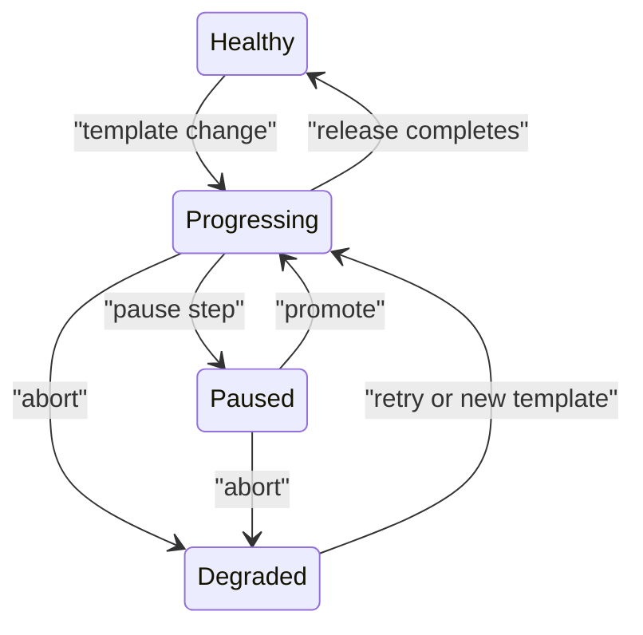

# Promote And Pause A Canary

The `scout` Rollout is paused with one podinfo 6.15.0 pod and four stable 6.14.0 pods. A Rollout is an Argo Rollouts resource that changes ReplicaSet counts according to release steps. Promotion lets its controller continue beyond a pause; it is an operator decision that the application is ready for more traffic.

<!-- astrona:playground:renew -->

```sh
kubectl argo rollouts promote scout -n starfleet
```

The output is:

```text
rollout 'scout' promoted
```

This clears the current canary pause. It does not skip every remaining step. The controller executes `setWeight: 60`, makes three new replicas ready and reaches the second indefinite pause.

## Check the next split

After a few seconds, check the controller's status and the ReplicaSets. A ReplicaSet keeps pods running from one template; the stable ReplicaSet retains the last fully promoted template.

```sh
kubectl argo rollouts get rollout scout -n starfleet --no-color
kubectl -n starfleet get rs -l app=scout -o custom-columns='NAME:.metadata.name,DESIRED:.spec.replicas,READY:.status.readyReplicas,IMAGE:.spec.template.spec.containers[0].image'
```

The status header is shortened below:

```text
Name:            scout
Namespace:       starfleet
Status:          ॥ Paused
Message:         CanaryPauseStep
Strategy:        Canary
  Step:          3/4
  SetWeight:     60
  ActualWeight:  60
Images:          ghcr.io/stefanprodan/podinfo:6.14.0 (stable)
                 ghcr.io/stefanprodan/podinfo:6.15.0 (canary)
Replicas:
  Desired:       5
  Current:       5
  Updated:       3
  Ready:         5
  Available:     5
```

The replica table from the same run is:

```text
NAME               DESIRED   READY   IMAGE
scout-7f68c4cfbd   2         2       ghcr.io/stefanprodan/podinfo:6.14.0
scout-d4f6bf74f    3         3       ghcr.io/stefanprodan/podinfo:6.15.0
```

The step index is now `3/4`, the second pause. Three updated pods and two stable pods give the requested 60% split. The new ReplicaSet is still the canary: reaching 60% does not make it stable. Full completion does that.

## An explicit pause is a separate control

A canary pause comes from the `steps` list. The plugin's `pause` command sets `spec.paused: true`, an explicit pause on the Rollout itself. It gives an operator a way to stop progress without editing the strategy steps.

Pause the Rollout and read that field:

```sh
kubectl argo rollouts pause scout -n starfleet
kubectl -n starfleet get rollout scout -o jsonpath='{.spec.paused}{"\n"}'
```

The output is:

```text
rollout 'scout' paused
true
```

The release was already stopped at a canary pause. You have now added an explicit pause too. Promote once and read the field again:

```sh
kubectl argo rollouts promote scout -n starfleet
kubectl -n starfleet get rollout scout -o jsonpath='{.spec.paused}{"\n"}'
```

The output is:

```text
rollout 'scout' promoted
false
```

The field becomes `false`. In this case, the first promotion clears the explicit pause but leaves the canary pause in place. Promote again to pass that step and wait for completion:

```sh
kubectl argo rollouts promote scout -n starfleet
kubectl argo rollouts status scout -n starfleet --timeout 120s
```

The recorded output is:

```text
rollout 'scout' promoted
Progressing - more replicas need to be updated
Progressing - old replicas are pending termination
Healthy
```

The controller scales the new ReplicaSet to five replicas and removes the old serving pods. Check again after the old pods finish terminating and the Service endpoints settle:

```sh
kubectl argo rollouts get rollout scout -n starfleet --no-color
kubectl -n starfleet exec deploy/shuttle -- curl -s http://scout | grep '"version"'
```

The output below is shortened to the status header:

```text
Name:            scout
Namespace:       starfleet
Status:          ✔ Healthy
Strategy:        Canary
  Step:          4/4
  SetWeight:     100
  ActualWeight:  100
Images:          ghcr.io/stefanprodan/podinfo:6.15.0 (stable)
Replicas:
  Desired:       5
  Current:       5
  Updated:       5
  Ready:         5
  Available:     5
```

The response line from the same run is:

```text
  "version": "6.15.0",
```

The status is `Healthy`, the weight is 100 and the image 6.15.0 is stable. The plugin's full tree also marks its ReplicaSet, `scout-d4f6bf74f`, `stable`. Zero-replica older ReplicaSets can remain for release history; their presence does not mean they still receive requests.

## Release states and operator decisions

The plugin reports a status from the Rollout's fields and conditions. `Progressing` means the controller is still changing the release. `Paused` means it awaits a step or operator action. `Healthy` means the desired release completed. An abort reports `Degraded` even when the stable application still serves successfully.



The diagram shows release status transitions, including an abort that can leave a healthy stable application behind a Degraded Rollout.

You can now advance one pause at a time, distinguish an explicit pause from a strategy pause, and verify full promotion through status and a request. Progress still depends on your decision; no metrics provider in this playground decides whether a release should continue.

## Common pitfalls

> [!WARNING]
> - **Assuming one promotion skips all pauses.** Normal promotion advances the current pause; later pauses still apply.
> - **Missing the explicit pause.** When `spec.paused` is true, promotion first clears that field.
> - **Treating old ReplicaSets as active traffic.** Check their replica counts and readiness.
> - **Testing before endpoints settle.** Terminating pods and endpoint updates can briefly outlast the status change.
