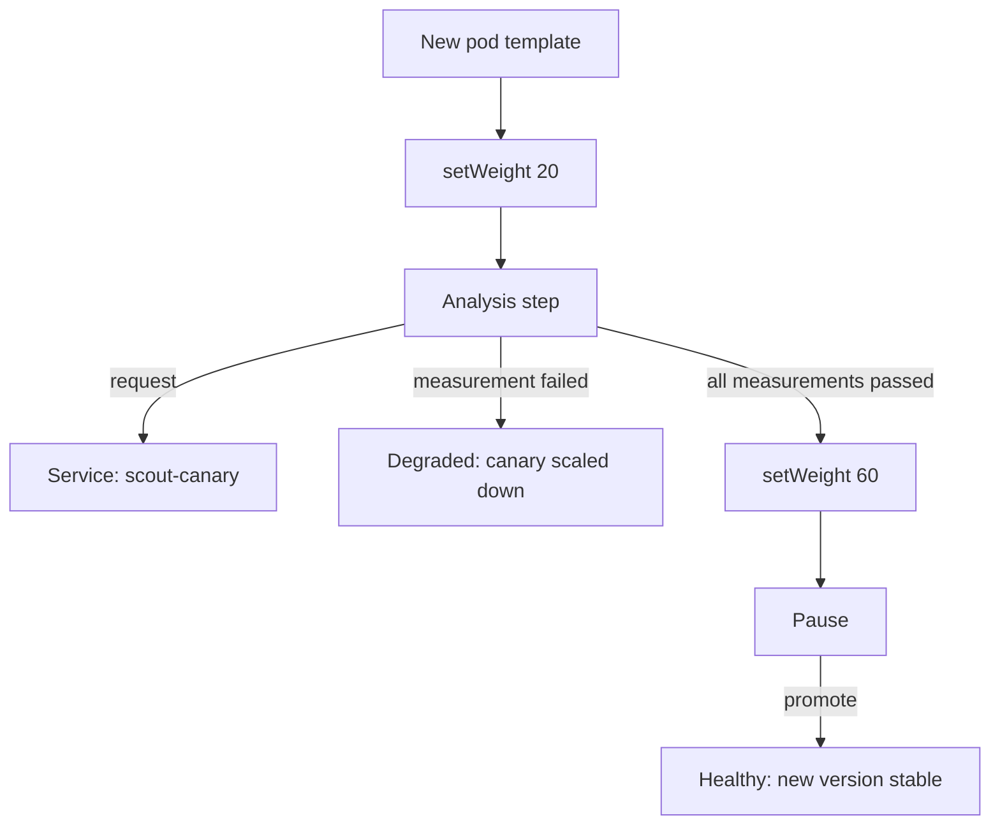

# Gate A Canary With A Web Analysis Step

A person who promotes a canary at every pause can miss a bad release or delay a good one. The `scout` team wants an automatic check at the first stop instead. The check needs no metrics system: it asks the new version one question over HTTP (Hypertext Transfer Protocol) and reads the answer. First finish a release by hand, so that you can compare the two kinds of promotion. Then replace the first pause with a check that runs by itself.

A Rollout is the Argo Rollouts resource that manages a release through ReplicaSets. A canary is the version being tested. The stable version is the last fully promoted one. `scout` is healthy on podinfo 6.14.0. Start a release of 6.15.0 and wait for its first pause. Also change the image in your saved `rollout-scout.yaml` to 6.15.0.

<!-- astrona:playground:renew -->

```sh
kubectl argo rollouts set image scout scout=ghcr.io/stefanprodan/podinfo:6.15.0 -n starfleet
kubectl -n starfleet wait rollout/scout --for=jsonpath='{.status.phase}'=Paused --timeout=120s
kubectl argo rollouts get rollout scout -n starfleet --no-color
```

Look for status `Paused` and step `1/4`.

## Compare promote with promote --full

A normal promotion clears the current pause and runs the next steps. A full promotion ignores every remaining step. Use each form once:

```sh
kubectl argo rollouts promote scout -n starfleet
kubectl -n starfleet wait rollout/scout --for=jsonpath='{.status.currentStepIndex}'=3 --timeout=120s
kubectl argo rollouts get rollout scout -n starfleet --no-color
kubectl argo rollouts promote scout -n starfleet --full
kubectl argo rollouts status scout -n starfleet --timeout 120s
```

After the first `promote`, look for step `3/4`. The release ran `setWeight: 60` and stopped at the second pause. The new version is still the canary. After `promote --full`, the `status` command ends at `Healthy`. The controller skipped the last pause and made 6.15.0 stable.

The difference matters when a release has checks. A normal promotion leaves later checks in place. A full promotion sets the `status.promoteFull` field, which skips pauses, steps and analysis together.

## Write the check

The check must reach only the new version. The `scout` Service selects pods of both versions, so a request to it can receive either answer. A second Service solves this. When a Rollout names a Service in `canaryService`, the controller adds a label selector to that Service, so that it selects only the pods of the canary ReplicaSet.

An AnalysisTemplate is a reusable definition of one or more checks. Each check is a metric, and a measurement is one result of that metric. The `web` provider measures a metric with an HTTP request and needs no metrics system.

Save this as `service-scout-canary.yaml`:

```yaml
apiVersion: v1
kind: Service
metadata:
  name: scout-canary
  namespace: starfleet
spec:
  selector:
    app: scout
  ports:
    - name: http
      port: 80
      targetPort: http
```

Save this as `analysistemplate-scout-canary-message.yaml`:

```yaml
apiVersion: argoproj.io/v1alpha1
kind: AnalysisTemplate
metadata:
  name: scout-canary-message
  namespace: starfleet
spec:
  metrics:
    - name: message
      initialDelay: 15s
      count: 3
      interval: 10s
      successCondition: result == "canary-ready"
      provider:
        web:
          url: http://scout-canary.starfleet/
          timeoutSeconds: 5
          jsonPath: "{$.message}"
```

Apply both:

```sh
kubectl apply -f service-scout-canary.yaml -f analysistemplate-scout-canary-message.yaml
```

podinfo returns JSON (JavaScript Object Notation), a text format of named fields. Its `message` field comes from the environment variable `PODINFO_UI_MESSAGE`. `jsonPath` sits under `web` and selects that field. Its value becomes `result` in `successCondition`, which sits on the metric. So this metric passes only when the canary reports `canary-ready`.

`initialDelay` waits 15 seconds, so the Service has time to reach the new pod. `count` and `interval` then take three measurements, 10 seconds apart. The metric has no `failureLimit`, so one failed measurement fails the whole check. A response outside the 200 range counts as an error, not as a pass.

## Replace the first pause

A step of `canary.steps` can be an `analysis` step. It starts the check when the release reaches that step and holds the release until the check ends. A pass moves the release to the next step. A failure aborts the release.

Save this as `rollout-scout.yaml`:

```yaml
apiVersion: argoproj.io/v1alpha1
kind: Rollout
metadata:
  name: scout
  namespace: starfleet
spec:
  replicas: 5
  revisionHistoryLimit: 3
  selector:
    matchLabels:
      app: scout
  template:
    metadata:
      labels:
        app: scout
    spec:
      containers:
        - name: scout
          image: ghcr.io/stefanprodan/podinfo:6.15.0
          ports:
            - name: http
              containerPort: 9898
          readinessProbe:
            httpGet:
              path: /readyz
              port: http
          resources:
            requests:
              cpu: 10m
              memory: 32Mi
            limits:
              memory: 64Mi
  strategy:
    canary:
      canaryService: scout-canary
      maxSurge: 1
      maxUnavailable: 0
      steps:
        - setWeight: 20
        - analysis:
            templates:
              - templateName: scout-canary-message
        - setWeight: 60
        - pause: {}
```

Apply it:

```sh
kubectl apply -f rollout-scout.yaml
```

Then check the result:

```sh
kubectl -n starfleet get svc scout-canary -o jsonpath='{.spec.selector}{"\n"}'
kubectl argo rollouts get rollout scout -n starfleet --no-color
```

Look for `rollouts-pod-template-hash` in the selector. That label is how the Service selects one ReplicaSet. Status stays `Healthy`, because a change to the steps alone does not start a release when the pod template is already stable.

## Trigger a release that fails the check

A release starts when the pod template changes, and an environment variable is part of the template. The plugin's `set` command changes only images, so patch the Rollout. Use a message that the check must reject, then read the AnalysisRun. An AnalysisRun is the object the controller creates from the template for one check. It holds the result of each measurement.

```sh
kubectl -n starfleet patch rollout scout --type=json -p='[{"op":"add","path":"/spec/template/spec/containers/0/env","value":[{"name":"PODINFO_UI_MESSAGE","value":"not-ready"}]}]'
kubectl -n starfleet wait rollout/scout --for=jsonpath='{.status.phase}'=Degraded --timeout=180s
RUN_NAME=$(kubectl -n starfleet get analysisrun -l rollout-type=Step --sort-by=.metadata.creationTimestamp -o jsonpath='{.items[-1:].metadata.name}')
kubectl -n starfleet get analysisrun "$RUN_NAME" -o jsonpath='{.metadata.name} {.status.phase} {.status.metricResults[0].measurements[0].value}{"\n"}'
kubectl -n starfleet exec deploy/shuttle -- curl -s http://scout | grep '"message"'
```

Look for phase `Failed` and the value `"not-ready"`. The double quotes are part of the stored value, because the `web` provider stores a text value in JSON form. `successCondition` still compares the plain text. The Rollout reports `Degraded`, which describes the release: the controller scaled the canary down and the stable pods keep serving. After the canary pod ends, a request from `shuttle` does not return `not-ready`.

## Trigger a release that passes the check

A new pod template clears the abort and starts another release. Change the message to the one the check accepts. Do not promote while the check runs.

```sh
kubectl -n starfleet patch rollout scout --type=json -p='[{"op":"add","path":"/spec/template/spec/containers/0/env","value":[{"name":"PODINFO_UI_MESSAGE","value":"canary-ready"}]}]'
kubectl -n starfleet wait rollout/scout --for=jsonpath='{.status.currentStepIndex}'=3 --timeout=180s
RUN_NAME=$(kubectl -n starfleet get analysisrun -l rollout-type=Step --sort-by=.metadata.creationTimestamp -o jsonpath='{.items[-1:].metadata.name}')
kubectl -n starfleet get analysisrun "$RUN_NAME" -o jsonpath='{.metadata.name} {.status.phase} {.status.metricResults[0].measurements[0].value}{"\n"}'
kubectl argo rollouts promote scout -n starfleet
kubectl argo rollouts status scout -n starfleet --timeout 120s
kubectl -n starfleet exec deploy/shuttle -- curl -s http://scout | grep '"message"'
```

Look for phase `Successful` and the value `"canary-ready"`. The final `promote` is a normal promotion, because only the last pause remains. After `status` ends at `Healthy`, old pods can answer for a few seconds, so repeat the request if it does not show `canary-ready` yet. Add the same `env` list to the `scout` container in your saved `rollout-scout.yaml`, so that a later apply does not remove it.



The analysis step decides the first stop by itself, and the last pause still waits for a person.

You can now finish a paused release in either way, write a check with the `web` provider, and read why a release stopped from its AnalysisRun. The check proves only what its condition compares. A correct `message` field does not prove error rates or latency under real traffic.

## Common pitfalls

> [!WARNING]
> - **Promoting while the analysis step runs.** With no pause to clear, a normal promotion moves to the next step and cancels the running check.
> - **Using `--full` when the check must run.** It skips analysis as well as pauses and steps.
> - **Trusting a pass from a response that is not JSON.** Argo Rollouts 1.10.0 marks such a measurement as passed without evaluating `successCondition`. podinfo returns a web page to a request with a browser `User-Agent` header, so do not send one.
> - **Putting the fields in the wrong place.** `jsonPath` belongs under `provider.web`. `successCondition` belongs on the metric.
> - **Copying the stored value into the condition.** The AnalysisRun shows `"canary-ready"` with quotes. The condition compares the plain text.
> - **Requesting the `scout` Service.** It selects both versions, so a check through it may measure the stable pods.
> - **Editing the steps during a release.** A change to the steps restarts that release from the first step.
> - **Applying a saved file without the environment variable.** The apply removes the variable, changes the pod template and starts a new release.
