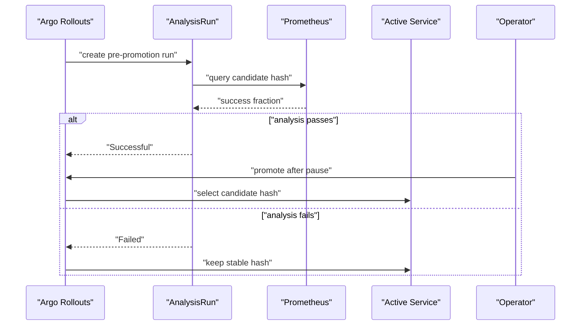

# Pre-Promotion Analysis With Prometheus

The active `scout` configuration returns `preview-good`. A Rollout is the Argo Rollouts resource that controls a release. Instead of judging the next candidate from one response, let its controller check a measured success rate before changing active traffic. Prometheus is the monitoring system that collects these measurements and evaluates queries.

An AnalysisTemplate defines the queries, arguments and conditions used to judge a release. An AnalysisRun is one execution of that template, with recorded measurements and a final phase. Argo Rollouts creates and evaluates the run; Prometheus only answers the queries. The template below checks the candidate's root requests, separate from stable traffic and readiness checks.

## Define a measurable release condition

<!-- astrona:playground:renew -->

Save this as `analysistemplate-scout-success.yaml`:

```yaml
apiVersion: argoproj.io/v1alpha1
kind: AnalysisTemplate
metadata:
  name: scout-success
  namespace: starfleet
spec:
  args:
    - name: candidate-hash
  metrics:
    - name: success-rate
      initialDelay: 45s
      interval: 15s
      count: 3
      failureLimit: 1
      successCondition: len(result) == 1 && result[0] >= 0.99
      failureCondition: len(result) != 1 || result[0] < 0.99
      provider:
        prometheus:
          address: http://kps-prometheus.monitoring.svc:9090
          query: |
            sum(rate(http_request_duration_seconds_count{namespace="starfleet",path="root",rollouts_pod_template_hash="{{args.candidate-hash}}",status=~"2.."}[2m]))
            /
            sum(rate(http_request_duration_seconds_count{namespace="starfleet",path="root",rollouts_pod_template_hash="{{args.candidate-hash}}"}[2m]))
```

The argument `candidate-hash` selects one pod template through the `rollouts_pod_template_hash` label. Prometheus Query Language (PromQL) is the language used to select and calculate stored time series. The query divides successful response rate by total request rate, using the histogram's count series. `path="root"` selects `/`, and `status=~"2.."` selects successful Hypertext Transfer Protocol (HTTP) status codes 200–299.

podinfo exposes these metrics on a dedicated port, 9797. Its random error setting affects the application port, including `/metrics` there, so the PodMonitor scrapes the separate port to keep fault measurements available.

The provider address is reachable from the controller in the cluster. The host address `127.0.0.1:9090` would point at the controller's own pod, not your forwarded Prometheus. Keep the in-cluster Service address in the template.

The first measurement waits 45 seconds to allow multiple 15-second scrapes. `count: 3` requests three measurements, with 15 seconds between them. `successCondition` requires one result of at least `0.99`, or 99%. `failureCondition` rejects a result below that value or an unexpected result count.

`failureLimit: 1` tolerates one failed measurement; a second failure exceeds the limit and fails the run.

`result` is a vector, a list of values returned by Prometheus. `len(result)` checks its length before `result[0]` reads the first value. An empty result is a failed measurement here. A zero request rate can instead produce `NaN`, meaning not a number; it satisfies neither numeric comparison and cannot pass this check. Restore traffic and inspect the measurements rather than converting missing evidence to success.

Apply it:

```sh
kubectl apply -f analysistemplate-scout-success.yaml
```

```text
analysistemplate.argoproj.io/scout-success created
```

Creating the template does not start a run. The Rollout must reference it at the point where the check should occur.

## Attach the check before active traffic switches

`prePromotionAnalysis` runs once the candidate pods are available and before the controller switches the active Service. A Service provides a stable address and selects ready pods by labels. `podTemplateHashValue: Latest` passes the candidate's hash, rather than the stable hash, into the query.

Save this as `rollout-scout-gated.yaml`:

```yaml
apiVersion: argoproj.io/v1alpha1
kind: Rollout
metadata:
  name: scout
  namespace: starfleet
spec:
  replicas: 2
  revisionHistoryLimit: 3
  selector:
    matchLabels:
      app: scout
  template:
    metadata:
      labels:
        app: scout
    spec:
      containers:
      - name: scout
        image: ghcr.io/stefanprodan/podinfo:6.15.0
        command:
        - ./podinfo
        - --port=9898
        - --port-metrics=9797
        env:
        - name: PODINFO_UI_MESSAGE
          value: gated-good
        ports:
        - name: http
          containerPort: 9898
        - name: metrics
          containerPort: 9797
        readinessProbe:
          tcpSocket:
            port: http
        resources:
          requests:
            cpu: 10m
            memory: 32Mi
          limits:
            memory: 64Mi
  strategy:
    blueGreen:
      activeService: scout
      previewService: scout-preview
      autoPromotionEnabled: false
      scaleDownDelaySeconds: 30
      prePromotionAnalysis:
        templates:
        - templateName: scout-success
        args:
        - name: candidate-hash
          valueFrom:
            podTemplateHashValue: Latest
```

The message changes to `gated-good`, which creates a new pod template and starts a release. The saved manifest keeps automatic promotion disabled. Passing analysis permits the release to reach its operator pause; it does not remove that separate decision.

Apply it:

```sh
kubectl apply -f rollout-scout-gated.yaml
```

```text
rollout.argoproj.io/scout configured
```

Then check the result after roughly 90 seconds. The first delay and three measurements take about 75 seconds after the run starts; pod startup and scraping can add time. The run name comes from the Rollout's current pre-promotion analysis status, so it does not depend on copying a generated name.

```sh
kubectl -n starfleet get analysisrun -o custom-columns='NAME:.metadata.name,PHASE:.status.phase,COUNT:.status.metricResults[0].count,SUCCESSFUL:.status.metricResults[0].successful,FAILED:.status.metricResults[0].failed'
ANALYSIS_RUN=$(kubectl -n starfleet get rollout scout -o jsonpath='{.status.blueGreen.prePromotionAnalysisRunStatus.name}')
kubectl -n starfleet get analysisrun "$ANALYSIS_RUN" -o jsonpath='{range .status.metricResults[0].measurements[*]}{.phase}{" "}{.value}{"\n"}{end}'
kubectl argo rollouts get rollout scout -n starfleet --no-color
kubectl -n starfleet exec deploy/shuttle -- curl -s http://scout | grep '"message"'
kubectl -n starfleet exec deploy/shuttle -- curl -s http://scout-preview | grep '"message"'
```

The analysis table and recorded measurements were:

```text
NAME                     PHASE        COUNT   SUCCESSFUL   FAILED
scout-74d8c484cb-3-pre   Successful   3       3            <none>
Successful [1]
Successful [1]
Successful [1]
```

The plugin's status header is shortened below:

```text
Name:            scout
Namespace:       starfleet
Status:          ॥ Paused
Message:         BlueGreenPause
Strategy:        BlueGreen
Images:          ghcr.io/stefanprodan/podinfo:6.15.0 (active, preview, stable)
Replicas:
  Desired:       2
  Current:       4
  Updated:       2
  Ready:         2
  Available:     2
```

The two response lines from the same command block were:

```text
  "message": "preview-good",
  "message": "gated-good",
```

The AnalysisRun is Successful with three successful values of `[1]`. Its failed count is absent, so the table shows `<none>`. The Rollout is still Paused, and active requests still return `preview-good`. This proves analysis completed without bypassing `autoPromotionEnabled: false`.

## Follow the decision through the controller

The controller waits for available candidate pods, creates an AnalysisRun and queries Prometheus. A passing run allows the configured manual pause. A failing run aborts the release and retains the active selector.



The diagram shows analysis deciding whether the release can reach promotion, with manual approval still required after a passing run.

Promote the tested candidate normally and wait for release completion:

```sh
kubectl argo rollouts promote scout -n starfleet
kubectl argo rollouts status scout -n starfleet --timeout 120s
```

```text
rollout 'scout' promoted
Healthy
```

After the Service endpoints settle, check the active response:

```sh
kubectl -n starfleet exec deploy/shuttle -- curl -s http://scout | grep -E '"(version|message)"'
```

```text
  "version": "6.15.0",
  "message": "gated-good",
```

Active traffic now returns `gated-good`. A passing measurement, a Successful AnalysisRun and a Healthy Rollout each describe a different stage; the application response proves the selected configuration is serving.

You can now create a metric gate, pass the candidate template hash into it and read its recorded measurements. The controller runs the check before the Service switch, while manual promotion remains a separate decision after success.

## Common pitfalls

> [!WARNING]
> - **Passing the stable template hash.** A good stable version says nothing about candidate quality.
> - **Using the host's forwarded address in the provider.** The query runs from the controller inside the cluster.
> - **Assuming a Successful run automatically promotes.** Automatic promotion is still disabled in this Rollout.
> - **Using `promote --full` to pass the gate.** Full promotion bypasses remaining release checks.
