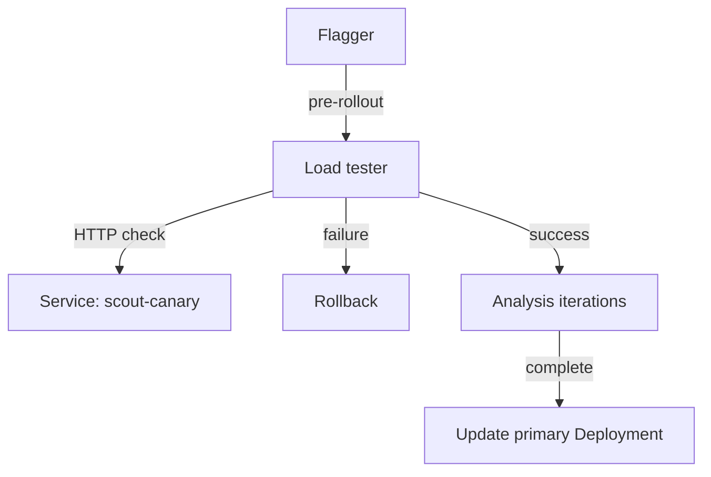

# Blue/Green Without A Service Mesh

The `scout` team needs to test a new pod template before users receive it, but it has no service mesh or metrics backend. A blue/green release keeps the serving template while a second template is checked. Flagger 1.45.0 supports this with `provider: kubernetes`, a fixed number of analysis iterations and an HTTP (Hypertext Transfer Protocol) webhook. A webhook is an HTTP request that Flagger sends to another service to run a check.

Use the dedicated mesh-free environment for this example. It provides the `scout` Deployment on podinfo 6.15.0 with message `baseline`, a `shuttle` client and Flagger load tester 0.39.0. It installs neither Istio nor Prometheus. Pause the playground before starting it.

<!-- astrona:playground:renew -->

```sh
astrona stop ats-018-playground-050-03
astrona run --git ssh://git@github.com/astrona-io/ATS018.git -c sections/section-050/module-03/labs/lab-02
```

## Check the candidate before promotion

A Flagger `Canary` is a Kubernetes resource that names a workload and defines its release policy. The resource name stays `Canary` even when the strategy is blue/green. Save this as `canary-scout.yaml`:

```yaml
apiVersion: flagger.app/v1beta1
kind: Canary
metadata:
  name: scout
  namespace: starfleet
spec:
  provider: kubernetes
  targetRef:
    apiVersion: apps/v1
    kind: Deployment
    name: scout
  progressDeadlineSeconds: 120
  service:
    port: 80
    targetPort: http
  analysis:
    interval: 15s
    threshold: 2
    iterations: 3
    metrics: []
    webhooks:
      - name: scout-http-check
        type: pre-rollout
        url: http://flagger-loadtester.starfleet/
        timeout: 5s
        metadata:
          type: bash
          cmd: "curl -fsS --max-time 3 http://scout-canary.starfleet/status/500"
```

Apply it:

```sh
kubectl apply -f canary-scout.yaml
```

Then check the result:

```sh
kubectl -n starfleet wait canary/scout --for=jsonpath='{.status.phase}'=Initialized --timeout=240s
kubectl -n starfleet get deploy,svc
kubectl -n starfleet get svc scout -o jsonpath='{.spec.selector}{"\n"}'
```

Look for the primary Deployment and the primary and canary Services. The `scout` Service selects `app: scout-primary`. The `scout-canary` Service selects the target Deployment's pods so tests can reach them directly. Flagger scales that target to zero between releases.

`iterations: 3` selects three analysis iterations instead of a series of traffic weights. `metrics: []` leaves metric checks empty, so no metrics provider is needed. An iteration without a configured metric or rollout webhook does not measure application health. The pre-rollout webhook supplies the explicit check here; it runs before iteration advancement, rather than on every iteration.

The webhook has two different type fields. The outer `type: pre-rollout` tells Flagger when to call it. The nested `metadata.type: bash` tells the load tester to run `metadata.cmd` synchronously. In load tester 0.39.0, that command's exit status determines the HTTP response to Flagger. The asynchronous `cmd` task starts work in the background, so use `bash` for this gate. There is no separate `metadata.url` field for the request to the application: its address belongs inside `metadata.cmd`.

## Read a failed gate

The command deliberately calls podinfo's `/status/500` endpoint. Curl's `-f` option makes an HTTP error fail the command; `--max-time 3` limits its duration. Trigger a release by changing an environment variable in the Deployment's pod template:

```sh
kubectl -n starfleet set env deploy/scout PODINFO_UI_MESSAGE=blocked
kubectl -n starfleet wait canary/scout --for=jsonpath='{.status.phase}'=Failed --timeout=300s
kubectl -n starfleet describe canary scout
kubectl -n starfleet logs deploy/flagger-loadtester | grep 'command failed'
kubectl -n starfleet exec deploy/shuttle -c shuttle -- curl -fsS http://scout.starfleet/
```

Look for a failed `scout-http-check` event and a rollback after two failed checks. The load tester receives the webhook, requests the canary Service and returns HTTP 500 to Flagger because curl failed. Flagger retries the gate at the analysis interval, then marks the release `Failed` at the threshold. The response through `scout` should still contain `baseline`: the failed template never reached the primary Deployment.

The event tells you that the gate failed, but not why. The Flagger webhook client discards the response body of an HTTP 5xx response, so curl's error never reaches the event. Find the reason in the load tester log, which holds the command and its exit status. Curl exits with status 22 when `-f` sees an HTTP error.



The gate checks the candidate before Flagger can copy its template to the primary.

## Promote and keep the events

Replace the `cmd` value in `canary-scout.yaml` with `"curl -fsS --max-time 3 http://scout-canary.starfleet/"`. This checks the application's root path instead of a deliberate error. Save the file, then apply it and trigger a different template:

```sh
kubectl apply -f canary-scout.yaml
kubectl -n starfleet set env deploy/scout PODINFO_UI_MESSAGE=green
kubectl -n starfleet wait canary/scout --for=jsonpath='{.status.phase}'=Succeeded --timeout=360s
kubectl -n starfleet exec deploy/shuttle -c shuttle -- curl -fsS http://scout.starfleet/
```

Look for message `green`. With the Kubernetes provider, Flagger keeps the public Service selecting primary pods. After the iterations, it copies the candidate template to `scout-primary` and waits for Kubernetes to roll out that Deployment. There is no weighted route or atomic Service selector switch. The rollout of primary pods can briefly serve both templates.

Events explain why Flagger stopped or promoted. Save them before they expire. A unique identifier (UID) identifies each event and its related Canary. This command saves those identities and the message as tab-separated fields. The Go template uses `printf "%q"` to quote the message and escape any newline in an error:

```sh
kubectl -n starfleet get events --field-selector involvedObject.kind=Canary,involvedObject.name=scout -o go-template='{{range .items}}{{.metadata.uid}}{{"\t"}}{{.involvedObject.uid}}{{"\t"}}{{printf "%q" .message}}{{"\n"}}{{end}}' > /tmp/scout-canary-events.txt
cat /tmp/scout-canary-events.txt
```

Look for the failed gate, the rollback, the passed gate, iteration progress and promotion. Saving stable identity fields lets you compare the file with live events without relying on changing occurrence counts or ages.

You can now release a Deployment without a mesh or metrics backend, use a synchronous HTTP gate, and preserve the events that explain its result. The gate proves only what its command checks. A successful root request does not prove error rates or latency under production traffic.

## Common pitfalls

> [!WARNING]
> - Do not use `stepWeight` to request weighted traffic with `provider: kubernetes`. Use `iterations` for this strategy.
> - Do not look for the curl error in the Canary event. Read the load tester log.
> - Do not omit curl's `-f`: an HTTP 500 response can otherwise leave curl with a successful exit status.
> - Do not check the public `scout` Service in the pre-rollout hook. It still serves the old primary template. Check `scout-canary`.
> - Do not expect `metrics: []` to create a health check. Configure a webhook for the behaviour you need to test.
> - Do not retry a failed release by editing `scout-primary`. Change the target Deployment's pod template.

## Your mission: Gate A Mesh-Free Blue/Green Release With Flagger

You can now configure iteration-based analysis and diagnose a failed HTTP gate. The mission asks you to block a release, repair the gate, promote an environment change and save the Canary events.

If you used the lab environment for practice above, remove it first. Start a fresh attempt with these commands:

```sh
astrona destroy ats-018-lab-050-03-02
astrona run --git ssh://git@github.com/astrona-io/ATS018.git -c sections/section-050/module-03/labs/lab-02
```

Grade the completed task, then return to the playground:

```sh
astrona submit --git ssh://git@github.com/astrona-io/ATS018.git -c sections/section-050/module-03/labs/lab-02
astrona destroy ats-018-lab-050-03-02
astrona start ats-018-playground-050-03
```
