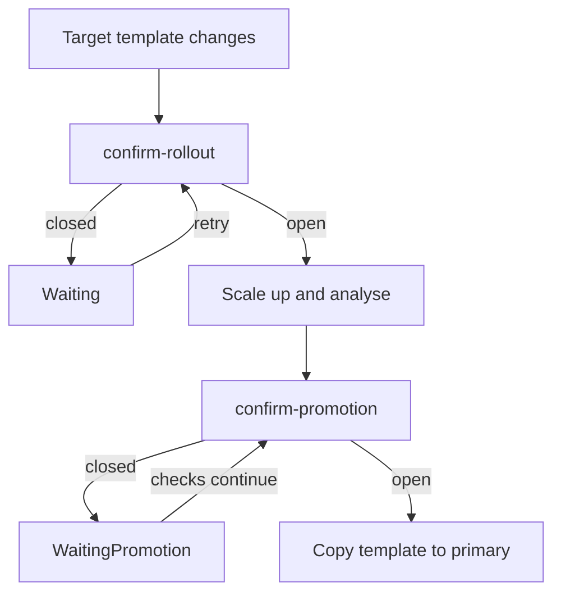

# Require Manual Approval Before A Release

The `scout` team wants a person to approve a release even when its automated
checks pass. A webhook is an HTTP (Hypertext Transfer Protocol) request that
Flagger sends to another service for a decision. Flagger 1.45.0 provides
`confirm-rollout` to wait before candidate scale-up and `confirm-promotion`
to wait before copying the candidate template into the primary Deployment.
These gates control when work proceeds; they do not measure application health.

## Wait before starting analysis

Use the module playground with Istio and its load tester. A `Canary` is the
Flagger resource that defines a workload's release policy. The following
policy works whether `scout` already has a Canary or still needs one.
It retains a rollout webhook to generate traffic for the success-rate check.

<!-- astrona:playground:renew -->

Save this as `canary-scout-approval.yaml`:

```yaml
apiVersion: flagger.app/v1beta1
kind: Canary
metadata:
  name: scout
  namespace: starfleet
spec:
  provider: istio
  targetRef:
    apiVersion: apps/v1
    kind: Deployment
    name: scout
  progressDeadlineSeconds: 120
  service:
    port: 80
    targetPort: http
  analysis:
    interval: 15s
    threshold: 3
    maxWeight: 50
    stepWeight: 10
    metrics:
      - name: request-success-rate
        thresholdRange:
          min: 99
        interval: 30s
    webhooks:
      - name: scout-approval
        type: confirm-rollout
        url: http://flagger-loadtester.starfleet/gate/check
        timeout: 5s
      - name: load-test
        type: rollout
        url: http://flagger-loadtester.starfleet/
        timeout: 5s
        metadata:
          cmd: "hey -z 1m -q 10 -c 2 http://scout-canary.starfleet/"
```

Apply it:

```sh
kubectl apply -f canary-scout-approval.yaml
```

Then check the result:

```sh
kubectl -n starfleet get canary scout
kubectl -n starfleet get deploy scout-primary
```

If this creates the Canary, wait until its phase is `Initialized`. If the
Canary already exists, finish any active release first. A confirmation hook
does not gate initial primary creation. It gates a later template change.

Close the gate explicitly and change the target Deployment's environment.
This creates a new pod template even if the image is already current:

```sh
kubectl -n starfleet exec deploy/shuttle -c shuttle -- curl -fsS -d '{"name":"scout","namespace":"starfleet"}' http://flagger-loadtester.starfleet/gate/close
kubectl -n starfleet set env deploy/scout PODINFO_UI_MESSAGE=approval-one
kubectl -n starfleet wait canary/scout --for=jsonpath='{.status.phase}'=Waiting --timeout=180s
kubectl -n starfleet describe canary scout
kubectl -n starfleet get deploy scout,scout-primary
```

Flagger detects the template change, calls the confirmation hook and receives
a rejection from the closed gate. It sets `.status.phase` to `Waiting` and
emits a Warning event about waiting for approval. The target remains scaled
to zero. Flagger does not start pre-rollout hooks, traffic shifting or metric
analysis, and the primary keeps its previous template. On each analysis
interval Flagger asks for approval again. A rejection here does not increment
`.status.failedChecks` toward the analysis threshold.

## Control the load tester gate

Load tester 0.39.0 serves gate endpoints as well as load-testing tasks.
`/gate/check` reads an in-memory value keyed by Canary name and namespace.
The value starts closed. Flagger supplies that identity in its webhook
payload; a manual request supplies the same fields in its body.

| Endpoint | Purpose | HTTP status |
| --- | --- | --- |
| `/gate/check` | Read this Canary's gate | 403 closed, 200 open |
| `/gate/open` | Store an open value | 202 |
| `/gate/close` | Store a closed value | 202 |
| `/gate/approve` | Always accept; does not change stored state | 200 |
| `/gate/halt` | Always reject; does not change stored state | 403 |

Check the closed gate, open it and check again. Curl's `-d` sends a POST
request; `-i` shows the response headers and status. The check deliberately
omits `-f` so a closed gate's 403 remains visible without a curl error:

```sh
kubectl -n starfleet exec deploy/shuttle -c shuttle -- curl -i -d '{"name":"scout","namespace":"starfleet"}' http://flagger-loadtester.starfleet/gate/check
kubectl -n starfleet exec deploy/shuttle -c shuttle -- curl -fsS -d '{"name":"scout","namespace":"starfleet"}' http://flagger-loadtester.starfleet/gate/open
kubectl -n starfleet exec deploy/shuttle -c shuttle -- curl -i -d '{"name":"scout","namespace":"starfleet"}' http://flagger-loadtester.starfleet/gate/check
kubectl -n starfleet wait canary/scout --for=jsonpath='{.status.phase}'=Succeeded --timeout=360s
kubectl -n starfleet describe canary scout
```

Look for the change from status 403 to 200. Flagger emits a Normal event for
the passed confirmation, changes phase to `Progressing` and scales up the
target. It then runs any pre-rollout hooks, begins analysis and eventually
promotes. Inspect `.status.failedChecks`, `.status.canaryWeight` and the
events in the describe result to distinguish waiting from a failing analysis.

The open value survives later releases until it is closed, but not a load
tester process restart. It is not tied to the image or webhook type. Two
confirmation hooks using `/gate/check` for the same Canary share one gate.
Use a separate approval service if each stage needs an independent decision.

## Wait before promotion

To observe a promotion gate separately, change only the `scout-approval`
webhook's `type` in `canary-scout-approval.yaml` to `confirm-promotion`.
Leave the load-test hook unchanged. Apply it:

```sh
kubectl apply -f canary-scout-approval.yaml
```

Close the stored gate before triggering another pod-template change:

```sh
kubectl -n starfleet exec deploy/shuttle -c shuttle -- curl -fsS -d '{"name":"scout","namespace":"starfleet"}' http://flagger-loadtester.starfleet/gate/close
kubectl -n starfleet set env deploy/scout PODINFO_UI_MESSAGE=approval-two
kubectl -n starfleet wait canary/scout --for=jsonpath='{.status.phase}'=WaitingPromotion --timeout=360s
kubectl -n starfleet describe canary scout
```

This time Flagger scales up the candidate and runs analysis before asking for
approval. When the canary reaches its promotion point, a closed gate sets
`.status.phase` to `WaitingPromotion`. The controller emits a Warning event
about waiting for promotion approval. The primary retains its previous
template, but the candidate still receives the configured canary traffic.
Flagger continues rollout hooks and metric checks at the analysis interval.
A failing check can therefore still cause rollback while approval is pending.
A rejected promotion confirmation itself does not count as a failed metric.



The diagram places each optional confirmation gate at the point where Flagger
checks it. Read the event type and these message fragments to tell the two
waits apart:

| Phase or transition | Event type | Message contains |
| --- | --- | --- |
| `Waiting` | Warning | `waiting for approval` |
| Start approved | Normal | `Confirm-rollout check` and the webhook name |
| `WaitingPromotion` | Warning | `waiting for promotion approval` |
| Promotion approved | Normal | `Confirm-promotion check` and the webhook name |

The passing confirmation messages end with `passed`. A closed gate event is
emitted when Flagger enters its waiting phase, rather than on every retry.

Open the promotion gate and wait for completion:

```sh
kubectl -n starfleet exec deploy/shuttle -c shuttle -- curl -fsS -d '{"name":"scout","namespace":"starfleet"}' http://flagger-loadtester.starfleet/gate/open
kubectl -n starfleet wait canary/scout --for=jsonpath='{.status.phase}'=Succeeded --timeout=360s
kubectl -n starfleet rollout status deploy/scout-primary --timeout=120s
kubectl -n starfleet describe canary scout
```

Look for the passed promotion confirmation and completed promotion events.
Closing a `confirm-rollout` gate after analysis starts does not freeze that
analysis: Flagger checks that hook before starting a release. Close it before
the next template change to require a new start approval.

A `pre-rollout` webhook serves a different purpose. Flagger calls it after
candidate scale-up and before routing canary traffic. It runs in `Progressing`;
failures increment `.status.failedChecks`, emit a failed pre-rollout event
and lead to rollback at `analysis.threshold`. Use it to test a running
candidate. Use a confirmation hook to wait for a decision.

You can now place approval before candidate scale-up or before primary
promotion, inspect the status and events at each point, and control a stored
load tester gate. Keep the gate identity and release phase in view: an open
gate allows the next check, while application health remains the job of tests
and metrics.

## Common pitfalls

> [!WARNING]
> - Do not confuse `Waiting` with `WaitingPromotion`. Only the latter keeps analysis running with the candidate active.
> - Do not use a failing `pre-rollout` test as an indefinite approval wait. Its failures count toward rollback.
> - Do not open `/gate/approve` to change the stored gate. Use `/gate/open` with the same name and namespace as the Canary.
> - Do not leave the gate open and expect fresh approval for every release. Close it before the next template change.
> - Do not change `scout-primary`. Flagger watches the target Deployment and owns the primary copy.

## Your mission: Require Manual Approval Before A Flagger Rollout

You can now hold a new template before analysis starts. The mission asks you
to add a confirmation gate, save waiting events and approve a new image.

Pause the playground and start the separate mesh-free lab:

```sh
astrona stop ats-018-playground-050-03
astrona run --git ssh://git@github.com/astrona-io/ATS018.git -c sections/section-050/module-03/labs/lab-03
```

Grade the completed task once, then return to the playground:

```sh
astrona submit --git ssh://git@github.com/astrona-io/ATS018.git -c sections/section-050/module-03/labs/lab-03
astrona destroy ats-018-lab-050-03-03
astrona start ats-018-playground-050-03
```
