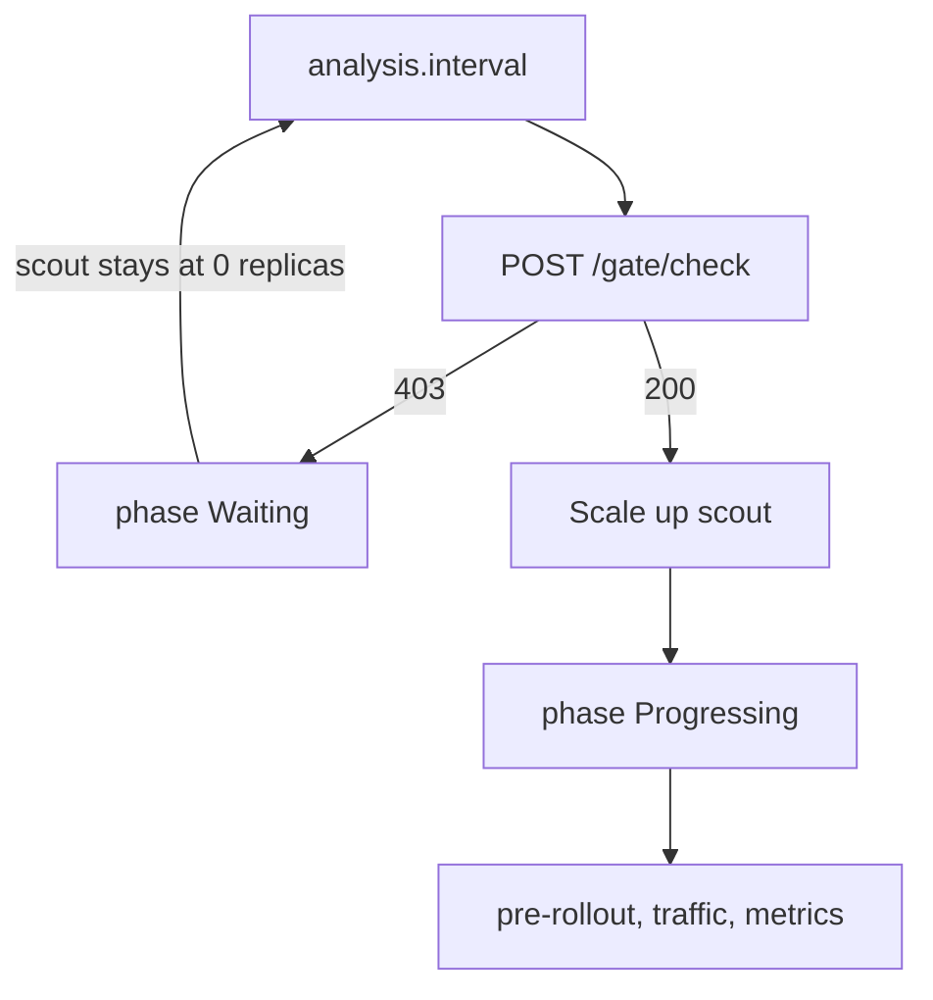

# Wait For Approval Before A Rollout

The `scout` team wants a person to approve a release even when its automated
checks pass. A webhook is an HTTP (Hypertext Transfer Protocol) request that
Flagger sends to another service for a decision. Flagger 1.45.0 provides the
`confirm-rollout` webhook type to wait before it scales up the candidate and
the `confirm-promotion` type to wait before it copies the candidate template
into the primary Deployment. This page uses the first gate. The gates control
when work proceeds; they do not measure application health.

## Add a confirmation webhook

Use the module playground with Istio and its load tester. A `Canary` is the
Flagger resource that defines a workload's release policy. The following
policy works whether `scout` already has a Canary or still needs one. It
keeps a `rollout` webhook that generates traffic for the success-rate check.

<!-- astrona:playground:renew -->

Save this as `canary-scout-approval.yaml`:

```yaml
apiVersion: flagger.app/v1beta1
kind: Canary
metadata:
  name: scout
  namespace: starfleet
spec:
  provider: istio
  targetRef:
    apiVersion: apps/v1
    kind: Deployment
    name: scout
  progressDeadlineSeconds: 120
  service:
    port: 80
    targetPort: http
  analysis:
    interval: 15s
    threshold: 3
    maxWeight: 50
    stepWeight: 10
    metrics:
      - name: request-success-rate
        thresholdRange:
          min: 99
        interval: 30s
    webhooks:
      - name: scout-approval
        type: confirm-rollout
        url: http://flagger-loadtester.starfleet/gate/check
        timeout: 5s
      - name: load-test
        type: rollout
        url: http://flagger-loadtester.starfleet/
        timeout: 5s
        metadata:
          cmd: "hey -z 1m -q 10 -c 2 http://scout-canary.starfleet/"
```

Apply it:

```sh
kubectl apply -f canary-scout-approval.yaml
```

Then check the result:

```sh
kubectl -n starfleet get canary scout
kubectl -n starfleet get deploy scout-primary
```

If this creates the Canary, wait until its phase is `Initialized`. If the
Canary already exists, finish any active release first. A confirmation hook
does not gate initial primary creation. It gates a later template change.

Every webhook call is a POST request with a JSON body that names the Canary:
`name`, `namespace`, the current `phase`, a `checksum` of the applied template
and the webhook's `metadata`. Flagger treats an HTTP status of 202 or lower as
approval and any higher status, or no answer within `timeout` (default 10s),
as a rejection. The `scout-approval` hook therefore gives the load tester
5 seconds to answer.

## Hold the release at the gate

Close the gate explicitly and change the target Deployment's environment.
This creates a new pod template even if the image is already current:

```sh
kubectl -n starfleet exec deploy/shuttle -c shuttle -- curl -fsS -d '{"name":"scout","namespace":"starfleet"}' http://flagger-loadtester.starfleet/gate/close
kubectl -n starfleet set env deploy/scout PODINFO_UI_MESSAGE=approval-one
kubectl -n starfleet wait canary/scout --for=jsonpath='{.status.phase}'=Waiting --timeout=180s
kubectl -n starfleet describe canary scout
kubectl -n starfleet get deploy scout,scout-primary
```

Flagger works in rounds. Every `analysis.interval` (15 seconds here) the
controller reads the Canary and decides one step. In the first round after
the change it compares the target's pod template with
`.status.lastAppliedSpec`, sees a new revision and, because the policy has
a `confirm-rollout` hook, calls the gate before anything else. The closed
gate answers 403. Flagger sets `.status.phase` to `Waiting`, emits one
Warning event `Halt scout.starfleet advancement waiting for approval
scout-approval` and ends the round. It does not scale up `scout`, run
pre-rollout hooks, shift traffic or query metrics. The primary keeps its
previous template.



The diagram shows one round of the loop: a closed gate ends the round in
`Waiting`, an open gate starts the release. Every later round repeats the
call. While the answer stays 403 the phase stays `Waiting`, and Flagger does
not repeat the Warning event; it is emitted once, when the phase changes.
Three status fields tell you what the controller is doing:

```sh
kubectl -n starfleet get canary scout -o jsonpath='{.status.phase} {.status.canaryWeight} {.status.failedChecks} {.status.lastTransitionTime}{"\n"}'
kubectl -n starfleet get canary scout -o jsonpath='{.status.conditions[0]}{"\n"}'
```

In `Waiting`, `canaryWeight` and `failedChecks` are both 0. A rejection is not
a failed check: `analysis.threshold` counts metric and pre-rollout failures
during analysis, and this gate runs before analysis starts. The `Promoted`
condition shows `status: Unknown`, `reason: Waiting` and the message
`Waiting for approval.`; `lastTransitionTime` records when the phase changed.
No field limits how long the gate may stay closed.

## Control the load tester gate

Load tester 0.39.0 serves gate endpoints as well as load-testing tasks.
`/gate/check` reads an in-memory value keyed by Canary name and namespace.
The value starts closed. Flagger supplies that identity in its webhook
payload; a manual request supplies the same fields in its body.

| Endpoint | Purpose | HTTP status |
| --- | --- | --- |
| `/gate/check` | Read this Canary's gate | 403 closed, 200 open |
| `/gate/open` | Store an open value | 202 |
| `/gate/close` | Store a closed value | 202 |
| `/gate/approve` | Always accept; does not change stored state | 200 |
| `/gate/halt` | Always reject; does not change stored state | 403 |

Check the closed gate, open it and check again. Curl's `-d` sends a POST
request; `-i` shows the response headers and status. The check deliberately
omits `-f` so a closed gate's 403 remains visible without a curl error:

```sh
kubectl -n starfleet exec deploy/shuttle -c shuttle -- curl -i -d '{"name":"scout","namespace":"starfleet"}' http://flagger-loadtester.starfleet/gate/check
kubectl -n starfleet exec deploy/shuttle -c shuttle -- curl -fsS -d '{"name":"scout","namespace":"starfleet"}' http://flagger-loadtester.starfleet/gate/open
kubectl -n starfleet exec deploy/shuttle -c shuttle -- curl -i -d '{"name":"scout","namespace":"starfleet"}' http://flagger-loadtester.starfleet/gate/check
kubectl -n starfleet wait canary/scout --for=jsonpath='{.status.phase}'=Succeeded --timeout=360s
kubectl -n starfleet describe canary scout
```

Look for the change from status 403 to 200. In the next round the gate
answers 200 and Flagger records a Normal event `Confirm-rollout check
scout-approval passed`, followed by `New revision detected! Scaling up
scout.starfleet`. It scales the target Deployment from zero, sets the phase
to `Progressing` and resets `canaryWeight`, `failedChecks` and the iteration
counter to 0. The round after that starts the analysis: pre-rollout hooks
run first, then the first traffic step `Advance scout.starfleet canary weight
10`. From there the release runs as any other canary: each round the
`load-test` hook sends traffic, the metric check runs, and the weight grows
by `stepWeight` until promotion. In the describe result, a wait shows one
`waiting for approval` Warning with `failedChecks` 0; a failing analysis
shows `Progressing`, a growing `failedChecks` and `Halt advancement` events
that name a metric or a pre-rollout check.

The open value survives later releases until it is closed, but not a load
tester process restart. It is not tied to the image or webhook type. Two
confirmation hooks using `/gate/check` for the same Canary share one gate.
Closing the gate after analysis has started does not freeze that analysis:
Flagger checks a `confirm-rollout` hook only before a release starts. Close
it before the next template change to require a new start approval.

You can now hold a new template before Flagger scales up the candidate, read
the phase, status fields and events that prove it is waiting, and open a
stored gate to let the release run. The open question is what changes when
the gate sits at the other end of the release, after analysis has passed and
before the primary takes the new template.

## Common pitfalls

> [!WARNING]
> - Do not read `Waiting` as a failed release. `failedChecks` stays 0 and nothing is rolled back; the release has not started.
> - Do not open `/gate/approve` to change the stored gate. Use `/gate/open` with the same name and namespace as the Canary.
> - Do not leave the gate open and expect fresh approval for every release. Close it before the next template change.
> - Do not expect a gate to time out. No Canary field limits how long `Waiting` lasts; a forgotten closed gate holds the release until someone opens it.
> - Do not change `scout-primary`. Flagger watches the target Deployment and owns the primary copy.
