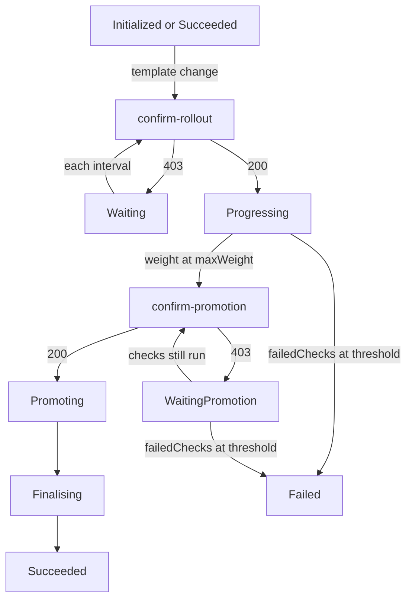

# Wait For Approval Before Promotion

Some teams want the candidate to carry live traffic and pass its metric
checks before a person decides. Flagger 1.45.0 provides the
`confirm-promotion` webhook type for this: a webhook is an HTTP (Hypertext
Transfer Protocol) request Flagger sends to another service for a decision,
and this one is sent when the canary has reached its maximum weight and is
about to be copied into the primary Deployment. The gate sits at the other
end of the release from `confirm-rollout`, and that changes what keeps
running while the answer is no.

## Move the gate to the promotion point

Use the module playground with Istio and its load tester. A `Canary` is the
Flagger resource that defines a workload's release policy. The policy below
is the approval policy with one change: the `scout-approval` webhook's `type`
is `confirm-promotion`. The `load-test` rollout hook stays, because the
success-rate check needs traffic.

<!-- astrona:playground:renew -->

Save this as `canary-scout-promotion.yaml`:

```yaml
apiVersion: flagger.app/v1beta1
kind: Canary
metadata:
  name: scout
  namespace: starfleet
spec:
  provider: istio
  targetRef:
    apiVersion: apps/v1
    kind: Deployment
    name: scout
  progressDeadlineSeconds: 120
  service:
    port: 80
    targetPort: http
  analysis:
    interval: 15s
    threshold: 3
    maxWeight: 50
    stepWeight: 10
    metrics:
      - name: request-success-rate
        thresholdRange:
          min: 99
        interval: 30s
    webhooks:
      - name: scout-approval
        type: confirm-promotion
        url: http://flagger-loadtester.starfleet/gate/check
        timeout: 5s
      - name: load-test
        type: rollout
        url: http://flagger-loadtester.starfleet/
        timeout: 5s
        metadata:
          cmd: "hey -z 1m -q 10 -c 2 http://scout-canary.starfleet/"
```

Apply it:

```sh
kubectl apply -f canary-scout-promotion.yaml
```

Changing a webhook in the Canary does not start a release; only a change to
the target's pod template does. The load tester keeps one in-memory gate per
Canary, keyed by name and namespace, and an open value from an earlier
release is still open. Close the stored gate before triggering another
pod-template change:

```sh
kubectl -n starfleet exec deploy/shuttle -c shuttle -- curl -fsS -d '{"name":"scout","namespace":"starfleet"}' http://flagger-loadtester.starfleet/gate/close
kubectl -n starfleet set env deploy/scout PODINFO_UI_MESSAGE=approval-two
kubectl -n starfleet wait canary/scout --for=jsonpath='{.status.phase}'=WaitingPromotion --timeout=360s
kubectl -n starfleet describe canary scout
```

This time Flagger scales up the candidate and runs the analysis before it
asks anyone. Each `analysis.interval` it runs the `load-test` hook, queries
the success-rate metric and advances the canary weight by `stepWeight`:
10, 20, 30, 40, 50. In the round where the weight read from the Istio
`VirtualService` equals `maxWeight`, and the checks have passed again,
Flagger calls the `confirm-promotion` hook. The closed gate answers 403.
Flagger sets `.status.phase` to `WaitingPromotion`, emits one Warning event
`Halt scout.starfleet advancement waiting for promotion approval
scout-approval` and ends the round without touching the primary.

## What keeps running while promotion waits

The wait is not a pause. In every later round Flagger still runs the rollout
hooks and the metric checks, because the candidate is live and serving half
the traffic. A failed check adds 1 to `.status.failedChecks`, and when that
counter reaches `analysis.threshold` Flagger rolls back from
`WaitingPromotion` exactly as it would from `Progressing`: it routes all
traffic to the primary, scales the candidate to zero and sets the phase to
`Failed`. A rejected promotion answer itself never counts as a failed check.
Only the `confirm-traffic-increase` hook type is skipped in this phase,
because the weight no longer grows.

The status does not show the live traffic split. Entering
`WaitingPromotion` resets `.status.canaryWeight` to 0, so the `WEIGHT` column
of `kubectl get canary` reads 0 while the mesh still sends half the requests
to the candidate. Read the `VirtualService` that Flagger owns to see the real
split:

```sh
kubectl -n starfleet get canary scout
kubectl -n starfleet get virtualservice scout -o jsonpath='{.spec.http[0].route}{"\n"}'
kubectl -n starfleet get canary scout -o jsonpath='{.status.phase} {.status.failedChecks} {.status.conditions[0].message}{"\n"}'
```

The route list shows the `scout-primary` and `scout-canary` destinations with
their weights, 50 and 50 here. The `Promoted` condition carries the same
message as the earlier gate, `Waiting for approval.`, with `reason:
WaitingPromotion`. Flagger reads the weight from the `VirtualService`, not
from the status, in every round, which is why the checks keep running.



The diagram shows the phases of one gated release and where each gate holds
it. Read the event type and these message fragments to tell the two waits
apart:

| Phase or transition | Event type | Message contains |
| --- | --- | --- |
| `Waiting` | Warning | `waiting for approval` |
| Start approved | Normal | `Confirm-rollout check` and the webhook name |
| `WaitingPromotion` | Warning | `waiting for promotion approval` |
| Promotion approved | Normal | `Confirm-promotion check` and the webhook name |

The passing confirmation messages end with `passed`. A closed gate event is
emitted when Flagger enters its waiting phase, rather than on every retry.

## Open the gate and watch the promotion

Open the promotion gate and wait for completion:

```sh
kubectl -n starfleet exec deploy/shuttle -c shuttle -- curl -fsS -d '{"name":"scout","namespace":"starfleet"}' http://flagger-loadtester.starfleet/gate/open
kubectl -n starfleet wait canary/scout --for=jsonpath='{.status.phase}'=Succeeded --timeout=360s
kubectl -n starfleet rollout status deploy/scout-primary --timeout=120s
kubectl -n starfleet describe canary scout
```

The next round runs the checks once more, then the gate answers 200. Flagger
records `Confirm-promotion check scout-approval passed` and `Copying
scout.starfleet template spec to scout-primary.starfleet`, writes the
candidate's pod template into `scout-primary` and sets the phase to
`Promoting`. In the following rounds it waits until the new primary pods are
ready, then records `Routing all traffic to primary`, sets the
`VirtualService` to 100 and 0, and moves to `Finalising`. One round later it
scales `scout` back to zero, sets `Succeeded`, runs any post-rollout hooks
and records `Promotion completed! Scaling down scout.starfleet`. The
`rollout status` command proves the primary finished its own rolling update.

A `pre-rollout` webhook is not a third gate. Flagger calls it once, after
candidate scale-up and before the first traffic step, with the phase
`Progressing`. A failure emits a Warning event that names the check, adds 1
to `failedChecks` and leads to rollback at `analysis.threshold`. Use it to
test a running candidate. Use a confirmation hook to wait for a decision.

You can now place approval before candidate scale-up or before primary
promotion, read the phase, the status fields and the `VirtualService` at each
point, and control a stored load tester gate. Keep the gate identity and
release phase in view: an open gate allows the next check, while application
health remains the job of tests and metrics.

## Common pitfalls

> [!WARNING]
> - Do not confuse `Waiting` with `WaitingPromotion`. Only the latter keeps the candidate live and the checks running; a failing metric can still roll it back.
> - Do not trust `.status.canaryWeight` in `WaitingPromotion`. It reads 0; the `VirtualService` holds the real split.
> - Do not use a failing `pre-rollout` test as an indefinite approval wait. Its failures count toward rollback.
> - Do not expect a new release after changing only the webhook `type`. Flagger starts a release on a pod-template change.
> - Do not leave the gate open after the promotion. The stored value stays open for the next release until you close it.
