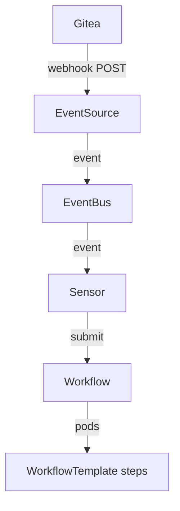

# Trace A Git Push Into A Workflow Run

A push-driven pipeline has many objects between Git and the test step, and each one can fail on its own. When a push starts no Workflow, or starts one that fails, you must find the one object that broke. This part gives you an order for that search, so you check each object once and fix the right one.

## The path of one push

A push travels through five objects before a test step runs. Gitea, the Git server, sends a webhook: an HTTP `POST` request with a JSON body. The `EventSource` is the Argo Events object that receives that request. The `EventBus` carries the event inside the cluster. The `Sensor` filters the event and creates a Workflow. The Workflow then runs the steps of its `WorkflowTemplate` as pods.

The diagram shows that each object hands the push to the next one, so a fault stops everything after it.

A running pod does not prove that its object works. The `Sensor` pod can be `Running` while its filter drops every push. So follow the push itself, from one object to the next, and stop at the first object that does not pass it on.

## Check the branch and the commit separately

The `Sensor` makes two separate choices, and each one can be wrong on its own. Its filter decides whether the push passes. Its trigger parameters decide which values go into the new Workflow.

The push body has the field `ref`, the full name of the pushed branch, for example `refs/heads/main`. A filter on `body.ref` must compare against that full name. A filter value such as `main` or `refs/heads/master` matches no push to `main`, and the `Sensor` creates no Workflow at all. The symptom is silence: no new Workflow appears after the push.

The push body also has the field `after`, the ID of the new commit. The trigger parameter with `dataKey: body.after` copies it into the Workflow argument `revision`. If the parameter reads another field, the Workflow still starts, but it clones a different commit. The symptom is a Workflow whose `revision` argument does not match the commit you pushed. Compare the two values every time; a green run of the wrong commit proves nothing.

## Two service accounts with two jobs

Once the `Sensor` creates a Workflow, a second kind of fault can appear. Two service accounts take part, and they need different permissions.

The `Sensor` uses its own service account to create Workflow objects in `starfleet`. If that account cannot create Workflows, the `Sensor` logs a permission error and no Workflow appears. The Workflow pods use the service account named in the Workflow. Each pod reports its result by creating and patching `WorkflowTaskResult` objects. If that account has a `Role` with those rights but no `RoleBinding`, the `Role` gives nothing to anyone. The step then runs, but its `wait` container is denied when it reports the result, and the Workflow ends in the phase `Error`.

Fix the missing binding for the account the pods actually use. Do not bind the `cluster-admin` role to it: that hides the fault and gives the pods far more rights than they need.

## Follow the clone into the test step

The last object to check is the `WorkflowTemplate` itself. A typical template has a clone step that writes the repository into a folder on a volume, and a test step that runs in that folder. The `workingDir` of the test step must point at the folder that the clone step wrote.

If the two paths differ, the clone step succeeds and the test step fails. `argo get` shows the failed node, and `argo logs` on that node shows that the folder or its files do not exist. Fix the path in the `WorkflowTemplate`. Do not change the clone step to hide the error.

## Prove the whole path with a new push

A Workflow that you submit by hand with `argo submit` tests the template only. It does not prove that the webhook, the filter and the trigger parameter work. After every fix, push a new commit and read the Workflow that the `Sensor` created. Its `revision` argument must equal the ID of the commit you pushed, and its phase must be `Succeeded`.

You now have an order for the search: the event arrives, the filter passes it, the trigger copies the right commit, the service accounts have their rights, and the test step starts in the cloned folder. The open question is always which object stopped the push first, and the symptoms above tell you where to look.

## Common pitfalls

> [!WARNING]
> A `Running` `Sensor` pod does not mean its filter or trigger is correct.
> A filter on `body.ref` needs the full name, such as `refs/heads/main`. A
> Workflow you submit by hand does not prove the push path; push a new commit
> and compare the `revision` argument with the commit ID. A `Role` without a
> `RoleBinding` grants nothing, and `cluster-admin` is not the fix.
