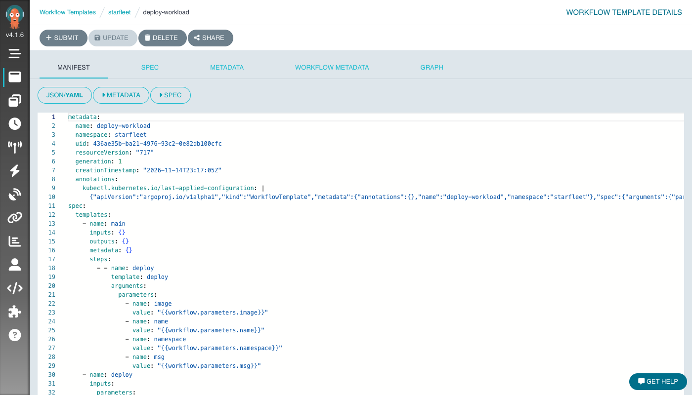
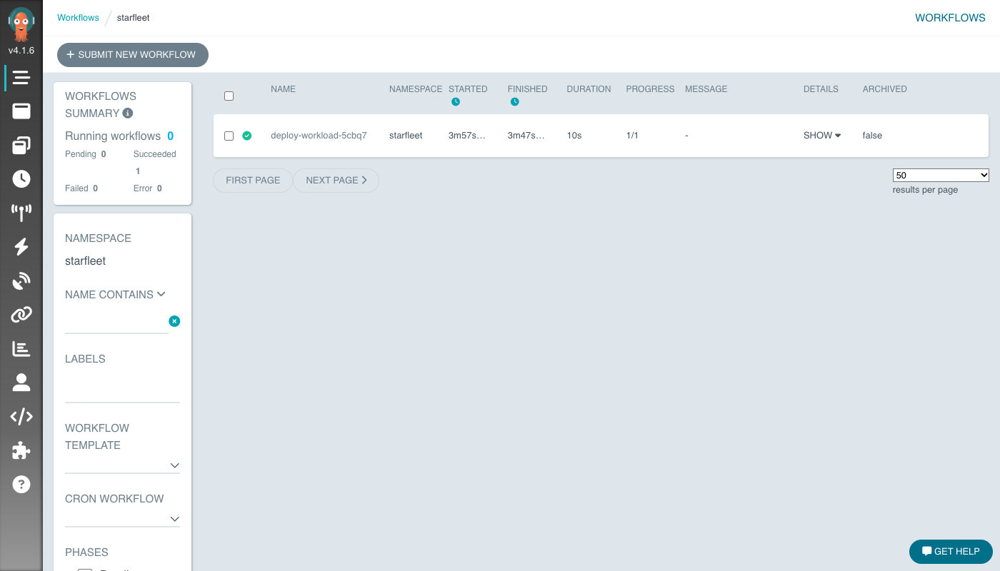
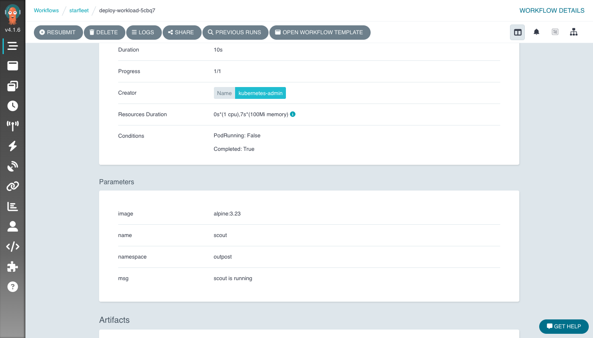
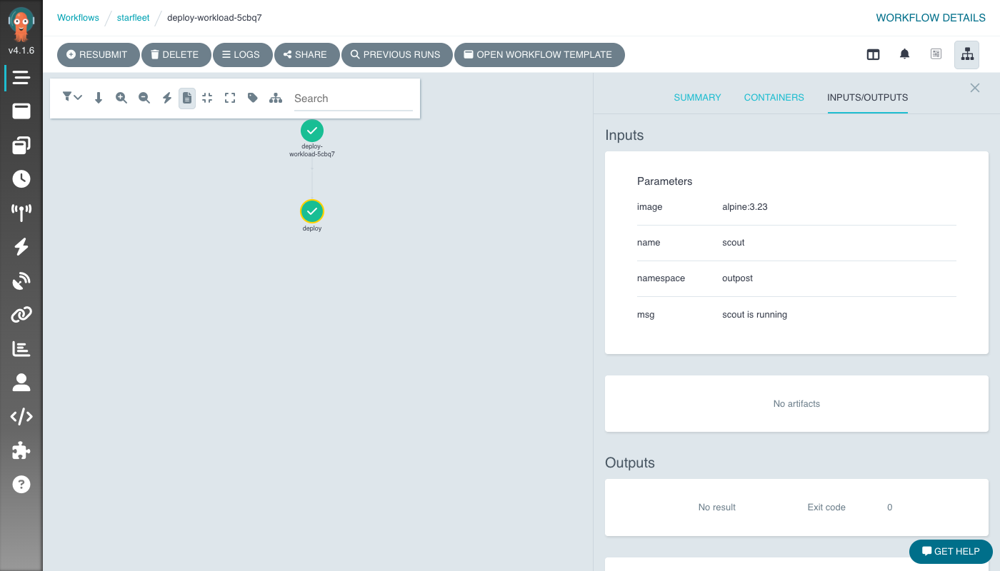

# Solution

A WorkflowTemplate is a stored workflow specification that you can run many times with different parameters. In this template the `main` step passes the four workflow parameters into the `deploy` template as `inputs.parameters`. The `deploy` template is a `resource` template: the Argo executor sends its manifest to the Kubernetes API instead of running a container. The manifest passes `msg` to the container as the environment variable `MSG`, and the shell command prints it with `echo "$MSG"`. An environment variable keeps a message with spaces or quotes in one piece.

This solution creates and runs the template in the terminal, and then reads the result in the Argo Workflows web UI. The web UI reads the same Workflow and WorkflowTemplate objects as the `argo` command-line tool. The exam gives you only a terminal, so use the web UI here to understand what the objects hold, not as a replacement for the commands.

Save this as `workflowtemplate-deploy-workload.yaml`:

```yaml
apiVersion: argoproj.io/v1alpha1
kind: WorkflowTemplate
metadata:
  name: deploy-workload
  namespace: starfleet
spec:
  entrypoint: main
  serviceAccountName: deployment-writer
  arguments:
    parameters:
      - name: image
      - name: name
      - name: namespace
      - name: msg
  templates:
    - name: main
      steps:
        - - name: deploy
            template: deploy
            arguments:
              parameters:
                - name: image
                  value: "{{workflow.parameters.image}}"
                - name: name
                  value: "{{workflow.parameters.name}}"
                - name: namespace
                  value: "{{workflow.parameters.namespace}}"
                - name: msg
                  value: "{{workflow.parameters.msg}}"
    - name: deploy
      inputs:
        parameters:
          - name: image
          - name: name
          - name: namespace
          - name: msg
      resource:
        action: create
        successCondition: status.availableReplicas > 0
        manifest: |
          apiVersion: apps/v1
          kind: Deployment
          metadata:
            name: "{{inputs.parameters.name}}"
            namespace: "{{inputs.parameters.namespace}}"
          spec:
            replicas: 1
            selector:
              matchLabels:
                app: "{{inputs.parameters.name}}"
            template:
              metadata:
                labels:
                  app: "{{inputs.parameters.name}}"
              spec:
                containers:
                  - name: workload
                    image: "{{inputs.parameters.image}}"
                    env:
                      - name: MSG
                        value: "{{inputs.parameters.msg}}"
                    command:
                      - sh
                      - -c
                      - echo "$MSG"; while true; do sleep 3600; done
```

Apply it:

```sh
kubectl apply -f workflowtemplate-deploy-workload.yaml
```

```text
workflowtemplate.argoproj.io/deploy-workload created
```

Run `astrona submit` now. The `workflow-template` check passes; the other two fail because no workflow has run yet.

Each `-p` flag sets one workflow parameter. `--from workflowtemplate/deploy-workload` creates a Workflow from the stored template, and `--wait` keeps the command running until the workflow finishes:

```sh
export PATH="$HOME/.astrona/bin:$PATH"
argo submit -n starfleet --from workflowtemplate/deploy-workload \
  -p image=alpine:3.23 -p name=scout -p namespace=outpost \
  -p msg="scout is running" --wait
```

```text
Name:                deploy-workload-5cbq7
Namespace:           starfleet
ServiceAccount:      unset
Status:              Pending
Created:             Sun Nov 15 00:17:13 +0100 (now)
Progress:            
Parameters:          
  image:             alpine:3.23
  name:              scout
  namespace:         outpost
  msg:               scout is running
deploy-workload-5cbq7 Succeeded at 2026-11-15 00:17:23 +0100 CET
```

The `argo` command-line tool prints the new workflow while it is still `Pending`, then one line when it ends. The workflow name ends in five random characters, so yours is different. The workflow runs in `starfleet`. The `namespace` parameter only decides where the Deployment goes, here `outpost`. The `successCondition` keeps the resource step running until the Deployment has an available replica, so `Succeeded` means the pod runs.

## Check the result in the web UI

The Argo Workflows web UI is served by the `argo-server` Deployment in `starfleet`. In this lab it runs without a login, so the page opens straight away.

`kind` has no load balancer, so the lab forwards port `2746` of the `argo-server` Service to your machine when it starts. Open the **Argo Workflows** tab next to the terminal, or open `http://127.0.0.1:2746` in a browser. On the first visit the web UI may show a "new version" note and a short survey; close both with the `×` in their top right corner.

Click **Workflow Templates** in the left menu and then `deploy-workload`. The **MANIFEST** tab shows the stored template, with the `main` step passing each `{{workflow.parameters.*}}` value to `deploy`:



Click **Workflows** in the left menu. The list shows the run from `argo submit` with a green check, a duration of 10 seconds and progress `1/1`:



Click the workflow name, then the summary icon at the top right (the first of the four icons). The summary shows the status `Succeeded`, the template it came from (`DEPLOY-WORKLOAD`) and the label `workflows.argoproj.io/workflow-template: deploy-workload`:



Click the graph icon (the last of the four icons) and then the `deploy` node. Open the **INPUTS/OUTPUTS** tab in the panel on the right. It lists the four parameters the step received:



The web UI shows the workflow and its steps, but not the `scout` Deployment, because that object is not part of Argo Workflows. The workflow only proves that the controller created something. Check the Deployment it created in `outpost` and the log of its container with `kubectl`:

```sh
kubectl -n outpost get deployment scout -o wide
kubectl -n outpost logs deploy/scout
```

```text
NAME    READY   UP-TO-DATE   AVAILABLE   AGE   CONTAINERS   IMAGES        SELECTOR
scout   1/1     1            1           8s    workload     alpine:3.23   app=scout
scout is running
```

The Deployment has `1/1` ready, the image `alpine:3.23` and the selector `app=scout`, all filled from the parameters. The container printed the `msg` value, `scout is running`.

A second run with a name that already exists fails, because action `create` refuses an existing object. Use a new name, or delete only that Deployment, before you run it again.

Run `astrona submit`. All three checks pass.
