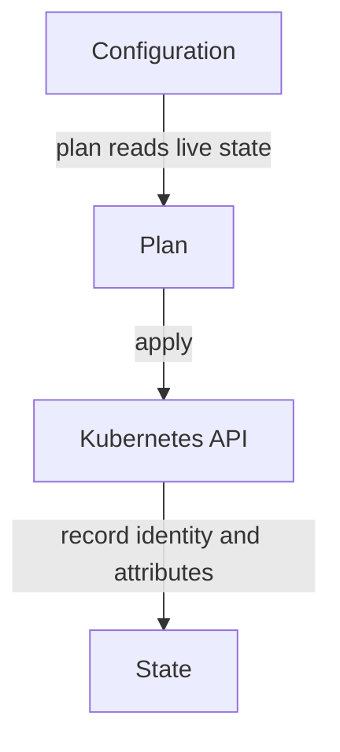

# Add A Service And Understand Reconciliation

The `scout` pods run, but clients need a stable address to reach them. A Service
selects pods by label and forwards traffic to their application port. You will
add that Service to the same OpenTofu state as the existing Deployment.

<!-- astrona:playground:renew -->

Read the pod labels and the existing state before adding a resource:

```sh
cd ~/resources/tofu/scout
tofu state list
kubectl -n starfleet get pods -l app=scout --show-labels
```

Save this as `service.tf`:

```hcl
resource "kubernetes_service" "scout" {
  metadata {
    name      = "scout"
    namespace = kubernetes_deployment.scout.metadata[0].namespace
  }
  spec {
    selector = kubernetes_deployment.scout.spec[0].template[0].metadata[0].labels
    port {
      port        = 80
      target_port = 9898
    }
    type = "ClusterIP"
  }
}
```

`metadata` sets the Service name and namespace. `spec.selector` reads the pod
labels from the Deployment resource. The `[0]` expressions select the first
block in the provider's list-shaped schema. This reference also tells OpenTofu
that the Service depends on the Deployment. Kubernetes routes to matching
pods, not to the Deployment object itself.

The port block accepts connections on port 80 and sends them to port 9898 in
the selected pods. `ClusterIP` keeps the Service inside the cluster.

Apply it after reviewing the proposed creation:

```sh
tofu plan -no-color -out=service.plan
tofu show -no-color service.plan > service-diff.txt
cat service-diff.txt
tofu apply service.plan
```

Look for one new `kubernetes_service.scout` and no Deployment replacement. Then
check the state, the Service and a real request:

```sh
tofu state list
kubectl -n starfleet get service scout
kubectl -n starfleet exec deploy/shuttle -- curl -fsS http://scout.starfleet/
tofu plan -no-color
```

Look for version `6.15.0` in the response and a plan that proposes no changes.
The provider creates the Service through the Kubernetes application programming
interface (API). Kubernetes
maintains its pod endpoints and forwards traffic.

## When drift gets repaired

Drift is a difference between live settings and the desired configuration.
OpenTofu reads live settings during a normal plan, but it does not run a
continuous controller between commands. If someone changes the Deployment's
replica count by hand, OpenTofu proposes restoring the configured value the
next time you plan. The repair happens when you apply.

Crossplane runs controllers inside Kubernetes. Reconciliation is the repeated
comparison and repair of desired and live state. Crossplane can repair a manual
change on a later reconciliation without a person running an apply command.
Both tools need one clear owner for a resource. Do not give Crossplane and
OpenTofu control over the same fields of the same object.



OpenTofu changes the API objects during apply and records their identity in state.

Change managed attributes in the configuration, review the plan and apply it.
A manual edit can be overwritten later and leaves the files misleading. You
can now add a dependent resource and explain which tool repairs drift and when.

## Common pitfalls

> [!WARNING]
> A Service selector must match pod labels in the same namespace. A correct
> name alone does not route traffic. OpenTofu does not continuously repair
> manual changes, and state does not make it a running controller. Change the
> configuration rather than editing managed objects by hand.
